# Ngân hàng câu hỏi — Toán cho các nhà kinh tế

> Chỉ gồm bài lấy **nguyên văn** từ các **ví dụ có lời giải trong bài giảng** và câu trắc nghiệm hệ thống khi có. Không có câu tự soạn.
> - **Lời giải:** theo các bước của bài giảng, bổ sung bước trung gian để tự làm lại được. Kết luận không có trên slide đánh dấu ⚠️. Chỗ slide in nhầm ghi ⚡ kèm kết quả đúng. Khi có đáp án hệ thống (LTTN, KT) thì đáp án hệ thống thắng.
> - **Số viết theo kiểu bài giảng:** dấu chấm thập phân, dấu phẩy phân cách nghìn (6,800 = sáu nghìn tám trăm; 0.67 = không phẩy sáu bảy).
> - **Ký hiệu:** ⚡ là câu có bẫy hoặc slide in nhầm, ❌ là câu từng làm sai.
> - **Bản gom theo chủ đề để học:** [ngan-hang-theo-chu-de.md](ngan-hang-theo-chu-de.md).
> - **Câu trắc nghiệm hệ thống** (LTTN, KT) sẽ nối vào cuối file, mỗi lần làm một mục.

## Bài 1 — Ví dụ trong bài giảng

> Nguồn: [Bài 1 — Hàm số và giới hạn](tai-lieu/bai-1-ham-so-va-gioi-han.pdf). Lời giải theo bài giảng, bổ sung bước trung gian.

**Câu 1.** Cho hàm f(x) = √(3 − 2x) / (x² + 4). _(Ví dụ 1, Bài 1)_
- a) Tìm tập xác định của hàm f.
- b) Tính giá trị f(1).

> ✅ **Lời giải (theo bài giảng):**
>
> **a)** Tập xác định
> - **Điều kiện:** tập xác định gồm mọi số thực x sao cho biểu thức có nghĩa. Mẫu x² + 4 ≥ 4 > 0 với mọi x nên không cần điều kiện mẫu; chỉ cần biểu thức dưới căn không âm.
> - **Giải:** 3 − 2x ≥ 0 ⇔ 2x ≤ 3 ⇔ x ≤ 3/2.
> - **Kết quả:** **D = (−∞; 3/2]**.
>
> **b)** Giá trị f(1)
> - **Kiểm tra:** x = 1 ≤ 3/2 nên thuộc tập xác định.
> - **Thay số:** f(1) = √(3 − 2(1)) / (1² + 4) = √1 / 5.
> - **Kết quả:** **f(1) = 1/5** (= 0.2).
> - ⚡ **Lỗi hay gặp:** đặt thêm điều kiện x² + 4 ≠ 0 rồi loại nhầm x; quên dấu "]" (x = 3/2 thuộc tập xác định vì √0 = 0).

**Câu 2.** Thương hiệu giầy Ugg của tập đoàn Deckers Outdoor có mặt trên thị trường từ năm 1979, đến năm 2003 doanh số bán hàng tăng nhanh làm cho giá cổ phiếu tăng mạnh. Gọi S(t) là giá cổ phiếu của tập đoàn t năm sau kể từ ngày 1 tháng 1 năm 2000, người ta ước lượng được S(t) = 8.1 − 1.7t nếu t < 3 và S(t) = 6t² − 36t + 57 nếu t ≥ 3. Tìm và giải thích ý nghĩa của S(2) và S(7.5). _(Ví dụ 2, Bài 1)_

> ✅ **Lời giải (theo bài giảng):**
> - **Công thức:** hàm cho bởi hai công thức, chọn công thức theo t < 3 hay t ≥ 3.
> - **S(2):** t = 2 < 3 nên dùng S(t) = 8.1 − 1.7t. Thay số: S(2) = 8.1 − 1.7(2) = 8.1 − 3.4 = **4.7**.
> - **Ý nghĩa S(2):** giá cổ phiếu của tập đoàn 2 năm sau kể từ ngày 1/1/2000 là **$4.7**, nghĩa là vào **ngày 1 tháng 1 năm 2002** giá cổ phiếu là $4.7.
> - **S(7.5):** t = 7.5 > 3 nên dùng S(t) = 6t² − 36t + 57. Thay số: S(7.5) = 6(7.5)² − 36(7.5) + 57 = 6(56.25) − 270 + 57 = 337.5 − 270 + 57 = **124.5**.
> - **Ý nghĩa S(7.5):** giá cổ phiếu của tập đoàn vào **ngày 1 tháng 7 năm 2007** là **$124.5**.
> - ⚡ **Lỗi hay gặp:** dùng nhầm công thức (t = 7.5 mà thay vào 8.1 − 1.7t ra số âm); hiểu t = 7.5 là năm 2007 tháng 5 (đúng là 7.5 năm = 7 năm 6 tháng, tức 1/7/2007).

**Câu 3.** Nghiên cứu cho thấy người tiêu dùng sẽ mua x nghìn đơn vị một loại máy pha cà phê khi đơn giá là: p(x) = −0.27x + 51 (đô la). Chi phí sản xuất x nghìn đơn vị đó là: C(x) = 2.23x² + 3.5x + 85 (nghìn đô la). _(Ví dụ 3, Bài 1)_
- a) Chi phí bình quân để sản xuất 4,000 máy pha cà phê (x = 4) là bao nhiêu?
- b) Tìm doanh thu và lợi nhuận từ việc bán x nghìn đơn vị máy pha cà phê.
- c) Tìm x để việc sản xuất máy pha cà phê là có lợi nhuận?

> ✅ **Lời giải (theo bài giảng):**
>
> **a)** Chi phí bình quân
> - **Công thức:** AC(x) = C(x)/x.
> - **Lấy số / đổi đơn vị:** 4,000 máy ⇒ x = 4 (nghìn máy).
> - **Thay số:** C(4) = 2.23(4)² + 3.5(4) + 85 = 35.68 + 14 + 85 = 134.68 (nghìn đô la). AC(4) = 134.68/4.
> - **Kết quả:** **AC(4) = 33.67 đô la/máy** (nghìn đô la chia nghìn máy = đô la/máy).
>
> **b)** Doanh thu và lợi nhuận
> - **Công thức:** R(x) = x·p(x); P(x) = R(x) − C(x).
> - **Thay số:** R(x) = x(−0.27x + 51) = −0.27x² + 51x. P(x) = (−0.27x² + 51x) − (2.23x² + 3.5x + 85) = (−0.27 − 2.23)x² + (51 − 3.5)x − 85.
> - **Kết quả:** **R(x) = −0.27x² + 51x**; **P(x) = −2.5x² + 47.5x − 85**.
>
> **c)** Khoảng có lợi nhuận
> - **Điều kiện:** P(x) > 0 ⇔ −2.5x² + 47.5x − 85 > 0.
> - **Giải:** chia cho −2.5 (đổi chiều): x² − 19x + 34 < 0. Phương trình x² − 19x + 34 = 0 có Δ = 19² − 4·34 = 361 − 136 = 225, √Δ = 15 ⇒ x = (19 − 15)/2 = 2 hoặc x = (19 + 15)/2 = 17. Hệ số x² của P âm nên P > 0 giữa hai nghiệm.
> - **Kết quả:** **2 < x < 17**.
> - **Kết luận:** ⚠️ (bổ sung) sản xuất có lợi nhuận khi bán từ trên 2,000 đến dưới 17,000 máy.
> - ⚡ **Lỗi hay gặp:** lấy C(4) mà quên chia 4; ghi AC là 33.67 nghìn đô la; trừ C(x) mà quên đổi dấu cả 3 hạng tử; chia cho số âm mà không đổi chiều bất phương trình.

**Câu 4.** Cho các hàm: f(u) = u² + 3u + 1; g(x) = x + 1. Tìm các hàm hợp f[g(x)] và g[f(u)]. _(Ví dụ 4, Bài 1)_

> ✅ **Lời giải (theo bài giảng):**
> - **Công thức:** f[g(x)] là thay u = g(x) vào mọi chỗ có u trong f(u); g[f(u)] là thay x = f(u) vào g.
> - **f[g(x)]:** f[g(x)] = [g(x)]² + 3g(x) + 1 = (x + 1)² + 3(x + 1) + 1 = (x² + 2x + 1) + (3x + 3) + 1.
> - **Kết quả:** **f[g(x)] = x² + 5x + 5**.
> - **g[f(u)]:** g[f(u)] = f(u) + 1 = (u² + 3u + 1) + 1.
> - **Kết quả:** **g[f(u)] = u² + 3u + 2**.
> - ⚡ **Lỗi hay gặp:** khai triển sai (x + 1)² thành x² + 1; nghĩ f[g(x)] = g[f(x)] (hai hàm hợp khác nhau).

**Câu 5.** Một nhà máy có thể sản xuất giấy in với chi phí $2 mỗi ream giấy. Giá bán hiện tại là $5 mỗi ream giấy, và với mức giá đó thì người tiêu dùng mua 4,000 reams giấy mỗi tháng. Nhà sản xuất dự định nâng mức giá bán lên và ước tính rằng với mỗi lần tăng giá thêm $1 thì số giấy bán được mỗi tháng sẽ giảm đi 400 reams. Xác định giá bán để nhà máy thu lợi nhuận tối đa. Lợi nhuận tối đa bằng bao nhiêu? _(Ví dụ 5, Bài 1)_

> ✅ **Lời giải (theo bài giảng):**
> - **Đặt ẩn:** gọi giá bán mỗi ream giấy là x (đô la).
> - **Số lần tăng giá thêm $1:** x − 5.
> - **Số ream bán được:** 4,000 − 400(x − 5) = 6,000 − 400x.
> - **Lợi nhuận mỗi ream:** x − 2.
> - **Công thức:** P(x) = [4,000 − 400(x − 5)](x − 2) = (6,000 − 400x)(x − 2) = 6,000x − 12,000 − 400x² + 800x = **−400x² + 6,800x − 12,000**.
> - **Lợi nhuận tối đa:** P là parabol có a = −400 < 0 nên đạt lớn nhất tại đỉnh x = −b/(2a) = −6,800/(2·(−400)) = 6,800/800 = **8.5**.
> - **Thay số:** P(8.5) = (6,000 − 400·8.5)(8.5 − 2) = (6,000 − 3,400)(6.5) = 2,600 × 6.5.
> - **Kết quả:** giá bán **$8.5 mỗi ream**, lợi nhuận tối đa **P(8.5) = 16,900 đô la** (mỗi tháng).
> - ⚡ **Slide ghi** x = 6,800/(2(−400)) (in nhầm, thiếu dấu trừ ở tử; thay đúng như viết ra −8.5), kết luận không đổi: x = 8.5.
> - ⚡ **Lỗi hay gặp:** viết lượng bán là 4,000 − 400x (quên "x − 5"); lấy lợi nhuận mỗi ream là x thay vì x − 2; trả lời lợi nhuận tối đa là 8.5.

**Câu 6.** Cho hàm cung và hàm cầu đối với một loại hàng hóa lần lượt là: p = S(x) = x² + 14; p = D(x) = 174 − 6x. _(Ví dụ 6, Bài 1)_
- a) Xác định mức sản xuất x và mức giá p khi thị trường ở trạng thái cân bằng.
- b) Phác họa đường cung p = S(x) và đường cầu p = D(x) trên cùng một hệ trục tọa độ và giải thích.

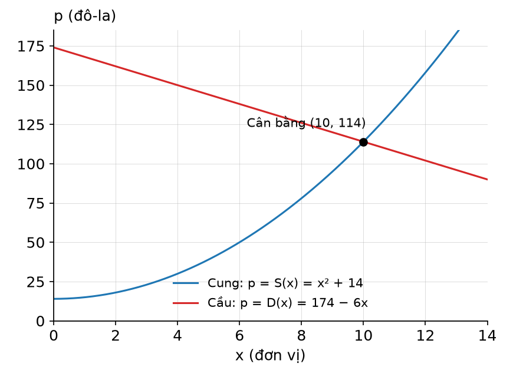

> ✅ **Lời giải (theo bài giảng):**
>
> **a)** Điểm cân bằng
> - **Công thức:** cân bằng thị trường khi S(x) = D(x).
> - **Thay số:** x² + 14 = 174 − 6x ⇔ x² + 6x − 160 = 0. Δ' = 3² + 160 = 169, √Δ' = 13 ⇒ x = −3 + 13 = 10 hoặc x = −3 − 13 = −16 (loại vì x ≥ 0).
> - **Giá cân bằng:** pₑ = S(10) = 10² + 14 = 114 (kiểm tra: D(10) = 174 − 60 = 114).
> - **Kết quả:** **xₑ = 10 đơn vị, pₑ = 114 đô la**.
>
> **b)** Phác họa
> - Trục hoành x (đơn vị), trục tung p (đô la).
> - **Đường cung** p = x² + 14: nửa parabol đi lên, bắt đầu tại p = 14 trên trục tung.
> - **Đường cầu** p = 174 − 6x: đường thẳng đi xuống, bắt đầu tại p = 174, cắt trục hoành tại x = 29 (174 − 6x = 0).
> - Hai đường cắt nhau tại **điểm cân bằng (10; 114)**.
> - **Giải thích:** vùng phía trên điểm cân bằng (giữa hai đường, dưới mức 174): S(x) > D(x), thị trường **dư thừa**. Vùng phía dưới (trên mức 14): S(x) < D(x), thị trường **thiếu hụt**.
> - ⚡ **Lỗi hay gặp:** chỉ ghi x = 10 mà quên tính giá p (slide phần a) cũng chỉ ghi x = 10, pₑ = 114 nằm trên hình); không loại nghiệm âm; đảo "dư thừa" với "thiếu hụt".

**Câu 7.** Công ty nội thất của Emory bán một loại ghế tựa với giá p = 1,500 − 3x đô la mỗi chiếc khi sản xuất và bán được x chiếc. Tổng chi phí sản xuất bao gồm chi phí cố định $66,500 và $20 cho mỗi chiếc ghế được sản xuất. Công suất tối đa của công ty là 300 chiếc ghế. _(Ví dụ 7, Bài 1)_
- a) Emory phải sản xuất và bán được bao nhiêu chiếc ghế để hòa vốn? Khi đó, giá mỗi chiếc ghế là bao nhiêu?
- b) Nếu Emory sản xuất và bán được 35 chiếc ghế thì Emory có lãi hay thua lỗ? Mức lỗ/lãi cụ thể là bao nhiêu?

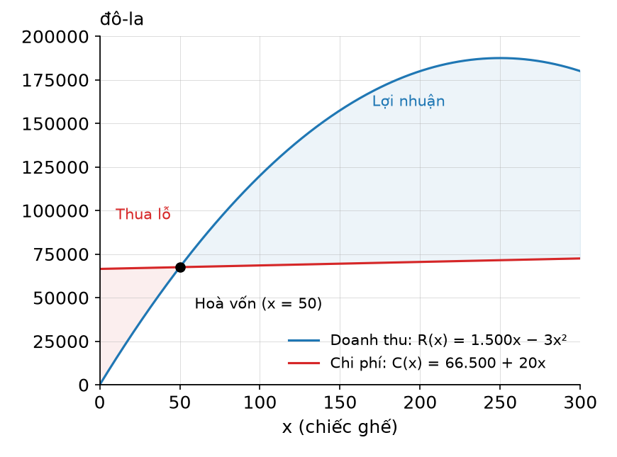

> ✅ **Lời giải (theo bài giảng):**
>
> **a)** Điểm hòa vốn
> - **Công thức:** R(x) = p·x = (1,500 − 3x)x = 1,500x − 3x²; C(x) = 66,500 + 20x. Hòa vốn khi R(x) = C(x).
> - **Thay số:** 1,500x − 3x² = 66,500 + 20x ⇔ 3x² − 1,480x + 66,500 = 0. Δ = 1,480² − 4·3·66,500 = 2,190,400 − 798,000 = 1,392,400, √Δ = 1,180 ⇒ x = (1,480 − 1,180)/6 = 50 hoặc x = (1,480 + 1,180)/6 ≈ 443.33.
> - **Loại nghiệm:** x ≈ 443.33 > công suất tối đa 300 nên loại.
> - **Giá:** p(50) = 1,500 − 3(50) = 1,350.
> - **Kết quả:** hòa vốn khi **x = 50 chiếc**, giá **p = 1,350 đô la/chiếc**.
>
> **b)** Lãi/lỗ khi x = 35
> - **Công thức:** P(x) = R(x) − C(x).
> - **Thay số:** R(35) = 1,500(35) − 3(35)² = 52,500 − 3,675 = 48,825; C(35) = 66,500 + 20(35) = 67,200. P(35) = 48,825 − 67,200.
> - **Kết quả:** **P(35) = −18,375**.
> - **Kết luận:** nếu sản xuất 35 chiếc ghế thì Emory **lỗ $18,375** (35 < 50 nằm bên trái điểm hòa vốn, vùng thua lỗ).
> - ⚡ **Lỗi hay gặp:** viết R(x) = 1,500 − 3x (quên nhân x); quên chi phí cố định; không loại nghiệm 443.33 (slide cũng không ghi bước loại, đây là lý do đề cho công suất tối đa 300).

**Câu 8.** Tính giới hạn lim_{x→1} (3x³ − 8)/(x − 2). _(Ví dụ 8, Bài 1)_

> ✅ **Lời giải (theo bài giảng):**
> - **Công thức:** lim f/g = lim f / lim g nếu lim g ≠ 0; giới hạn của đa thức tính bằng cách thay x = c.
> - **Kiểm tra mẫu:** lim_{x→1} (x − 2) = 1 − 2 = −1 ≠ 0 nên dùng được quy tắc thương.
> - **Thay số:** lim_{x→1} (3x³ − 8)/(x − 2) = (3·lim_{x→1} x³ − lim_{x→1} 8) / (lim_{x→1} x − lim_{x→1} 2) = (3·1 − 8)/(1 − 2) = (−5)/(−1).
> - **Kết quả:** **5**.
> - ⚡ **Lỗi hay gặp:** sai dấu (ra −5); không ghi điều kiện "lim mẫu ≠ 0" trước khi tách thương.

**Câu 9.** Nồng độ thuốc trong máu của một bệnh nhân t giờ sau khi tiêm là C(t) = 0.4/(t^1.2 + 1) + 0.013 (mg/ml). _(Ví dụ 9, Bài 1)_
- a) Nồng độ thuốc ngay sau khi tiêm bằng bao nhiêu?
- b) Nồng độ thuốc thay đổi một lượng bằng bao nhiêu trong giờ thứ 5? Nồng độ thuốc tăng hay giảm tại thời điểm này?
- c) Xác định nồng độ thuốc tồn dư, tức là nồng độ thuốc vẫn còn trong cơ thể bệnh nhân trong dài hạn.

> ✅ **Lời giải (theo bài giảng):**
>
> **a)** Ngay sau khi tiêm
> - **Lấy số:** "ngay sau khi tiêm" ứng với t = 0.
> - **Thay số:** C(0) = 0.4/(0^1.2 + 1) + 0.013 = 0.4/1 + 0.013.
> - **Kết quả:** **C(0) = 0.413 mg/ml**.
>
> **b)** Thay đổi trong giờ thứ 5
> - **Công thức:** giờ thứ 5 là từ t = 4 đến t = 5 ⇒ lượng thay đổi = C(5) − C(4).
> - **Thay số:** 5^1.2 ≈ 6.8986 ⇒ C(5) = 0.4/7.8986 + 0.013 ≈ 0.0506 + 0.013 ≈ 0.0636. 4^1.2 ≈ 5.2780 ⇒ C(4) = 0.4/6.2780 + 0.013 ≈ 0.0637 + 0.013 ≈ 0.0767.
> - **Kết quả:** C(5) − C(4) ≈ 0.0636 − 0.0767 = **−0.0131 mg/ml** < 0.
> - **Kết luận:** nồng độ thuốc **đang giảm** (giảm khoảng 0.0131 mg/ml trong giờ thứ 5).
> - ⚡ **Slide ghi** C(5) − C(4) = 0.0506 − 0.0637 (in nhầm: đó là riêng phần 0.4/(t^1.2 + 1), quên cộng 0.013), kết luận không đổi vì 0.013 triệt tiêu khi lấy hiệu.
>
> **c)** Nồng độ tồn dư
> - **Công thức:** nồng độ dài hạn = lim_{t→+∞} C(t); dùng lim_{t→+∞} A/tᵏ = 0.
> - **Thay số:** khi t → +∞ thì t^1.2 + 1 → +∞ nên 0.4/(t^1.2 + 1) → 0. Do đó lim_{t→+∞} (0.4/(t^1.2 + 1) + 0.013) = 0 + 0.013.
> - **Kết quả:** **0.013 mg/ml**.
> - ⚡ **Slide ghi** "lim_{N→+∞}" ở bước giữa (in nhầm), đúng là lim_{t→+∞}; kết quả không đổi.
> - ⚡ **Lỗi hay gặp:** lấy C(5) − C(0) hoặc C(6) − C(5) cho "giờ thứ 5"; nghĩ nồng độ tồn dư bằng 0.

## Bài 2 — Ví dụ trong bài giảng

> Nguồn: [Bài 2 — Đạo hàm và vi phân của hàm số (Phần 1)](tai-lieu/bai-2-dao-ham-va-vi-phan-phan-1.pdf). Lời giải theo bài giảng, bổ sung bước trung gian.

**Câu 10.** Lợi nhuận của một công ty khi sản xuất và tiêu thụ x nghìn đơn vị một loại sản phẩm là: P(x) = −400x² + 6,800x − 12,000 đô-la. _(Ví dụ 1, Bài 2)_
- a) Tính tốc độ thay đổi của lợi nhuận theo mức sản xuất x.
- b) Lợi nhuận đang tăng hay giảm tại mức sản xuất 9,000 đơn vị sản phẩm?

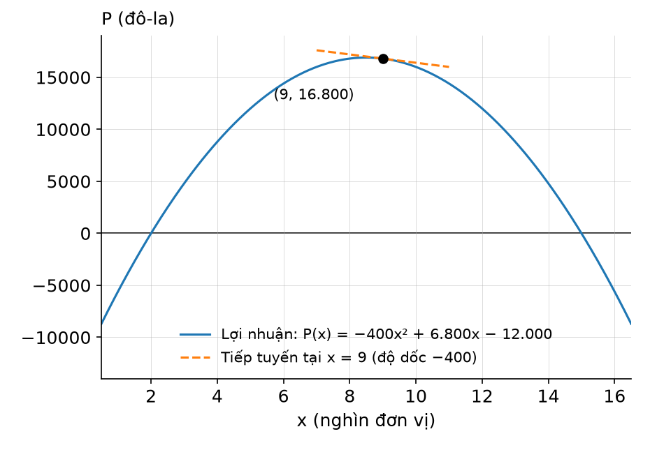

> ✅ **Lời giải (theo bài giảng):**
>
> **a)** Tốc độ thay đổi của lợi nhuận
> - **Công thức:** tốc độ thay đổi là đạo hàm P'(x) = lim_{h→0} [P(x + h) − P(x)]/h.
> - **Tính P(x + h):** P(x + h) = −400(x + h)² + 6,800(x + h) − 12,000 = −400x² − 800xh − 400h² + 6,800x + 6,800h − 12,000.
> - **Lập hiệu:** P(x + h) − P(x) = −800xh − 400h² + 6,800h.
> - **Chia h:** [P(x + h) − P(x)]/h = −800x − 400h + 6,800.
> - **Cho h → 0:** P'(x) = −800x + 6,800.
> - **Kết quả:** **P'(x) = −800x + 6,800** đô-la mỗi nghìn đơn vị sản phẩm. (Slide ghi thẳng kết quả giới hạn; các bước khai triển ở trên là bổ sung để tự làm lại.)
>
> **b)** Tăng hay giảm tại 9,000 sản phẩm
> - **Đổi đơn vị:** x tính bằng nghìn ⇒ 9,000 sản phẩm là x = 9.
> - **Thay số:** P'(9) = −800(9) + 6,800 = −7,200 + 6,800 = −400.
> - **Kết quả:** **P'(9) = −400 < 0**.
> - **Kết luận:** lợi nhuận **đang giảm** tại mức sản xuất 9,000 đơn vị sản phẩm (độ dốc tiếp tuyến tại x = 9 là −400).
> - ⚡ **Lỗi hay gặp:** thay x = 9,000; khai triển (x + h)² thiếu 2xh; nhìn hình thấy điểm x = 9 "gần đỉnh" mà kết luận lợi nhuận lớn nhất (đỉnh thật tại x = 8.5).

**Câu 11.** Tính đạo hàm của các hàm số: _(Ví dụ 2, Bài 2)_
- a) f(x) = −7/√x
- b) g(x) = 2x⁵ − 3x⁻⁷ + 3

> ✅ **Lời giải (theo bài giảng):**
>
> **a)** f(x) = −7/√x
> - **Công thức:** d/dx (xⁿ) = n·xⁿ⁻¹; d/dx [c·f(x)] = c·f'(x).
> - **Đổi dạng:** √x = x¹ᐟ² ⇒ −7/√x = −7x⁻¹ᐟ².
> - **Thay số:** d/dx (−7x⁻¹ᐟ²) = −7·((−1/2)·x⁻¹ᐟ²⁻¹) = −7·(−1/2)·x⁻³ᐟ².
> - **Kết quả:** **f'(x) = (7/2)x⁻³ᐟ²** (= 7/(2x√x)).
>
> **b)** g(x) = 2x⁵ − 3x⁻⁷ + 3
> - **Công thức:** đạo hàm của tổng bằng tổng các đạo hàm; hằng số nhân giữ nguyên; d/dx (3) = 0.
> - **Thay số:** g'(x) = 2·d/dx (x⁵) + (−3)·d/dx (x⁻⁷) + d/dx (3) = 2(5x⁴) + (−3)(−7x⁻⁸) + 0.
> - **Kết quả:** **g'(x) = 10x⁴ + 21x⁻⁸**.
> - ⚡ **Lỗi hay gặp:** (x⁻⁷)' = −7x⁻⁶ (sai số mũ, đúng là −8); quên dấu trừ khi nhân (−3)(−7) = +21; (x⁻¹ᐟ²)' ra x⁻¹ᐟ²⁺¹.

**Câu 12.** Ước tính rằng x tháng sau kể từ thời điểm hiện tại, tổng dân số ở một địa phương là: P(x) = x² + 20x + 8,000 người. _(Ví dụ 3, Bài 2)_
- a) Tính tốc độ thay đổi dân số theo thời gian ở tháng thứ 15?
- b) Thay đổi dân số thực tế trong tháng thứ 16 là bao nhiêu?

> ✅ **Lời giải (theo bài giảng):**
>
> **a)** Tốc độ thay đổi ở tháng thứ 15
> - **Công thức:** tốc độ thay đổi của dân số theo thời gian là đạo hàm của hàm tổng dân số: P'(x) = 2x + 20.
> - **Thay số:** P'(15) = 2(15) + 20 = 30 + 20.
> - **Kết quả:** **P'(15) = 50 người/tháng**.
>
> **b)** Thay đổi thực tế trong tháng thứ 16
> - **Công thức:** tháng thứ 16 là từ x = 15 đến x = 16 ⇒ thay đổi thực tế = P(16) − P(15).
> - **Thay số:** P(16) = 16² + 20(16) + 8,000 = 256 + 320 + 8,000 = 8,576; P(15) = 15² + 20(15) + 8,000 = 225 + 300 + 8,000 = 8,525.
> - **Kết quả:** P(16) − P(15) = 8,576 − 8,525 = **51 người**.
> - **Kết luận:** ⚠️ (bổ sung) tốc độ thay đổi P'(15) = 50 xấp xỉ thay đổi thực tế 51 người trong tháng tiếp theo.
> - ⚡ **Lỗi hay gặp:** câu b) lấy P'(16) = 52 hoặc P(16) = 8,576; câu a) tính P(15) thay vì P'(15).

**Câu 13.** Tổng sản phẩm trong nước (GDP) của một quốc gia t năm sau kể từ năm 2000 là N(t) = t² + 5t + 106 tỷ đô la. _(Ví dụ 4, Bài 2)_
- a) Tính tốc độ thay đổi của GDP theo thời gian vào năm 2010.
- b) Tính tốc độ thay đổi phần trăm của GDP theo thời gian vào năm 2010.

> ✅ **Lời giải (theo bài giảng):**
>
> **a)** Tốc độ thay đổi của GDP
> - **Công thức:** tốc độ thay đổi của GDP là đạo hàm N'(t) = 2t + 5.
> - **Lấy số:** năm 2010 ứng với t = 2010 − 2000 = 10.
> - **Thay số:** N'(10) = 2(10) + 5.
> - **Kết quả:** **N'(10) = 25 tỷ đô-la mỗi năm**.
>
> **b)** Tốc độ thay đổi phần trăm
> - **Công thức:** tốc độ thay đổi phần trăm = 100·N'(t)/N(t).
> - **Thay số:** N(10) = 10² + 5(10) + 106 = 100 + 50 + 106 = 256. 100·N'(10)/N(10) = 100·25/256 = 9.765625.
> - **Kết quả:** **≈ 9.77 (%/năm)**.
> - **Kết luận:** ⚠️ (bổ sung) vào năm 2010, GDP tăng khoảng 25 tỷ đô la mỗi năm, tương đương khoảng 9.77% mỗi năm.
> - ⚡ **Lỗi hay gặp:** lấy t = 2010; quên nhân 100 (ra 0.0977 là tốc độ thay đổi **tương đối**); chia cho N'(10) hoặc lấy N(10) sai.

**Câu 14.** Tính đạo hàm của các hàm số: _(Ví dụ 5, Bài 2)_
- a) P(x) = (x − 1)(3x − 2)
- b) Q(x) = (x² − 5x + 7)/(2x)

> ✅ **Lời giải (theo bài giảng):**
>
> **a)** Quy tắc tích
> - **Công thức:** (f·g)' = f'·g + f·g', với f = x − 1 (f' = 1), g = 3x − 2 (g' = 3).
> - **Thay số:** P'(x) = (x − 1)·d/dx [3x − 2] + (3x − 2)·d/dx [x − 1] = (x − 1)(3) + (3x − 2)(1) = 3x − 3 + 3x − 2.
> - **Kết quả:** **P'(x) = 6x − 5**.
>
> **b)** Quy tắc thương
> - **Công thức:** (f/g)' = (f'·g − f·g')/g², với f = x² − 5x + 7 (f' = 2x − 5), g = 2x (g' = 2), g² = 4x².
> - **Thay số:** Q'(x) = [(2x)(2x − 5) − (x² − 5x + 7)(2)]/(4x²) = [(4x² − 10x) − (2x² − 10x + 14)]/(4x²).
> - **Kết quả:** **Q'(x) = (2x² − 14)/(4x²)** (rút gọn: (x² − 7)/(2x²); slide để dạng chưa rút gọn).
> - ⚡ **Lỗi hay gặp:** a) lấy f'·g' = 3; b) đảo thứ tự tử thành f·g' − f'·g (đổi dấu), viết mẫu 2x² thay vì 4x², quên đổi dấu cả 3 hạng tử khi trừ (x² − 5x + 7)(2).

**Câu 15.** Một nhà sản xuất xác định rằng t tháng sau khi giới thiệu một sản phẩm mới ra thị trường, số lượng sản phẩm bán được là x(t) = t² + 3t trăm đơn vị với giá p(t) = −2t³ᐟ² + 30 đô la mỗi đơn vị. _(Ví dụ 6, Bài 2)_
- a) Biểu diễn hàm doanh thu R(t) theo thời gian dưới dạng tích.
- b) Tìm tốc độ thay đổi của doanh thu theo thời gian tại thời điểm 4 tháng sau? Doanh thu đang tăng hay giảm ở thời điểm đó?

> ✅ **Lời giải (theo bài giảng):**
>
> **a)** Hàm doanh thu
> - **Công thức:** doanh thu = lượng bán × giá: R(t) = x(t)·p(t).
> - **Kết quả:** **R(t) = (t² + 3t)(−2t³ᐟ² + 30)** (trăm đô la, vì x tính bằng trăm đơn vị).
>
> **b)** Tốc độ thay đổi của doanh thu tại t = 4
> - **Công thức:** quy tắc tích R'(t) = x(t)·p'(t) + p(t)·x'(t), với x'(t) = 2t + 3, p'(t) = −2·(3/2)t¹ᐟ² = −3t¹ᐟ².
> - **Lập R'(t):** R'(t) = (t² + 3t)·d/dt [−2t³ᐟ² + 30] + (−2t³ᐟ² + 30)·d/dt [t² + 3t] = (t² + 3t)[−2((3/2)t¹ᐟ²)] + (−2t³ᐟ² + 30)[2t + 3].
> - **Thay số t = 4:** 4¹ᐟ² = 2, 4³ᐟ² = 8. t² + 3t = 16 + 12 = 28; −3t¹ᐟ² = −6; −2t³ᐟ² + 30 = −16 + 30 = 14; 2t + 3 = 11. R'(4) = 28·(−6) + 14·11 = −168 + 154.
> - **Kết quả:** **R'(4) = −14** (trăm đô la mỗi tháng).
> - **Kết luận:** ở thời điểm 4 tháng sau, doanh thu **đang giảm** với tốc độ xấp xỉ 14 trăm đô-la (**1,400 đô la**) mỗi tháng.
> - ⚡ **Lỗi hay gặp:** tính 4³ᐟ² = 6 (đúng là (√4)³ = 8); kết luận −14 đô la (quên đơn vị trăm); lấy R'(t) = x'(t)·p'(t).

**Câu 16.** Tính đạo hàm của hàm sau: y = (x² + 2)³ − 3(x² + 2)² + 1 _(Ví dụ 7, Bài 2)_

> ✅ **Lời giải (theo bài giảng):**
> - **Đặt ẩn phụ:** u = x² + 2 ⇒ y = u³ − 3u² + 1.
> - **Công thức:** dy/dx = (dy/du)·(du/dx), với dy/du = 3u² − 6u và du/dx = 2x.
> - **Thay số:** dy/dx = (3u² − 6u)(2x) = [3(x² + 2)² − 6(x² + 2)](2x). Khai triển trong ngoặc: 3(x⁴ + 4x² + 4) − 6x² − 12 = 3x⁴ + 12x² + 12 − 6x² − 12 = 3x⁴ + 6x². Nhân 2x: (3x⁴ + 6x²)(2x).
> - **Kết quả:** **dy/dx = 6x⁵ + 12x³**.
> - ⚡ **Lỗi hay gặp:** quên nhân du/dx = 2x (ra 3x⁴ + 6x²); khai triển (x² + 2)² thiếu hạng tử 4x²; để nguyên biến u trong kết quả.

**Câu 17.** Biết rằng chi phí để sản xuất x đơn vị một loại hàng hóa là: C(x) = (1/3)x² + 4x + 53 đô-la và mức sản xuất t giờ sau kể từ khi bắt đầu vận hành sản xuất là: x(t) = 0.2t² + 0.03t đơn vị. Tính tốc độ thay đổi của chi phí theo thời gian tại thời điểm 4 giờ sau khi bắt đầu sản xuất. _(Ví dụ 8, Bài 2)_

> ✅ **Lời giải (theo bài giảng):**
> - **Đạo hàm thành phần:** dC/dx = (2/3)x + 4; dx/dt = 0.4t + 0.03.
> - **Công thức:** quy tắc hàm hợp dC/dt = (dC/dx)(dx/dt) = ((2/3)x + 4)(0.4t + 0.03).
> - **Lấy số:** khi t = 4, mức sản xuất x(4) = 0.2(4)² + 0.03(4) = 3.2 + 0.12 = 3.32 đơn vị.
> - **Thay số:** dC/dx = (2/3)(3.32) + 4 ≈ 2.2133 + 4 = 6.2133; dx/dt = 0.4(4) + 0.03 = 1.63. dC/dt ≈ 6.2133 × 1.63 ≈ 10.1277.
> - **Kết quả:** **dC/dt ≈ 10.13 đô-la mỗi giờ**.
> - **Kết luận:** ở thời điểm 4 giờ sau khi bắt đầu sản xuất, chi phí sản xuất **tăng** với tốc độ xấp xỉ 10.13 đô-la mỗi giờ.
> - ⚡ **Lỗi hay gặp:** thay x = 4 vào dC/dx (ra (2/3)(4) + 4 = 6.67, dC/dt ≈ 10.87, sai); chỉ tính dC/dx hoặc dx/dt mà không nhân.

**Câu 18.** Tính đạo hàm cấp hai của hàm số: f(x) = 5x⁴ − 3x² − 3x + 7 _(Ví dụ 9, Bài 2)_

> ✅ **Lời giải (theo bài giảng):**
> - **Công thức:** f''(x) = (f'(x))'; dùng (xⁿ)' = n·xⁿ⁻¹ cho từng hạng tử.
> - **Đạo hàm cấp một:** f'(x) = 5(4x³) − 3(2x) − 3 + 0 = 20x³ − 6x − 3.
> - **Đạo hàm cấp hai:** f''(x) = 20(3x²) − 6 − 0.
> - **Kết quả:** **f''(x) = 60x² − 6**.
> - ⚡ **Lỗi hay gặp:** giữ lại hằng số −3 ở bước cấp hai (đạo hàm hằng số bằng 0).

**Câu 19.** Một nghiên cứu về hiệu quả sản xuất tại một nhà máy cho thấy, trung bình một công nhân đến làm việc lúc 8 giờ sáng sẽ sản xuất được Q(t) = −t³ + 6t² + 24t đơn vị sản phẩm t giờ sau đó. _(Ví dụ 10, Bài 2)_
- a) Tính tốc độ sản xuất của công nhân tại thời điểm 11 giờ sáng
- b) Tốc độ sản xuất của công nhân ở thời điểm 11 giờ sáng thay đổi với tốc độ bằng bao nhiêu?

> ✅ **Lời giải (theo bài giảng):**
>
> **a)** Tốc độ sản xuất lúc 11 giờ
> - **Công thức:** tốc độ sản xuất là đạo hàm cấp một: R(t) = Q'(t) = −3t² + 12t + 24.
> - **Lấy số:** 11 giờ sáng là 3 giờ sau 8 giờ sáng ⇒ t = 3.
> - **Thay số:** R(3) = −3(3)² + 12(3) + 24 = −27 + 36 + 24.
> - **Kết quả:** **R(3) = 33 đơn vị mỗi giờ**.
>
> **b)** Tốc độ thay đổi của tốc độ sản xuất
> - **Công thức:** là đạo hàm của R(t), tức đạo hàm cấp hai của Q(t): R'(t) = Q''(t) = −6t + 12.
> - **Thay số:** R'(3) = −6(3) + 12 = −18 + 12.
> - **Kết quả:** **R'(3) = −6 đơn vị mỗi giờ, mỗi giờ**.
> - **Kết luận:** ⚠️ (bổ sung) lúc 11 giờ sáng tốc độ sản xuất của công nhân đang giảm khoảng 6 đơn vị/giờ mỗi giờ.
> - ⚡ **Lỗi hay gặp:** lấy t = 11; tính Q(3) (sản lượng) thay vì Q'(3); hiểu R'(3) < 0 là sản lượng giảm.

## Bài 3 — Ví dụ trong bài giảng

> Nguồn: [Bài 3 — Đạo hàm và vi phân của hàm số (Phần 2)](tai-lieu/bai-3-dao-ham-va-vi-phan-phan-2.pdf). Lời giải theo bài giảng, bổ sung bước trung gian.

**Câu 20.** Một nhà sản xuất ước tính tổng chi phí sản xuất x đơn vị một loại hàng hóa là C(x) = (1/8)x² + 3x + 98 đô la và tất cả x đơn vị hàng hóa đó được bán với giá p(x) = (1/3)(75 − x) đô la mỗi đơn vị. _(Ví dụ 1, Bài 3)_
- a) Xác định hàm chi phí cận biên và doanh thu cận biên.
- b) Sử dụng chi phí cận biên để **ước tính** chi phí sản xuất đơn vị hàng hóa thứ 37. Chi phí **thực tế** để sản xuất đơn vị hàng hóa thứ 37 là bao nhiêu?
- c) Sử dụng doanh thu cận biên để **ước tính** doanh thu thu được từ việc bán đơn vị hàng hóa thứ 37. Doanh thu **thực tế** thu được từ việc bán đơn vị hàng hóa thứ 37 là bao nhiêu?

> ✅ **Lời giải (theo bài giảng):**
> **a)**
> - **Công thức:** chi phí cận biên MC = C'(x); doanh thu R(x) = x·p(x), doanh thu cận biên MR = R'(x).
> - **Lập doanh thu:** R(x) = x·(1/3)(75 − x) = (1/3)(75x − x²) = 25x − (1/3)x².
> - **Đạo hàm từng hạng tử:** ((1/8)x²)' = (2/8)x = (1/4)x; (3x)' = 3; (98)' = 0. (25x)' = 25; ((1/3)x²)' = (2/3)x.
> - **Kết quả:** **C'(x) = (1/4)x + 3** và **R'(x) = 25 − (2/3)x**.
> **b)**
> - **Công thức:** chi phí đơn vị thứ x₀ + 1 ≈ C'(x₀); chi phí thực tế = C(x₀ + 1) − C(x₀).
> - **Lấy số:** hàng hóa thứ 37 = x₀ + 1 nên **x₀ = 36**.
> - **Thay số (ước tính):** C'(36) = (1/4)·36 + 3 = 9 + 3 = **12 đô la**.
> - **Thay số (thực tế):** C(37) = (1/8)·1,369 + 111 + 98 = 171.125 + 209 = 380.125; C(36) = (1/8)·1,296 + 108 + 98 = 162 + 206 = 368. C(37) − C(36) = 12.125.
> - **Kết quả:** chi phí thực tế ≈ **12.13 đô la**.
> **c)**
> - **Công thức:** doanh thu từ đơn vị thứ x₀ + 1 ≈ R'(x₀); doanh thu thực tế = R(x₀ + 1) − R(x₀).
> - **Thay số (ước tính):** R'(36) = 25 − (2/3)·36 = 25 − 24 = **1 đô la**.
> - **Thay số (thực tế):** R(37) = (1/3)(75·37 − 37²) = (1/3)(2,775 − 1,369) = 1,406/3 ≈ 468.67; R(36) = (1/3)(2,700 − 1,296) = 1,404/3 = 468. R(37) − R(36) = 2/3.
> - **Kết quả:** doanh thu thực tế ≈ **0.67 đô la**.
> - **Kết luận:** ⚠️ (bổ sung) giá trị cận biên xấp xỉ khá sát giá trị thực tế (12 so với 12.13; 1 so với 0.67).
> - ⚡ **Lỗi hay gặp:** lấy x₀ = 37 (sai, phải là 36); đạo hàm giá p(x) thay vì doanh thu R(x); chỉ tính ước tính mà quên phần thực tế.

**Câu 21.** Quentin là giám đốc kinh doanh của một công ty sản xuất máy ảnh kỹ thuật số. Anh ước tính rằng, nếu x trăm chiếc máy ảnh được sản xuất thì tổng lợi nhuận sẽ là P nghìn đô la, với: P(x) = −0.0035x³ + 0.07x² + 25x − 200. Quentin định sử dụng lợi nhuận cận biên để đưa ra quyết định sản xuất trong tương lai. _(Ví dụ 2, Bài 3)_
- a) Tìm hàm lợi nhuận cận biên.
- b) Mức sản xuất hiện tại là x = 10 (tương ứng 1,000 máy ảnh). Dựa vào lợi nhuận cận biên ở mức sản xuất này, Quentin nên tăng hay giảm mức sản xuất để tăng lợi nhuận?
- c) Quentin nên quyết định như thế nào nếu mức sản xuất hiện tại là x = 80?

> ✅ **Lời giải (theo bài giảng):**
> **a)**
> - **Công thức:** lợi nhuận cận biên MP = P'(x).
> - **Đạo hàm từng hạng tử:** (−0.0035x³)' = −0.0105x²; (0.07x²)' = 0.14x; (25x)' = 25; (−200)' = 0.
> - **Kết quả:** **P'(x) = −0.0105x² + 0.14x + 25** (nghìn đô la/ trăm chiếc).
> **b)**
> - **Thay số:** P'(10) = −0.0105·100 + 0.14·10 + 25 = −1.05 + 1.4 + 25.
> - **Kết quả:** **P'(10) = 25.35** (nghìn đô la/ trăm chiếc) > 0.
> - **Kết luận:** ⚠️ (bổ sung) P'(10) > 0 nên tăng sản xuất thêm 1 trăm chiếc làm lợi nhuận tăng khoảng 25.35 nghìn đô la → Quentin nên **tăng** mức sản xuất.
> **c)**
> - **Thay số:** P'(80) = −0.0105·6,400 + 0.14·80 + 25 = −67.2 + 11.2 + 25.
> - **Kết quả:** **P'(80) = −31** (nghìn đô la/ trăm chiếc) < 0.
> - **Kết luận:** ⚠️ (bổ sung) P'(80) < 0 nên tăng sản xuất làm lợi nhuận giảm khoảng 31 nghìn đô la mỗi trăm chiếc → Quentin nên **giảm** mức sản xuất.
> - ⚡ **Lỗi hay gặp:** đạo hàm sai hệ số (−0.0035·3 = −0.0105, 0.07·2 = 0.14); quên đơn vị "nghìn đô la/ trăm chiếc"; nhìn dấu P(x) thay vì dấu P'(x) để quyết định.

**Câu 22.** Giả sử tổng chi phí để sản xuất q trăm đơn vị một loại hàng hóa là C nghìn đô la, với: C(q) = 3q² + 5q + 10. Nếu mức sản xuất hiện tại là 4,000 đơn vị hàng hóa thì tổng chi phí sẽ tăng thêm bao nhiêu nếu 4,050 đơn vị hàng hóa được sản xuất? _(Ví dụ 3, Bài 3)_

> ✅ **Lời giải (theo bài giảng):**
> - **Công thức:** ΔC ≈ C'(q₀)·Δq.
> - **Đổi đơn vị:** q tính bằng trăm đơn vị → q₀ = 4,000/100 = 40; q₁ = 4,050/100 = 40.5; Δq = 40.5 − 40 = 0.5.
> - **Đạo hàm:** C'(q) = 6q + 5.
> - **Thay số:** C'(40) = 6·40 + 5 = 245; ΔC ≈ 245 × 0.5.
> - **Kết quả:** **ΔC ≈ 122.5 nghìn đô la**.
> - **Kết luận:** ⚠️ (bổ sung) tổng chi phí tăng thêm khoảng 122.5 nghìn đô la (giá trị chính xác C(40.5) − C(40) = 5,133.25 − 5,010 = 123.25, sát với xấp xỉ).
> - ⚡ **Lỗi hay gặp:** lấy Δq = 50 (quên đổi sang trăm đơn vị) → ra 12,250, sai; thay q = 4,000 vào C'(q).

**Câu 23.** Sản lượng hàng ngày của một nhà máy là Q(L) = 900L¹ᐟ³ đơn vị, trong đó L là quy mô lao động, được đo bằng số giờ làm việc của công nhân. Hiện tại, nhà máy đang sử dụng 1,000 giờ làm việc của công nhân mỗi ngày. Sử dụng giải tích toán học để ước lượng số giờ làm việc cần bổ sung để sản lượng hàng ngày tăng thêm 15 đơn vị. _(Ví dụ 4, Bài 3)_

> ✅ **Lời giải (theo bài giảng):**
> - **Công thức:** ΔQ ≈ Q'(L₀)·ΔL, suy ra ΔL ≈ ΔQ/Q'(L₀).
> - **Lấy số:** L₀ = 1,000; ΔQ = 15; cần tìm ΔL.
> - **Đạo hàm:** Q'(L) = 900·(1/3)L^{1/3 − 1} = 300L⁻²ᐟ³.
> - **Thay số:** 1,000²ᐟ³ = (∛1,000)² = 10² = 100 → Q'(1,000) = 300/100 = 3. Khi đó 15 ≈ 3·ΔL.
> - **Kết quả:** **ΔL = 5 giờ làm việc**.
> - **Kết luận:** ⚠️ (bổ sung) cần bổ sung khoảng 5 giờ làm việc của công nhân mỗi ngày.
> - ⚡ **Lỗi hay gặp:** nhân thay vì chia (15 × 3 = 45); tính sai lũy thừa âm L⁻²ᐟ³ (1,000⁻²ᐟ³ = 1/100, không phải 1/10).

**Câu 24.** Giả sử t năm sau kể từ năm 2005, GDP của một quốc gia là: N(t) = t² + 5t + 200 tỷ đô la. Sử dụng giải tích toán học để ước lượng phần trăm thay đổi của GDP trong quý 1 năm 2013. _(Ví dụ 5, Bài 3)_

> ✅ **Lời giải (theo bài giảng):**
> - **Công thức:** phần trăm thay đổi ≈ 100·N'(t₀)·Δt/N(t₀).
> - **Lấy số:** từ năm 2005 đến năm 2013 là 8 năm → t₀ = 8. Quý 1 năm 2013 (từ đầu năm đến hết quý 1) → Δt = 0.25 năm.
> - **Đạo hàm:** N'(t) = 2t + 5 (tỷ đô la/ năm).
> - **Thay số:** N'(8) = 16 + 5 = 21; N(8) = 64 + 40 + 200 = 304. Phần trăm thay đổi ≈ 100 × 21 × 0.25/304 = 525/304.
> - **Kết quả:** **≈ 1.73%**.
> - **Kết luận:** ⚠️ (bổ sung) GDP trong quý 1 năm 2013 tăng khoảng 1.73%.
> - ⚡ **Lỗi hay gặp:** lấy t₀ = 2013 hoặc t₀ = 9; lấy Δt = 1 hoặc 3 (tháng) thay vì 0.25 năm; quên chia N(8) (ra 5.25 tỷ đô la là thay đổi tuyệt đối, không phải %).

**Câu 25.** Viết biểu thức vi phân của hàm: f(x) = x³ − 7x² + 2 _(Ví dụ 6, Bài 3)_

> ✅ **Lời giải (theo bài giảng):**
> - **Công thức:** df = f'(x)·dx.
> - **Đạo hàm từng hạng tử:** (x³)' = 3x²; (−7x²)' = −14x; (2)' = 0 → f'(x) = 3x² − 14x.
> - **Kết quả:** **df = (3x² − 14x)dx**.
> - ⚡ **Lỗi hay gặp:** quên nhân dx (chỉ viết f'(x) là đạo hàm, chưa phải vi phân).

**Câu 26.** Giả sử y = y(x) là một hàm ẩn khả vi theo x được xác định từ phương trình: x²y + y² = x³. Tính đạo hàm dy/dx. _(Ví dụ 7, Bài 3)_

> ✅ **Lời giải (theo bài giảng):**
> - **Công thức:** đạo hàm hai vế theo x, y là hàm của x.
> - **Đạo hàm từng hạng tử:** (x²y)' = 2x·y + x²·(dy/dx) (quy tắc tích); (y²)' = 2y·(dy/dx) (hàm hợp); (x³)' = 3x².
> - **Phương trình sau khi đạo hàm:** 2xy + x²·(dy/dx) + 2y·(dy/dx) = 3x².
> - **Biến đổi:** (x² + 2y)·(dy/dx) = 3x² − 2xy.
> - **Kết quả:** **dy/dx = (3x² − 2xy)/(x² + 2y)**.
> - ⚡ **Lỗi hay gặp:** viết (x²y)' = 2xy (thiếu x²·y'); viết (y²)' = 2y (thiếu dy/dx).

**Câu 27.** Tìm độ dốc của tiếp tuyến với đường tròn x² + y² = 25 tại các điểm (3,4) và (3,−4). _(Ví dụ 8, Bài 3)_

> ✅ **Lời giải (theo bài giảng):**
> - **Công thức:** độ dốc tiếp tuyến = dy/dx tại điểm đó; đạo hàm hai vế theo x.
> - **Đạo hàm:** 2x + 2y·(dy/dx) = 0 → dy/dx = −x/y.
> - **Thay số tại (3, 4):** 2(3) + 2(4)·(dy/dx) = 0 → 6 + 8·(dy/dx) = 0 → dy/dx = −3/4.
> - **Thay số tại (3, −4):** 2(3) + 2(−4)·(dy/dx) = 0 → 6 − 8·(dy/dx) = 0 → dy/dx = 3/4.
> - **Kết quả:** độ dốc tại (3, 4) là **−3/4**; tại (3, −4) là **3/4**.
> - ⚡ **Lỗi hay gặp:** sai dấu khi thay y = −4; giải y = √(25 − x²) rồi đạo hàm sẽ mất nhánh y < 0.

**Câu 28.** Daiyu quản lý một nhà máy có sản lượng hàng ngày: Q = 2x³ + x²y + y³ đơn vị, trong đó x là số giờ lao động có kỹ năng và y là số giờ lao động giản đơn được sử dụng. Lực lượng lao động hiện sử dụng gồm 30 giờ lao động có kỹ năng và 20 giờ lao động giản đơn. Daiyu muốn tăng thêm 1 giờ lao động có kỹ năng và giảm bớt một số giờ lao động giản đơn mà không làm thay đổi sản lượng, hỏi số giờ lao động giản đơn cần thay đổi là bao nhiêu? _(Ví dụ 9, Bài 3)_

> ✅ **Lời giải (theo bài giảng):**
> - **Công thức:** giữ sản lượng không đổi → phương trình Q(x, y) = Q₀ xác định hàm ẩn y = y(x); với Δx = 1 thì Δy ≈ dy/dx.
> - **Lấy số:** Q(30, 20) = 2·27,000 + 900·20 + 8,000 = 54,000 + 18,000 + 8,000 = **80,000**. Phương trình (∗∗): 2x³ + x²y + y³ = 80,000 xác định hàm ẩn y = y(x) trên một lân cận của (30, 20). Δx = 1.
> - **Đạo hàm hai vế theo x:** (2x³)' = 6x²; (x²y)' = 2xy + x²·(dy/dx); (y³)' = 3y²·(dy/dx); (80,000)' = 0. Được 6x² + 2xy + x²·(dy/dx) + 3y²·(dy/dx) = 0 → dy/dx = −(6x² + 2xy)/(x² + 3y²).
> - **Thay số tại (30, 20):** tử 6·900 + 2·30·20 = 5,400 + 1,200 = 6,600; mẫu 900 + 3·400 = 900 + 1,200 = 2,100. dy/dx = −6,600/2,100 = −22/7.
> - **Kết quả:** **dy/dx tại (30, 20) ≈ −3.14**, nên Δy ≈ −3.14.
> - **Kết luận:** ⚠️ (bổ sung) cần **giảm khoảng 3.14 giờ** lao động giản đơn để sản lượng giữ ở 80,000 đơn vị.
> - ⚡ **Lỗi hay gặp:** quên Q₀ là hằng số (đạo hàm = 0); bỏ x²·y' trong (x²y)'; trả lời "tăng 3.14 giờ" (dấu âm nghĩa là giảm).

**Câu 29.** Quản lý của một nhà máy xác định rằng khi q trăm đơn vị một loại hàng hóa được sản xuất thì tổng chi phí sản xuất là C nghìn đô la, với: C² − 3q³ = 4,275. Khi 1,500 đơn vị hàng hóa được sản xuất, mức sản xuất đang tăng với tốc độ 20 đơn vị mỗi tuần. Tổng chi phí và tốc độ thay đổi của chi phí theo thời gian tại thời điểm đó là bao nhiêu? _(Ví dụ 10, Bài 3)_

> ✅ **Lời giải (theo bài giảng):**
> - **Công thức:** đặt t là thời gian (tuần); q, C là hàm của t. Cần tìm C và dC/dt.
> - **Đổi đơn vị:** 1,500 đơn vị → q = 15 (trăm đơn vị); 20 đơn vị/tuần → dq/dt = 0.2 (trăm đơn vị/tuần).
> - **Tìm C:** thay q = 15: C² = 4,275 + 3·15³ = 4,275 + 3·3,375 = 4,275 + 10,125 = 14,400 → C = 120 (C > 0).
> - **Đạo hàm hai vế theo t:** (C²)' = 2C·(dC/dt); (3q³)' = 9q²·(dq/dt); (4,275)' = 0. Được 2C·(dC/dt) − 9q²·(dq/dt) = 0 → dC/dt = 9q²·(dq/dt)/(2C).
> - **Thay số:** q = 15, C = 120, dq/dt = 0.2: dC/dt = 9·225·0.2/(2·120) = 405/240 = 1.6875.
> - **Kết quả:** tổng chi phí **C = 120 nghìn đô la**; **dC/dt ≈ 1.69 nghìn đô la/ tuần**.
> - **Kết luận:** ⚠️ (bổ sung) tại thời điểm đó chi phí là 120 nghìn đô la và đang tăng khoảng 1.69 nghìn đô la mỗi tuần.
> - ⚡ **Lỗi hay gặp:** thay q = 1,500 hoặc dq/dt = 20 (quên đổi sang trăm đơn vị); thay q = 15 vào phương trình trước khi đạo hàm.

**Câu 30.** Khi giá của một loại hàng hóa là p đô la mỗi đơn vị, nhà sản xuất sẽ cung cấp ra thị trường x nghìn đơn vị hàng hóa với: x² − 2x√p − p² = 31. Cung sẽ tăng nhanh như thế nào khi giá mỗi đơn vị hàng hóa là 9 đô la và đang tăng với tốc độ 20 cents mỗi tuần? _(Ví dụ 11, Bài 3)_

> ✅ **Lời giải (theo bài giảng):**
> - **Công thức:** đặt t là thời gian (tuần); x, p là hàm của t. Cần tìm dx/dt.
> - **Đổi đơn vị:** 20 cents = 0.2 đô la → dp/dt = +0.2 (đô la/tuần).
> - **Tìm x:** thay p = 9 (√p = 3): x² − 6x − 81 = 31 → x² − 6x − 112 = 0 → (x − 14)(x + 8) = 0 → x = 14 (loại x = −8).
> - **Đạo hàm hai vế theo t:** (x²)' = 2x·(dx/dt); (2x√p)' = 2[(dx/dt)·√p + x·(1/(2√p))·(dp/dt)] (quy tắc tích); (p²)' = 2p·(dp/dt). Được 2x·(dx/dt) − 2[(dx/dt)·√p + x·(1/(2√p))·(dp/dt)] − 2p·(dp/dt) = 0.
> - **Thay số:** x = 14, p = 9, dp/dt = 0.2: 28·(dx/dt) − 2[3·(dx/dt) + 14·(1/6)·0.2] − 18·0.2 = 0 → 28·(dx/dt) − 6·(dx/dt) − 0.9333 − 3.6 = 0 → 22·(dx/dt) = 4.5333 → dx/dt ≈ 0.2061.
> - **Kết quả:** **dx/dt ≈ 0.21 nghìn đơn vị/ tuần**.
> - **Kết luận:** ⚠️ (bổ sung) cung đang tăng khoảng 0.21 nghìn đơn vị (khoảng 210 đơn vị) mỗi tuần.
> - ⚡ **Lỗi hay gặp:** lấy dp/dt = 20; quên hạng tử x·(1/(2√p))·(dp/dt) khi đạo hàm tích x√p; giữ nghiệm x = −8.

**Câu 31.** Một quả bóng nhỏ hình cầu được đưa vào một động mạch bị tắc và được thổi phồng với tốc độ 0.002π mm³/phút. Tính tốc độ tăng bán kính của quả bóng theo thời gian khi bán kính R = 0.005 mm? _(Ví dụ 12, Bài 3)_

> ✅ **Lời giải (theo bài giảng):**
> - **Công thức:** gọi t là thời gian (phút), V là thể tích quả bóng; V = (4/3)πR³. Cần tìm dR/dt.
> - **Đạo hàm hai vế theo t:** dV/dt = (4/3)π·3R²·(dR/dt) = 4πR²·(dR/dt).
> - **Thay số:** R = 0.005 → R² = 0.000025; dV/dt = 0.002π. 0.002π = 4π·0.000025·(dR/dt) = 0.0001π·(dR/dt) → dR/dt = 0.002/0.0001.
> - **Kết quả:** **dR/dt = 20 mm/phút**.
> - **Kết luận:** ⚠️ (bổ sung) khi R = 0.005 mm, bán kính quả bóng tăng với tốc độ 20 mm/phút.
> - ⚡ **Lỗi hay gặp:** quên hệ số 3 khi đạo hàm R³; tính sai 0.005² (= 0.000025).

## Bài 4 — Ví dụ trong bài giảng

> Nguồn: [Bài 4 — Một số ứng dụng của đạo hàm (Phần 1)](tai-lieu/bai-4-ung-dung-cua-dao-ham-phan-1.pdf). Lời giải theo bài giảng, bổ sung bước trung gian.

**Câu 32.** Xác định các khoảng tăng, giảm của hàm: f(x) = x²/(x − 3) _(Ví dụ 1, Bài 4)_

> ✅ **Lời giải (theo bài giảng):**
> - **Tập xác định:** x − 3 ≠ 0 → D = ℝ\{3}.
> - **Công thức:** quy tắc thương với u = x², v = x − 3: u' = 2x, v' = 1.
> - **Đạo hàm:** f'(x) = [2x(x − 3) − x²·1]/(x − 3)² = (2x² − 6x − x²)/(x − 3)² = (x² − 6x)/(x − 3)² = **x(x − 6)/(x − 3)²**.
> - **Điểm chia:** f'(x) = 0 ⇔ x = 0; x = 6. Thêm x = 3 (f' không xác định, ngoài D). Các khoảng: (−∞; 0); (0; 3); (3; 6); (6; +∞).
> - **Thay số lấy dấu:** f'(−1) = (−1)(−7)/(−4)² = 7/16 = 0.4375 > 0; f'(1) = (1)(−5)/(−2)² = −5/4 = −1.25 < 0; f'(4) = 4·(−2)/1² = −8 < 0; f'(7) = 7·1/4² = 7/16 = 0.4375 > 0.
> - **Kết quả:** hàm f **tăng** trên các khoảng **(−∞; 0) và (6; +∞)**; **giảm** trên các khoảng **(0; 3) và (3; 6)**.
> - ⚡ **Lỗi hay gặp:** quên điểm chia x = 3; gộp thành "giảm trên (0; 6)" (sai vì x = 3 không thuộc tập xác định); sai dấu ở tử khi dùng quy tắc thương (u'v − uv', không phải uv' − u'v).

**Câu 33.** Tìm các số tới hạn của hàm f(x) = 2x⁴ − 4x² + 3 và phân loại các điểm tới hạn là cực đại, cực tiểu hay không phải cực trị tương đối. _(Ví dụ 2, Bài 4)_

> ✅ **Lời giải (theo bài giảng):**
> - **Tập xác định:** D = ℝ.
> - **Đạo hàm từng hạng tử:** (2x⁴)' = 8x³; (−4x²)' = −8x; (3)' = 0 → f'(x) = 8x³ − 8x = 8x(x² − 1).
> - **Số tới hạn:** f'(x) = 0 ⇔ x = 0; x = ±1.
> - **Điểm tới hạn:** f(−1) = 2 − 4 + 3 = 1; f(0) = 3; f(1) = 1 → A(−1, 1); B(0, 3); C(1, 1).
> - **Xét dấu f' trên các khoảng** (−∞; −1); (−1; 0); (0; 1); (1; +∞):
>   - f'(−2) = 8·(−2)·(4 − 1) = −48 < 0;
>   - f'(−1/2) = 8·(−1/2)·(1/4 − 1) = (−4)·(−3/4) = 3 > 0;
>   - f'(1/4) = 8·(1/4)·(1/16 − 1) = 2·(−15/16) = −15/8 < 0;
>   - f'(2) = 8·2·(4 − 1) = 48 > 0.
> - **Kết quả:** f' đổi dấu − → + tại x = ±1 nên **A(−1, 1) và C(1, 1) là các điểm cực tiểu tương đối**; f' đổi dấu + → − tại x = 0 nên **B(0, 3) là điểm cực đại tương đối**.
> - ⚡ **Slide ghi** f'(−2) = −64 (in nhầm), đúng là −48; kết luận không đổi.
> - ⚡ **Lỗi hay gặp:** chỉ tìm x = 0 mà quên x = ±1 (khi chia hai vế cho x); trả lời số tới hạn mà quên phân loại.

**Câu 34.** Doanh thu thu được từ việc bán một loại ván trượt mới có gắn động cơ ở thời điểm t tuần sau khi đưa ra thị trường được cho bởi: R(t) = (63t − t²)/(t² + 63) triệu đô-la. Thời điểm nào doanh thu đạt tối đa? Doanh thu tối đa bằng bao nhiêu? _(Ví dụ 3, Bài 4)_

> ✅ **Lời giải (theo bài giảng):**
> - **Tập xác định:** D = [0; 63].
> - **Công thức:** quy tắc thương với u = 63t − t², v = t² + 63: u' = 63 − 2t, v' = 2t.
> - **Đạo hàm:** tử = (63 − 2t)(t² + 63) − (63t − t²)·2t = (63t² + 3,969 − 2t³ − 126t) − (126t² − 2t³) = −63t² − 126t + 3,969 = −63(t² + 2t − 63) = −63(t − 7)(t + 9). Vậy **R'(t) = −63(t − 7)(t + 9)/(t² + 63)²**.
> - **Số tới hạn:** R'(t) = 0 ⇔ t = 7 (loại t = −9 vì ngoài D). Hàm R(t) có một số tới hạn t = 7.
> - **Xét dấu R' trên** (0; 7); (7; 63):
>   - R'(1) = −63·(−6)·10/64² = 3,780/4,096 ≃ 0.923 > 0;
>   - R'(8) = −63·1·17/127² = −1,071/16,129 ≃ −0.066 < 0.
> - **Tính giá trị:** R(7) = (63·7 − 49)/(49 + 63) = (441 − 49)/112 = 392/112 = 3.5.
> - **Kết quả:** R(t) tăng trên 0 < t < 7, giảm trên 7 < t < 63; R(t) đạt cực đại tương đối tại **t = 7** và **R(7) = 3.5**.
> - **Kết luận:** ⚠️ (bổ sung) doanh thu đạt tối đa sau **7 tuần**, doanh thu tối đa là **3.5 triệu đô-la** (R tăng rồi giảm trên [0; 63] nên cực đại tương đối cũng là giá trị lớn nhất).
> - ⚡ **Lỗi hay gặp:** sai dấu tử khi dùng quy tắc thương; giữ nghiệm t = −9; trả lời t = 7 mà quên tính R(7).

**Câu 35.** Tìm các khoảng lõm của hàm: f(x) = 2x⁶ − 5x⁴ + 7x − 3 _(Ví dụ 4, Bài 4)_

> ✅ **Lời giải (theo bài giảng):**
> - **Tập xác định:** D = ℝ.
> - **Đạo hàm cấp một:** (2x⁶)' = 12x⁵; (−5x⁴)' = −20x³; (7x)' = 7; (−3)' = 0 → f'(x) = 12x⁵ − 20x³ + 7.
> - **Đạo hàm cấp hai:** (12x⁵)' = 60x⁴; (−20x³)' = −60x²; (7)' = 0 → f''(x) = 60x⁴ − 60x² = **60x²(x² − 1)**.
> - **Điểm chia:** f''(x) = 0 khi x = 0, ±1. Các khoảng: (−∞; −1); (−1; 0); (0; 1); (1; +∞).
> - **Thay số lấy dấu:**
>   - f''(−2) = 60·4·(4 − 1) = 720 > 0;
>   - f''(−1/2) = 60·(1/4)·(1/4 − 1) = 15·(−3/4) = −45/4 < 0;
>   - f''(1/2) = −45/4 < 0;
>   - f''(5) = 60·25·(25 − 1) = 36,000 > 0.
> - **Kết quả:** đồ thị hàm f có **bề lõm hướng lên khi x < −1 hoặc x > 1**, có **bề lõm hướng xuống khi −1 < x < 0 hoặc 0 < x < 1**.
> - ⚡ **Lỗi hay gặp:** xét dấu f' thay vì f''; quên nghiệm x = 0 của 60x²; đạo hàm sai hạng tử 7x (f'' của 7x bằng 0).

**Câu 36.** Trong mỗi trường hợp, hãy tìm tất cả các điểm uốn của hàm số. _(Ví dụ 5, Bài 4)_
- a) f(x) = 3x⁵ − 5x⁴ − 1
- b) g(x) = x¹ᐟ³

> ✅ **Lời giải (theo bài giảng):**
> **a)**
> - **Tập xác định:** D = ℝ.
> - **Đạo hàm:** f'(x) = 15x⁴ − 20x³; f''(x) = 60x³ − 60x² = **60x²(x − 1)**.
> - **Điểm chia:** f''(x) liên tục trên ℝ và f''(x) = 0 tại x = 0 và x = 1. Các khoảng: (−∞; 0); (0; 1); (1; +∞).
> - **Thay số lấy dấu:** f''(−1) = 60·1·(−2) = −120 < 0; f''(0.5) = 60·0.25·(−0.5) = −7.5 < 0; f''(2) = 60·4·1 = 240 > 0.
> - **Tọa độ:** f(1) = 3 − 5 − 1 = −3.
> - **Kết quả:** f'' không đổi dấu qua x = 0, chỉ đổi dấu qua x = 1. Đồ thị hàm f chỉ có **một điểm uốn: (1, −3)**.
> **b)**
> - **Tập xác định:** D = ℝ.
> - **Đạo hàm:** g'(x) = (1/3)x⁻²ᐟ³; g''(x) = (1/3)·(−2/3)x⁻⁵ᐟ³ = **−(2/9)x⁻⁵ᐟ³** = −2/(9·(∛x)⁵).
> - **Điểm chia:** g''(x) luôn khác 0 và g''(x) không tồn tại khi x = 0. Các khoảng: (−∞; 0); (0; +∞).
> - **Thay số lấy dấu:** g''(−1) = −(2/9)·(−1)⁻⁵ᐟ³ = −(2/9)·(−1) = 2/9 > 0; g''(1) = −2/9 < 0.
> - **Tọa độ:** g(0) = 0; g liên tục tại 0.
> - **Kết quả:** đồ thị của hàm g thay đổi hướng lõm tại x = 0 (lõm lên khi x < 0, lõm xuống khi x > 0). Đồ thị hàm g chỉ có **một điểm uốn là (0, 0)**.
> - ⚡ **Slide ghi** g''(−1) = −2/9 < 0 và g''(1) = 1/3 > 0 (in nhầm), đúng là g''(−1) = 2/9 > 0 và g''(1) = −2/9 < 0; kết luận không đổi.
> - ⚡ **Lỗi hay gặp:** coi x = 0 ở ý a là điểm uốn vì f''(0) = 0; bỏ sót x = 0 ở ý b vì g'' không bằng 0 ở đâu cả.

**Câu 37.** Tìm các điểm tới hạn của hàm f(x) = 2x³ + 3x² − 12x − 7 và sử dụng đạo hàm cấp hai để phân loại các điểm tới hạn là cực đại tương đối hay cực tiểu tương đối. _(Ví dụ 6, Bài 4)_

> ✅ **Lời giải (theo bài giảng):**
> - **Tập xác định:** D = ℝ.
> - **Đạo hàm cấp một:** (2x³)' = 6x²; (3x²)' = 6x; (−12x)' = −12; (−7)' = 0 → f'(x) = 6x² + 6x − 12 = 6(x² + x − 2) = **6(x + 2)(x − 1)**.
> - **Số tới hạn:** f'(x) = 0 ⇔ x = −2; x = 1.
> - **Điểm tới hạn:** f(−2) = −16 + 12 + 24 − 7 = 13; f(1) = 2 + 3 − 12 − 7 = −14 → **(−2, 13) và (1, −14)**.
> - **Đạo hàm cấp hai:** f''(x) = 12x + 6.
> - **Thay số:** f''(−2) = −24 + 6 = −18 < 0; f''(1) = 12 + 6 = 18 > 0.
> - **Kết quả:** **(−2, 13) là điểm cực đại tương đối**; **(1, −14) là điểm cực tiểu tương đối**.
> - ⚡ **Lỗi hay gặp:** nhầm f'' < 0 là cực tiểu; thay c vào f' (luôn bằng 0) thay vì f''; tính sai f(−2) do dấu của (−2)³.

## Bài 5 — Ví dụ trong bài giảng

> Nguồn: [Bài 5 — Một số ứng dụng của đạo hàm (Phần 2)](tai-lieu/bai-5-ung-dung-cua-dao-ham-phan-2.pdf). Lời giải theo bài giảng, bổ sung bước trung gian.

**Câu 38.** Tìm cực đại tuyệt đối và cực tiểu tuyệt đối của hàm: f(x) = 2x³ + 3x² − 12x − 7 trên đoạn −3 ≤ x ≤ 0. _(Ví dụ 1, Bài 5)_

![Đồ thị f(x) trên đoạn [−3, 0] với cực đại, cực tiểu tuyệt đối](tai-lieu/hinh/bai5-vd1-cuc-tri-doan.png)

> ✅ **Lời giải (theo bài giảng):**
> - **Công thức:** f liên tục trên đoạn đóng ⟹ cực trị tuyệt đối đạt tại số tới hạn trong khoảng mở hoặc tại điểm mút (3 bước).
> - **Bước 1 — số tới hạn trong −3 < x < 0:** f'(x) = 6x² + 6x − 12 = 6(x² + x − 2) = 6(x + 2)(x − 1) = 0 ⟹ x = −2 hoặc x = 1. **Loại x = 1** vì không thuộc khoảng đang xét.
> - **Bước 2 — thay số:**
>   - f(−3) = 2(−27) + 3(9) − 12(−3) − 7 = −54 + 27 + 36 − 7 = **2**
>   - f(−2) = 2(−8) + 3(4) − 12(−2) − 7 = −16 + 12 + 24 − 7 = **13**
>   - f(0) = **−7**
> - **Kết quả:** cực đại tuyệt đối **f(−2) = 13**; cực tiểu tuyệt đối **f(0) = −7**.
> - **Kết luận:** trên −3 ≤ x ≤ 0, f lớn nhất bằng 13 tại x = −2 (cực đại tương đối bên trong) và nhỏ nhất bằng −7 tại x = 0 (điểm mút phải).
> - ⚡ **Lỗi hay gặp:** tính cả f(1) = −14 rồi chọn −14 làm cực tiểu (x = 1 nằm ngoài đoạn); quên mút x = 0 nên không thấy cực tiểu −7.

**Câu 39.** Tìm cực đại tuyệt đối và cực tiểu tuyệt đối (nếu có) của hàm: f(x) = x² + 16/x trên khoảng x > 0. _(Ví dụ 2, Bài 5)_

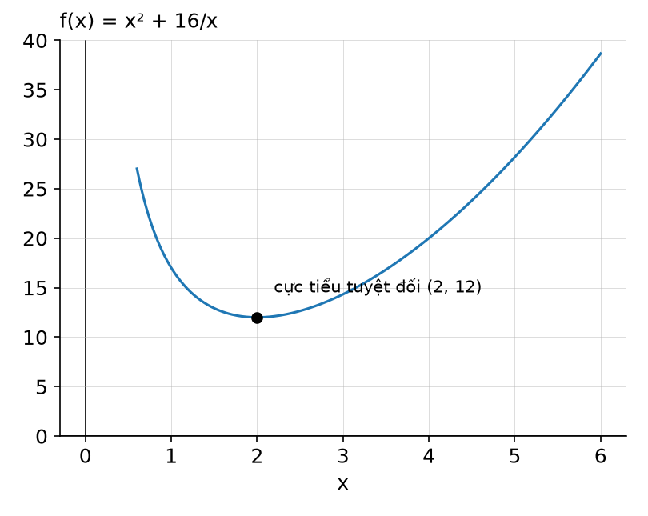

> ✅ **Lời giải (theo bài giảng):**
> - **Công thức:** khoảng x > 0 không đóng ⟹ dùng kiểm tra cực trị tuyệt đối bằng đạo hàm cấp hai (c là số tới hạn **duy nhất**, f'(c) = 0; f''(c) > 0 ⟹ cực tiểu tuyệt đối).
> - **Đạo hàm:** f(x) = x² + 16x⁻¹ ⟹ f'(x) = 2x − 16/x². f'(x) = 0 ⟺ 2x = 16/x² ⟺ x³ = 8 ⟺ **x = 2** (số tới hạn duy nhất trên x > 0).
> - **Đạo hàm cấp hai:** f''(x) = 2 + 32/x³ ⟹ f''(2) = 2 + 32/8 = **6 > 0**.
> - **Thay số:** f(2) = 4 + 16/2 = 4 + 8 = **12**.
> - **Kết quả:** **f(2) = 12 là cực tiểu tuyệt đối** trên x > 0; hàm **không có cực đại tuyệt đối**.
> - **Kết luận:** hàm liên tục trên x > 0, chỉ có một số tới hạn x = 2 và f''(2) > 0 nên giá trị nhỏ nhất là 12. ⚠️ (bổ sung) Không có cực đại vì f(x) → +∞ khi x → 0⁺ và khi x → +∞.
> - ⚡ **Lỗi hay gặp:** kết luận "có cực đại tuyệt đối"; quên kiểm tra số tới hạn là duy nhất trước khi dùng đạo hàm cấp hai.

**Câu 40.** Adam Goodman xác định rằng khi q nghìn đơn vị một loại sản phẩm được sản xuất mỗi tháng, nhà máy của anh ấy có thể bán toàn bộ số sản phẩm đó với giá p(q) = 22.2 − 1.2q đô la mỗi đơn vị. Tổng chi phí để sản xuất q đơn vị đó là: C(q) = 0.4q² + 3q + 40 nghìn đô la. _(Ví dụ 3, Bài 5)_
- a) Adam cần sản xuất bao nhiêu đơn vị sản phẩm để tối đa hóa lợi nhuận?
- b) Adam cần sản xuất bao nhiêu đơn vị sản phẩm để tối thiểu hóa chi phí bình quân A(q) = C(q)/q?

> ✅ **Lời giải (theo bài giảng):**
>
> **a)**
> - **Công thức:** lợi nhuận tối đa khi R'(q) = C'(q) và R''(q) < C''(q).
> - **Lập hàm:** R(q) = q·p(q) = q(22.2 − 1.2q) = −1.2q² + 22.2q.
>   - R'(q) = −2.4q + 22.2 ⟹ R''(q) = −2.4
>   - C(q) = 0.4q² + 3q + 40 ⟹ C'(q) = 0.8q + 3 ⟹ C''(q) = 0.8
> - **Thay số:** R'(q) = C'(q) ⟺ −2.4q + 22.2 = 0.8q + 3 ⟺ 3.2q = 19.2 ⟺ **q = 6**. Kiểm tra: R''(6) = −2.4 < C''(6) = 0.8 ✓.
> - **Đổi đơn vị:** q tính bằng nghìn ⟹ 6 × 1,000 = 6,000.
> - **Kết quả:** **6,000 đơn vị sản phẩm**.
> - **Kết luận:** để tối đa hoá lợi nhuận, Adam cần sản xuất 6,000 đơn vị. ⚠️ (bổ sung) Khi đó giá p(6) = 22.2 − 7.2 = 15 đô la; lợi nhuận P(6) = R(6) − C(6) = 90 − 72.4 = 17.6 nghìn đô la.
>
> **b)**
> - **Công thức:** chi phí bình quân tối thiểu khi A(q) = C'(q).
> - **Lập hàm:** A(q) = C(q)/q = (0.4q² + 3q + 40)/q = 0.4q + 3 + 40/q; C'(q) = 0.8q + 3.
> - **Thay số:** 0.4q + 3 + 40/q = 0.8q + 3 ⟺ 40/q = 0.4q ⟺ q² = 100 ⟺ **q = 10** (loại q = −10).
> - **Đổi đơn vị:** 10 × 1,000 = 10,000.
> - **Kết quả:** **10,000 đơn vị sản phẩm**.
> - **Kết luận:** để tối thiểu hoá chi phí bình quân, Adam cần sản xuất 10,000 đơn vị. ⚠️ (bổ sung) Khi đó A(10) = 4 + 3 + 4 = 11 = C'(10) = 11 (nghìn đô la / nghìn đơn vị, tức 11 đô la mỗi đơn vị).
> - ⚡ **Lỗi hay gặp:** trả lời "6" và "10" (quên đơn vị nghìn); viết R(q) = p(q) thay vì q·p(q); dùng điều kiện A = C' cho câu lợi nhuận hoặc R' = C' cho câu chi phí bình quân.

**Câu 41.** Người quản lý của một cửa hàng sách xác định rằng khi giá bán mỗi cuốn tiểu thuyết dạng bìa mềm mới xuất bản là p đô la thì cầu hàng ngày đối với cuốn sách đó là q = 300 − p² cuốn, với 0 ≤ p ≤ √300. _(Ví dụ 4, Bài 5)_
- a) Biểu diễn độ co giãn của cầu theo giá dưới dạng một hàm của p.
- b) Tính độ co giãn của cầu theo giá khi giá p = 5 và giải thích ý nghĩa của kết quả tính được.
- c) Xác định các mức giá tại đó cầu co giãn, không co giãn, co giãn đơn vị.
- d) Giải thích ý nghĩa kết quả tìm được trong câu c) theo hành vi của hàm doanh thu theo giá.

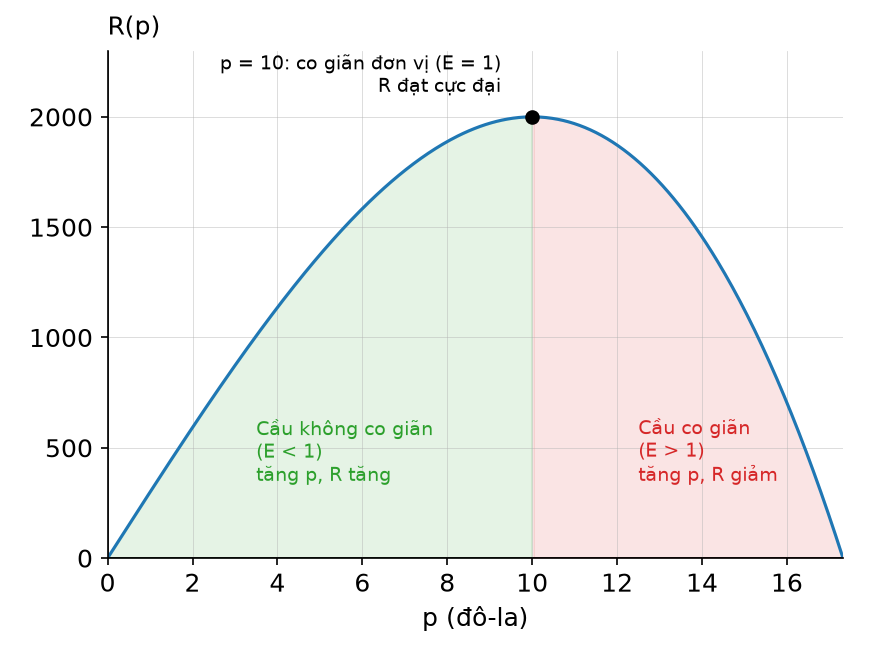

> ✅ **Lời giải (theo bài giảng):**
>
> **a)**
> - **Công thức:** E(p) = −(p/q)(dq/dp).
> - **Đạo hàm:** q = 300 − p² ⟹ dq/dp = −2p.
> - **Thay số:** E(p) = −(p/(300 − p²))·(−2p) = 2p²/(300 − p²).
> - **Kết quả:** **E(p) = 2p²/(300 − p²)**.
>
> **b)**
> - **Thay số:** E(5) = 2·25/(300 − 25) = 50/275 = 2/11 ≈ 0.18.
> - **Kết quả:** **E(5) ≈ 0.18**.
> - **Kết luận:** ở mức giá 5 đô la mỗi cuốn, nếu giá tăng thêm 1% thì cầu giảm xấp xỉ 0.18% (⚠️ bổ sung: cầu không co giãn vì 0.18 < 1).
>
> **c)**
> - **Co giãn đơn vị:** E(p) = 1 ⟺ 2p² = 300 − p² ⟺ 3p² = 300 ⟺ p² = 100 ⟺ p = ±10. Loại p = −10 vì không thuộc 0 ≤ p ≤ √300 ⟹ **p = 10**.
> - **Không co giãn:** E(p) < 1 ⟺ 2p² < 300 − p² (mẫu dương) ⟺ p² < 100 ⟹ **0 ≤ p < 10**.
> - **Co giãn:** E(p) > 1 ⟺ p² > 100 ⟹ **10 < p ≤ √300**.
> - **Kết luận:** cầu co giãn đơn vị tại p = 10 đô la, không co giãn khi giá dưới 10 đô la, co giãn khi giá trên 10 đô la.
>
> **d)**
> - **Công thức:** R(p) = p·q(p) ⟹ R'(p) = q(p)[1 − E(p)].
> - 0 ≤ p < 10 ⟹ E(p) < 1 ⟹ R'(p) > 0 ⟹ **doanh thu tăng** khi giá tăng.
> - 10 < p ≤ √300 ⟹ E(p) > 1 ⟹ R'(p) < 0 ⟹ **doanh thu giảm** khi giá tăng.
> - p = 10 ⟹ E(p) = 1 ⟹ R'(10) = 0 ⟹ **doanh thu đạt tối đa**.
> - **Kết luận:** hàm doanh thu R(p) = p(300 − p²) tăng trên [0, 10), đạt đỉnh tại p = 10, giảm trên (10, √300]. ⚠️ (bổ sung) R(10) = 10 × 200 = 2,000 đô la mỗi ngày.
> - ⚡ **Lỗi hay gặp:** bỏ dấu trừ nên được E = −0.18 rồi so với −1; đảo kết luận "cầu không co giãn thì tăng giá làm giảm doanh thu"; giữ nghiệm p = −10. ⚡ Tại p = √300 thì q = 0, E không xác định; slide vẫn ghi 10 < p ≤ √300.

**Câu 42.** Hai nhà máy công nghiệp A và B cách nhau 15 dặm và thải ra lần lượt 75 ppm (phần triệu) và 300 ppm một loại vật chất hạt. Mỗi nhà máy được bao quanh bởi một khu vực giới hạn có bán kính 1 dặm, ở đó không cho phép nhà ở, và nồng độ chất ô nhiễm đến một điểm Q bất kỳ từ mỗi nhà máy giảm tỷ lệ nghịch với khoảng cách từ nhà máy đó đến Q. Hỏi một ngôi nhà nên ở vị trí nào trên con đường nối hai nhà máy để giảm thiểu ô nhiễm đến từ cả hai nhà máy? _(Ví dụ 5, Bài 5)_

> ✅ **Lời giải (theo bài giảng):**
> - **B1 — đặt biến:** P là tổng mức độ ô nhiễm tại vị trí H đặt ngôi nhà (ppm); x là khoảng cách từ ngôi nhà đến nhà máy A (dặm). Vùng cấm bán kính 1 dặm quanh mỗi nhà máy ⟹ **1 ≤ x ≤ 14**; khoảng cách đến B là 15 − x.
> - **B2 & B3 — lập hàm:** ô nhiễm tỷ lệ nghịch với khoảng cách ⟹ P(x) = 75/x + 300/(15 − x) → Min.
> - **B4 — đạo hàm:** P'(x) = −75/x² + 300/(15 − x)² = 0 ⟺ 300x² = 75(15 − x)² ⟺ 4x² = (15 − x)² ⟺ 2x = 15 − x (hai vế dương) ⟺ **x = 5**.
> - **Thay số (số tới hạn và hai mút):**
>   - P(1) = 75/1 + 300/14 = 75 + 21.43 ≈ **96.43**
>   - P(5) = 75/5 + 300/10 = 15 + 30 = **45**
>   - P(14) = 75/14 + 300/1 = 5.36 + 300 ≈ **305.36**
> - **Kết quả:** P nhỏ nhất **= 45 ppm tại x = 5**.
> - **Kết luận (B5):** tổng mức ô nhiễm nhỏ nhất khi ngôi nhà ở vị trí cách nhà máy A 5 dặm (cách B 10 dặm), tại đó mức ô nhiễm là 45 ppm.
> - ⚡ **Lỗi hay gặp:** lấy miền 0 < x < 15 (quên vùng cấm 1 dặm); không so với hai mút; giải (15 − x)² = 4x² ra thêm nghiệm x = −15 mà không loại.

**Câu 43.** Một công ty xe buýt cho các nhóm có từ 35 người trở lên thuê những chiếc xe buýt 50 chỗ. Nếu nhóm có đúng 35 người thì mỗi người sẽ trả 60 đô la. Nếu nhóm có trên 35 người thì chi phí tính cho mỗi người sẽ được giảm đi 1 đô la với mỗi một người vượt quá số lượng 35. Xác định quy mô của nhóm để doanh thu của công ty xe buýt đạt tối đa. _(Ví dụ 6, Bài 5)_

> ✅ **Lời giải (theo bài giảng):**
> - **B1 — đặt biến:** R là doanh thu (đô la); x là số người vượt quá 35 của nhóm thuê xe. Xe 50 chỗ ⟹ **0 ≤ x ≤ 15**.
> - **B2 & B3 — lập hàm:** số người = 35 + x; giá mỗi người = 60 − x ⟹ R(x) = (35 + x)(60 − x) = 2,100 + 25x − x² → Max.
> - **B4 — đạo hàm:** R'(x) = 25 − 2x = 0 ⟺ **x = 12.5**. Số người phải là số nguyên ⟹ xét x = 12 và x = 13, cùng hai mút:
>   - R(12) = 47 × 48 = **2,256**
>   - R(13) = 48 × 47 = **2,256**
>   - R(0) = 35 × 60 = **2,100**
>   - R(15) = 50 × 45 = **2,250**
> - **Kết quả:** doanh thu tối đa **$2,256** tại x = 12 hoặc x = 13.
> - **Kết luận (B5):** với nhóm **47 hoặc 48 người**, doanh thu của công ty xe buýt đạt tối đa $2,256.
> - ⚡ **Lỗi hay gặp:** trả lời "12.5 người" hoặc "12/13 người" (quên cộng 35); tính R(12.5) = 2,256.25 làm doanh thu tối đa; quên giới hạn x ≤ 15 do xe chỉ có 50 chỗ.

## Bài 6 — Ví dụ trong bài giảng

> Nguồn: [Bài 6 — Phép toán tích phân (Phần 1)](tai-lieu/bai-6-phep-toan-tich-phan-phan-1.pdf). Lời giải theo bài giảng, bổ sung bước trung gian.

**Câu 44.** Chứng tỏ rằng: _(Ví dụ 1, Bài 6)_
- a) hàm F(x) = x³/3 + x²/2 + x + 2025 là một nguyên hàm của hàm f(x) = x² + x + 1
- b) nếu F(x) là một nguyên hàm của f(x) thì F(x) + C cũng là một nguyên hàm của f(x), với C là một hằng số nào đó.

> ✅ **Lời giải (theo bài giảng):**
>
> **a)**
> - **Công thức:** F là nguyên hàm của f ⟺ F'(x) = f(x) với mọi x.
> - **Đạo hàm từng hạng tử:** (x³/3)' = x²; (x²/2)' = x; (x)' = 1; (2025)' = 0.
> - **Kết quả:** F'(x) = x² + x + 1 = f(x), ∀x ∈ ℝ.
> - **Kết luận:** F(x) là một nguyên hàm của f(x).
>
> **b)**
> - **Công thức:** đạo hàm của hằng số bằng 0.
> - **Thay số:** (F(x) + C)' = F'(x) + 0 = F'(x) = f(x).
> - **Kết luận:** F(x) + C cũng là một nguyên hàm của f(x). ⚠️ (bổ sung) Vì vậy hằng số 2025 ở ý a) có thể thay bằng bất kỳ số nào; mọi nguyên hàm của f đều có dạng x³/3 + x²/2 + x + C.
> - ⚡ **Lỗi hay gặp:** lấy tích phân f rồi so sánh mà quên + C; nghĩ rằng hằng số 2025 làm F không còn là nguyên hàm.

**Câu 45.** Tính các tích phân sau: _(Ví dụ 2, Bài 6)_
- a) ∫ x¹⁵ dx
- b) ∫ 2/(3x√x) dx
- c) ∫ e⁻⁵ˣ dx
- d) ∫ (2x⁵ + 8x³ − 3x² + 5) dx
- e) ∫ ((x³ + 2x − 7)/x) dx
- f) ∫ (3e⁻⁵ᵗ + √t) dt

> ✅ **Lời giải (theo bài giảng):**
>
> **a)**
> - **Công thức:** quy tắc lũy thừa ∫ xⁿ dx = xⁿ⁺¹/(n + 1) + C, n = 15.
> - **Kết quả:** **∫ x¹⁵ dx = x¹⁶/16 + C**.
>
> **b)**
> - **Đổi về lũy thừa:** x√x = x·x¹ᐟ² = x³ᐟ² ⟹ 2/(3x√x) = (2/3)x⁻³ᐟ².
> - **Công thức:** nhân hằng số + lũy thừa với n = −3/2 ⟹ n + 1 = −1/2.
> - **Thay số:** (2/3)·x⁻¹ᐟ²/(−1/2) = (2/3)·(−2)·x⁻¹ᐟ² = −(4/3)x⁻¹ᐟ².
> - **Kết quả:** **∫ 2/(3x√x) dx = −(4/3)x⁻¹ᐟ² + C** (= −4/(3√x) + C).
>
> **c)**
> - **Công thức:** quy tắc mũ ∫ eᵏˣ dx = eᵏˣ/k + C, k = −5.
> - **Kết quả:** **∫ e⁻⁵ˣ dx = e⁻⁵ˣ/(−5) + C** = −(1/5)e⁻⁵ˣ + C.
>
> **d)**
> - **Công thức:** quy tắc tổng/hiệu, nhân hằng số, lũy thừa cho từng hạng tử.
> - **Từng hạng tử:** ∫ 2x⁵ dx = 2x⁶/6 = x⁶/3; ∫ 8x³ dx = 8x⁴/4 = 2x⁴; ∫ 3x² dx = 3x³/3 = x³; ∫ 5 dx = 5x.
> - **Kết quả:** **∫ (2x⁵ + 8x³ − 3x² + 5) dx = x⁶/3 + 2x⁴ − x³ + 5x + C**.
>
> **e)**
> - **Chia tử cho x trước:** (x³ + 2x − 7)/x = x² + 2 − 7/x.
> - **Từng hạng tử:** ∫ x² dx = x³/3; ∫ 2 dx = 2x; ∫ 7/x dx = 7 ln|x| (quy tắc logarit).
> - **Kết quả:** **∫ ((x³ + 2x − 7)/x) dx = x³/3 + 2x − 7 ln|x| + C**.
>
> **f)**
> - **Từng hạng tử:** ∫ 3e⁻⁵ᵗ dt = 3·e⁻⁵ᵗ/(−5); √t = t¹ᐟ² ⟹ ∫ t¹ᐟ² dt = t³ᐟ²/(3/2) = (2/3)t³ᐟ².
> - **Kết quả:** **∫ (3e⁻⁵ᵗ + √t) dt = (3/(−5))e⁻⁵ᵗ + (2/3)t³ᐟ² + C** = −(3/5)e⁻⁵ᵗ + (2/3)t³ᐟ² + C.
> - **Kết luận:** ⚠️ (bổ sung) Kiểm tra bằng cách lấy đạo hàm từng kết quả, đều ra đúng hàm lấy tích phân.
> - ⚡ **Lỗi hay gặp:** b) tính n + 1 = −5/2 (trừ 1 thay vì cộng 1) hoặc quên chia cho −1/2; c) viết −5e⁻⁵ˣ (nhầm với đạo hàm); e) tách ∫ tử / ∫ mẫu hoặc viết 7/x thành 7x⁻¹ rồi dùng quy tắc lũy thừa ra x⁰/0; quên + C.

**Câu 46.** Chi phí cận biên của việc sản xuất q đơn vị một loại sản phẩm của một nhà sản xuất là C'(q) = 3q² − 60q + 400 đô-la mỗi đơn vị. Biết rằng chi phí để sản xuất 2 đơn vị đầu tiên là $900. Tính chi phí để sản xuất 5 đơn vị đầu tiên? _(Ví dụ 3, Bài 6)_

> ✅ **Lời giải (theo bài giảng):**
> - **Công thức:** C(q) = ∫ C'(q) dq; hằng số tích phân C̄ tìm từ C(2) = 900.
> - **Tích phân từng hạng tử:** ∫ 3q² dq = q³; ∫ 60q dq = 30q²; ∫ 400 dq = 400q ⟹ C(q) = q³ − 30q² + 400q + C̄.
> - **Tìm C̄:** C(2) = 2³ − 30·2² + 400·2 + C̄ = 8 − 120 + 800 + C̄ = 688 + C̄ = 900 ⟹ **C̄ = 212**. Vậy C(q) = q³ − 30q² + 400q + 212.
> - **Thay số:** C(5) = 125 − 30·25 + 400·5 + 212 = 125 − 750 + 2,000 + 212 = 1,587.
> - **Kết quả:** **C(5) = $1,587**.
> - **Kết luận:** chi phí để sản xuất 5 đơn vị đầu tiên là $1,587.
> - ⚡ **Lỗi hay gặp:** quên hằng số rồi tính C(5) = 1,375; tìm hằng số bằng C(0) = 900 (sai, 900 là chi phí của 2 đơn vị); nhầm C̄ với hàm C(q).

**Câu 47.** Tính tích phân I = ∫ (2x + 3)⁷ dx _(Ví dụ 4, Bài 6)_

> ✅ **Lời giải (theo bài giảng):**
> - **Công thức:** phương pháp đổi biến, đặt u = 2x + 3.
> - **Tính du:** du = 2dx hay dx = du/2.
> - **Thay vào:** I = ∫ u⁷ ((1/2) du) = (1/2) ∫ u⁷ du = (1/2)(u⁸/8) + C = u⁸/16 + C.
> - **Thay u lại:** I = (2x + 3)⁸/16 + C.
> - **Kết quả:** **I = (2x + 3)⁸/16 + C**.
> - **Kết luận:** thủ tục trên gọi là tính tích phân bằng phương pháp đổi biến.
> - ⚡ **Slide ghi** "(1/2) ∫ u⁸ du" (in nhầm, đúng là (1/2) ∫ u⁷ du), kết luận không đổi.
> - ⚡ **Lỗi hay gặp:** quên hệ số 1/2 ⟹ (2x + 3)⁸/8 + C; khai triển (2x + 3)⁷ rồi tích phân từng hạng tử (rất dài).

**Câu 48.** Tính các tích phân: _(Ví dụ 5, Bài 6)_
- a) I₁ = ∫ √(2x + 7) dx
- b) I₂ = ∫ 8x(4x² − 3)⁵ dx
- c) I₃ = ∫ ((ln x)²/x) dx

> ✅ **Lời giải (theo bài giảng):**
>
> **a)**
> - **Đổi biến:** đặt u = 2x + 7 ⟹ du = 2dx hay dx = du/2.
> - **Thay vào:** I₁ = ∫ √u (du/2) = (1/2) ∫ u¹ᐟ² du = (1/2)·(2/3)u³ᐟ² + C = (1/3)u³ᐟ² + C.
> - **Kết quả:** **I₁ = (1/3)(2x + 7)³ᐟ² + C**.
> - ⚡ **Slide ghi** "∫ √u (du/2) = ∫ u¹ᐟ² du = (2/3)u³ᐟ² + C" và "I₁ = (2/3)(2x + 7)³ᐟ² + C" (in nhầm, mất hệ số 1/2). Kiểm tra: đạo hàm của (2/3)(2x + 7)³ᐟ² là 2√(2x + 7), gấp đôi hàm lấy tích phân; đạo hàm của (1/3)(2x + 7)³ᐟ² là √(2x + 7) ✓.
>
> **b)**
> - **Đổi biến:** đặt u = 4x² − 3 ⟹ du = 8x dx (đúng bằng phần 8x dx có sẵn).
> - **Thay vào:** I₂ = ∫ u⁵ du = u⁶/6 + C.
> - **Kết quả:** **I₂ = (4x² − 3)⁶/6 + C**.
>
> **c)**
> - **Đổi biến:** đặt u = ln x ⟹ du = (1/x) dx.
> - **Thay vào:** I₃ = ∫ u² du = u³/3 + C.
> - **Kết quả:** **I₃ = (ln x)³/3 + C**.
> - **Kết luận:** ⚠️ (bổ sung) cả ba câu đều chọn u sao cho u' (hoặc bội của u') có sẵn trong hàm lấy tích phân.
> - ⚡ **Lỗi hay gặp:** a) chọn phương án (2/3)(2x + 7)³ᐟ² + C (giống slide in nhầm); b) đặt u = 4x² − 3 nhưng vẫn giữ 8x trong tích phân; c) viết ∫ (ln x)² dx rồi quên 1/x.

**Câu 49.** Người ta ước lượng được tốc độ thay đổi giá p (đô-la) của mỗi đơn vị một loại hàng hóa là dp/dx = −135x/√(9 + x²), trong đó, x là cầu của người tiêu dùng (số lượng hàng hóa được mua ở mức giá p), đo bằng (trăm) đơn vị. Giả sử lượng cầu là 400 đơn vị (x = 4) khi giá p = $30 mỗi đơn vị. _(Ví dụ 6, Bài 6)_
- a) Tìm hàm cầu p(x).
- b) Với mức giá nào thì cầu là 300 đơn vị? Ở mức giá nào thì cầu bị triệt tiêu?
- c) Cầu bằng bao nhiêu khi giá là $20 mỗi đơn vị?

> ✅ **Lời giải (theo bài giảng):**
>
> **a)**
> - **Công thức:** p(x) = ∫ (dp/dx) dx = ∫ (−135x/√(9 + x²)) dx, dùng phương pháp đổi biến.
> - **Đổi biến:** đặt u = √(9 + x²) ⟹ du = (x/√(9 + x²)) dx ⟹ p(x) = ∫ −135 du = −135u + C = −135√(9 + x²) + C.
> - **Tìm C:** p(4) = −135√(9 + 16) + C = −135·5 + C = −675 + C = 30 ⟹ **C = 705**.
> - **Kết quả:** **p(x) = −135√(9 + x²) + 705**.
>
> **b)**
> - **Đổi đơn vị:** cầu 300 đơn vị ⟹ x = 3; cầu bị triệt tiêu ⟹ x = 0.
> - **Thay số:** p(3) = −135√18 + 705 = −135·4.2426 + 705 = −572.76 + 705 ≈ 132.24; p(0) = −135·3 + 705 = −405 + 705 = 300.
> - **Kết quả:** **p(3) = $132.24**; **p(0) = $300**.
> - **Kết luận:** ⚠️ (bổ sung) cầu là 300 đơn vị khi giá ≈ $132.24 mỗi đơn vị; cầu bị triệt tiêu (bằng 0) ở mức giá $300.
>
> **c)**
> - **Thay số:** −135√(9 + x²) + 705 = 20 ⟹ √(9 + x²) = 685/135 ≈ 5.0741 ⟹ 9 + x² ≈ 25.746 ⟹ x² ≈ 16.746 ⟹ x ≈ 4.09 (trăm đơn vị).
> - **Đổi đơn vị:** 4.09 × 100 ≈ 409.
> - **Kết quả:** **x ≈ 4.09 trăm ⟹ cầu xấp xỉ 409 đơn vị**.
> - **Kết luận:** cầu xấp xỉ 409 đơn vị khi giá là $20.
> - ⚡ **Lỗi hay gặp:** thay x = 300 hoặc x = 400 (quên đơn vị trăm); đổi biến u = 9 + x² mà quên du = 2x dx (hệ số 1/2); trả lời c) là 4.09 đơn vị.

**Câu 50.** Giả sử một đại lý bất động sản muốn tính diện tích một thửa đất có chiều rộng 100 feet, thửa đất bị bao bởi đường phố ở 3 mặt, mặt thứ tư tiếp giáp với một con sông. Đại lý xác định rằng, nếu hệ trục tọa độ được thiết lập như trong Hình 4.4 thì con sông có thể mô tả bởi đường cong y = x³ + 1, với x và y được đo theo đơn vị trăm feet. (Hình 4.4: miền dưới đường cong y = x³ + 1 từ x = 0 đến x = 1.) _(Ví dụ 7, Bài 6)_

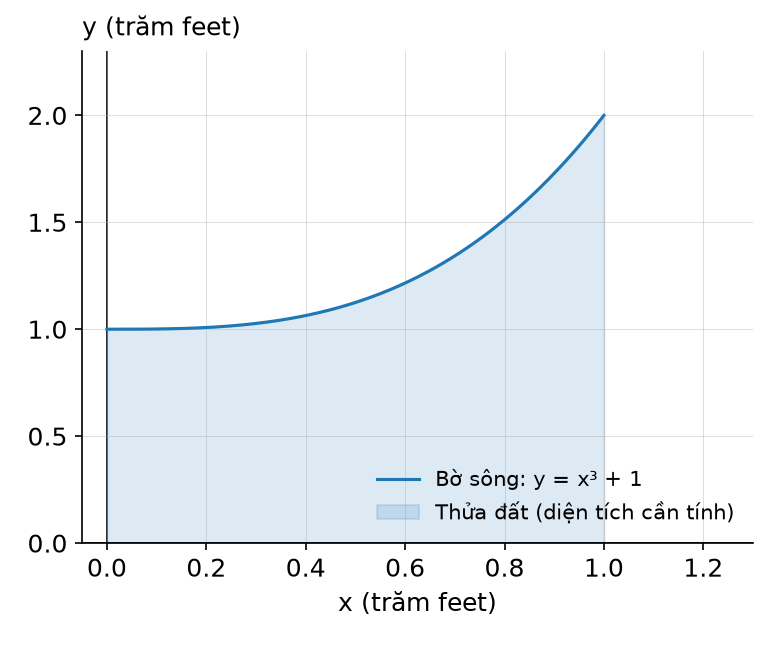

> ✅ **Lời giải (theo bài giảng):**
> - **Công thức:** diện tích miền dưới đường cong y = f(x) ≥ 0 trên [a, b] là S = ∫ₐᵇ f(x) dx.
> - **Lấy số:** chiều rộng 100 feet = 1 trăm feet ⟹ 0 ≤ x ≤ 1; f(x) = x³ + 1.
> - **Thay số:** S = ∫₀¹ (x³ + 1) dx = (x⁴/4 + x)|₀¹ = (1/4 + 1) − 0 = 5/4 = 1.25.
> - **Đổi đơn vị:** x và y đều đo bằng trăm feet ⟹ 1 đơn vị diện tích = 100 × 100 ft² ⟹ 1.25 × 100 × 100 = 12,500.
> - **Kết quả:** **S = 12,500 ft²**.
> - **Kết luận:** tổng diện tích thửa đất là 12,500 ft².
> - ⚡ **Lỗi hay gặp:** trả lời 1.25 ft² hoặc 125 ft² (chỉ nhân 100 một lần).

**Câu 51.** Sử dụng định lý cơ bản của giải tích để tìm diện tích của miền nằm dưới đường thẳng y = 2x + 1 trên đoạn 1 ≤ x ≤ 3. _(Ví dụ 8, Bài 6)_

> ✅ **Lời giải (theo bài giảng):**
> - **Công thức:** f(x) = 2x + 1 ≥ 0 và liên tục trên 1 ≤ x ≤ 3 ⟹ S = ∫₁³ (2x + 1) dx = F(3) − F(1).
> - **Nguyên hàm:** F(x) = x² + x.
> - **Thay số:** F(3) = 9 + 3 = 12; F(1) = 1 + 1 = 2 ⟹ S = 12 − 2 = 10.
> - **Kết quả:** **S = 10** (đơn vị diện tích).
> - **Kết luận:** ⚠️ (bổ sung) miền là hình thang với hai đáy f(1) = 3, f(3) = 7, chiều cao 2 ⟹ (3 + 7)·2/2 = 10, khớp.
> - ⚡ **Lỗi hay gặp:** quên kiểm tra f ≥ 0; tính F(3) − F(1) thành F(3) + F(1) = 14.

**Câu 52.** Tính các tích phân xác định: _(Ví dụ 9, Bài 6)_
- a) I₁ = ∫₀¹ (e⁻ˣ + √x) dx
- b) I₂ = ∫₁⁴ (1/x − x²) dx

> ✅ **Lời giải (theo bài giảng):**
>
> **a)**
> - **Nguyên hàm:** ∫ e⁻ˣ dx = e⁻ˣ/(−1) = −e⁻ˣ; ∫ x¹ᐟ² dx = (2/3)x³ᐟ² ⟹ F(x) = −e⁻ˣ + (2/3)x³ᐟ².
> - **Thay cận:** F(1) = −e⁻¹ + 2/3; F(0) = −e⁰ + 0 = −1.
> - **Thay số:** I₁ = (−1/e + 2/3) − (−1) = 2/3 + 1 − 1/e = 5/3 − 1/e.
> - **Kết quả:** **I₁ = 5/3 − 1/e** (⚠️ ≈ 1.2988).
>
> **b)**
> - **Nguyên hàm:** ∫ (1/x) dx = ln|x|; ∫ x² dx = x³/3 ⟹ F(x) = ln|x| − x³/3.
> - **Thay cận:** F(4) = ln 4 − 64/3; F(1) = ln 1 − 1/3 = −1/3.
> - **Thay số:** I₂ = (ln 4 − 64/3) − (−1/3) = ln 4 − 63/3 = ln 4 − 21 ≈ 1.3863 − 21.
> - **Kết quả:** **I₂ = ln 4 − 21 ≈ −19.6137**.
> - **Kết luận:** ⚠️ (bổ sung) I₂ âm vì trên [1, 4] hàm 1/x − x² âm; tích phân xác định không nhất thiết là diện tích.
> - ⚡ **Lỗi hay gặp:** a) quên F(0) = −1 (e⁰ = 1, không phải 0) ⟹ ra 2/3 − 1/e; b) quên ln 1 = 0 hoặc cộng thay vì trừ −1/3.

**Câu 53.** Cho các hàm f(x) và g(x) liên tục trên đoạn −2 ≤ x ≤ 5 và thỏa mãn các điều kiện: ∫₋₂⁵ f(x) dx = 3; ∫₋₂⁵ g(x) dx = −4; ∫₃⁵ f(x) dx = 7. Sử dụng các thông tin này để tính các tích phân sau: _(Ví dụ 10, Bài 6)_
- a) ∫₋₂⁵ [2f(x) − 3g(x)] dx
- b) ∫₋₂³ f(x) dx.

> ✅ **Lời giải (theo bài giảng):**
>
> **a)**
> - **Công thức:** quy tắc hiệu và quy tắc nhân với hằng số: ∫ₐᵇ [k·f − m·g] dx = k ∫ₐᵇ f dx − m ∫ₐᵇ g dx.
> - **Thay số:** ∫₋₂⁵ [2f(x) − 3g(x)] dx = 2 ∫₋₂⁵ f(x) dx − 3 ∫₋₂⁵ g(x) dx = 2(3) − 3(−4) = 6 + 12 = 18.
> - **Kết quả:** **18**.
>
> **b)**
> - **Công thức:** quy tắc phân đoạn ∫₋₂⁵ f = ∫₋₂³ f + ∫₃⁵ f ⟹ ∫₋₂³ f = ∫₋₂⁵ f − ∫₃⁵ f.
> - **Thay số:** ∫₋₂³ f(x) dx = 3 − 7 = −4.
> - **Kết quả:** **−4**.
> - **Kết luận:** ⚠️ (bổ sung) không cần biết f, g cụ thể, chỉ dùng tính chất tích phân xác định.
> - ⚡ **Lỗi hay gặp:** a) 2(3) − 3(−4) tính thành 6 − 12 = −6 (sai dấu); b) cộng 3 + 7 = 10 thay vì trừ.

**Câu 54.** Tính các tích phân: _(Ví dụ 11, Bài 6)_
- a) ∫₀¹ 8x(x² + 1)³ dx
- b) ∫_{1/4}^{2} (ln x / x) dx

> ✅ **Lời giải (theo bài giảng):**
>
> **a)** (cách 1: tìm nguyên hàm theo x rồi dùng định lý cơ bản)
> - **Đổi biến:** đặt u = x² + 1 ⟹ du = 2x dx ⟹ 8x dx = 4 du.
> - **Nguyên hàm:** ∫ 8x(x² + 1)³ dx = ∫ 4u³ du = u⁴ + C = (x² + 1)⁴ + C.
> - **Thay cận theo x:** (x² + 1)⁴|₀¹ = (1 + 1)⁴ − (0 + 1)⁴ = 16 − 1 = 15.
> - **Kết quả:** **15**.
>
> **b)** (cách 2: đổi cận)
> - **Đổi biến:** đặt u = ln x ⟹ du = (1/x) dx.
> - **Đổi cận:** x = 1/4 → u = ln(1/4); x = 2 → u = ln 2.
> - **Thay số:** ∫_{1/4}^{2} (ln x / x) dx = ∫_{ln(1/4)}^{ln 2} u du = (u²/2)|_{ln(1/4)}^{ln 2} = (1/2)(ln 2)² − (1/2)(ln(1/4))² = (1/2)(0.4805) − (1/2)(1.9218) ≈ 0.2402 − 0.9609.
> - **Kết quả:** **≈ −0.721**.
> - **Kết luận:** ⚠️ (bổ sung) vì ln(1/4) = −2 ln 2 nên kết quả đúng bằng (1/2)(ln 2)²(1 − 4) = −(3/2)(ln 2)² ≈ −0.721.
> - ⚡ **Lỗi hay gặp:** b) đổi sang u nhưng vẫn dùng cận 1/4 và 2; a) quên hệ số 4 (8x dx = 4 du) ⟹ ra 15/4; quên trừ (0 + 1)⁴ = 1 ⟹ ra 16.

**Câu 55.** Chi phí cận biên của một nhà máy là C'(q) = 3(q − 4)² đô la mỗi đơn vị khi mức sản xuất là q đơn vị. Nếu mức sản xuất tăng từ 6 đơn vị lên 10 đơn vị thì tổng chi phí sản xuất tăng bao nhiêu đô la? _(Ví dụ 12, Bài 6)_

> ✅ **Lời giải (theo bài giảng):**
> - **Công thức:** thay đổi ròng C(10) − C(6) = ∫₆¹⁰ C'(q) dq.
> - **Nguyên hàm:** ∫ 3(q − 4)² dq = (q − 4)³ (đặt u = q − 4, du = dq; ∫ 3u² du = u³).
> - **Thay số:** C(10) − C(6) = ∫₆¹⁰ 3(q − 4)² dq = (q − 4)³|₆¹⁰ = (10 − 4)³ − (6 − 4)³ = 216 − 8 = 208.
> - **Kết quả:** **$208**.
> - **Kết luận:** ⚠️ (bổ sung) khi mức sản xuất tăng từ 6 lên 10 đơn vị, tổng chi phí tăng $208.
> - ⚡ **Lỗi hay gặp:** tính C'(10) − C'(6) = 108 − 12 = 96 (lấy hiệu chi phí cận biên thay vì tích phân); chỉ tính (10 − 4)³ = 216 mà quên trừ cận dưới.

**Câu 56.** Một khối protein có khối lượng m (g) phân hủy thành các axít amin với tốc độ: dm/dt = −30/(t + 3)² (g/giờ). Mức thay đổi khối lượng ròng của khối protein này trong 2 giờ đầu là bao nhiêu? _(Ví dụ 13, Bài 6)_

> ✅ **Lời giải (theo bài giảng):**
> - **Công thức:** thay đổi ròng m(2) − m(0) = ∫₀² (dm/dt) dt = ∫₀² (−30/(t + 3)²) dt.
> - **Đổi biến:** đặt u = t + 3 ⟹ du = dt.
> - **Đổi cận:** t = 0 → u = 3; t = 2 → u = 5.
> - **Nguyên hàm:** ∫ −30u⁻² du = −30·u⁻¹/(−1) = 30/u.
> - **Thay số:** ∫₃⁵ −30u⁻² du = (30/u)|₃⁵ = 30/5 − 30/3 = 6 − 10 = −4.
> - **Kết quả:** **−4 (g)**.
> - **Kết luận:** ⚠️ (bổ sung) trong 2 giờ đầu, khối lượng khối protein giảm 4 g.
> - ⚡ **Lỗi hay gặp:** nguyên hàm sai dấu (ra −30/u ⟹ +4); quên đổi cận, thay t = 0, 2 vào 30/u (chia cho 0); trả lời "4 g" mà không nói là giảm.

## Bài 7 — Ví dụ trong bài giảng

> Nguồn: [Bài 7 — Phép toán tích phân (Phần 2)](tai-lieu/bai-7-phep-toan-tich-phan-phan-2.pdf). Lời giải theo bài giảng, bổ sung bước trung gian.

**Câu 57.** Tìm diện tích của miền bị giới hạn bởi các đường cong y = x³ và y = x². _(Ví dụ 1, Bài 7)_

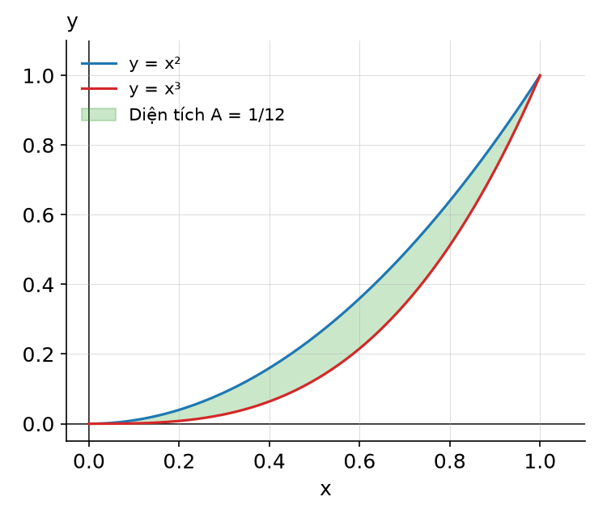

> ✅ **Lời giải (theo bài giảng):**
> - **Công thức:** A = ∫ₐᵇ [f(x) − g(x)] dx với f(x) ≥ g(x) trên [a, b].
> - **Bước 1 – giao điểm:** x³ = x² ⇔ x²(x − 1) = 0 ⇔ x = 0 hoặc x = 1 ⇒ cận [0, 1].
> - **Bước 2 – đường nằm trên:** thử x = 0.5: x² = 0.25 > x³ = 0.125 ⇒ trên [0, 1], y = x² nằm trên, y = x³ nằm dưới.
> - **Thay số:** A = ∫₀¹ (x² − x³) dx = [x³/3 − x⁴/4]₀¹ = 1/3 − 1/4.
> - **Kết quả:** **A = 1/12** (≈ 0.0833).
> - ⚡ **Lỗi hay gặp:** lấy ∫₀¹ (x³ − x²) dx = −1/12 (trừ ngược); bỏ qua bước tìm giao điểm nên không có cận.

**Câu 58.** Giả sử t năm sau kể từ bây giờ, một dự án đầu tư sẽ sinh lợi với tốc độ P₁'(t) = 50 + t² trăm đô la mỗi năm, trong khi đó, dự án đầu tư thứ hai sẽ sinh lợi với tốc độ P₂'(t) = 200 + 5t trăm đô la mỗi năm. _(Ví dụ 2, Bài 7)_
- a) Tốc độ sinh lợi của dự án thứ hai cao hơn dự án thứ nhất trong bao nhiêu năm?
- b) Tính lợi nhuận vượt trội ròng trong khoảng thời gian được tính ở phần (a). Biểu diễn giá trị của lợi nhuận vượt trội ròng bằng diện tích.

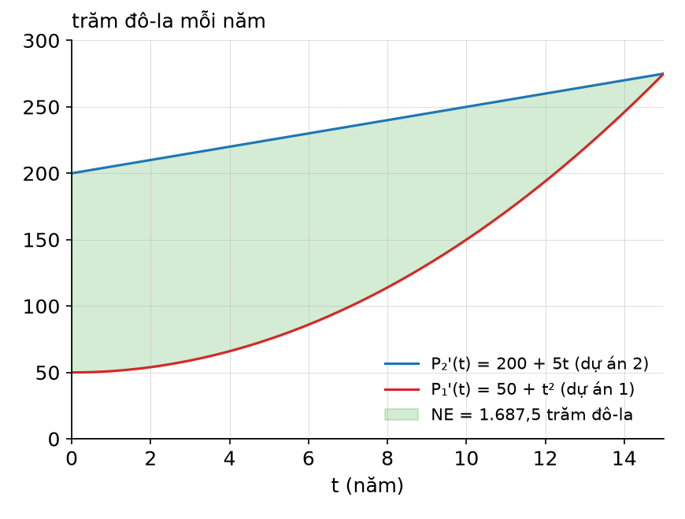

> ✅ **Lời giải (theo bài giảng):**
> **a)**
> - **Điều kiện:** P₂'(t) > P₁'(t) ⇔ 200 + 5t > 50 + t² ⇔ t² − 5t − 150 < 0.
> - **Giải:** t² − 5t − 150 = 0 có Δ = 25 + 600 = 625 ⇒ t = (5 ± 25)/2 ⇒ t = 15 hoặc t = −10 ⇒ (t − 15)(t + 10) < 0 ⇔ −10 < t < 15.
> - **Kết quả:** với t ≥ 0 thì 0 ≤ t < 15 ⇒ dự án thứ hai sinh lợi nhanh hơn trong **15 năm**.
>
> **b)**
> - **Công thức:** NE = E(15) − E(0) = ∫₀¹⁵ E'(t) dt = ∫₀¹⁵ [P₂'(t) − P₁'(t)] dt.
> - **Rút gọn hàm dưới dấu tích phân:** (200 + 5t) − (50 + t²) = 150 + 5t − t².
> - **Nguyên hàm:** ∫ (150 + 5t − t²) dt = 150t + 5t²/2 − t³/3.
> - **Thay số:** tại t = 15: 150(15) + 5(225)/2 − 3,375/3 = 2,250 + 562.5 − 1,125 = 1,687.5; tại t = 0: 0.
> - **Kết quả:** **NE = 1,687.5 trăm đô la = $168,750**.
> - **Biểu diễn bằng diện tích:** NE là diện tích miền nằm giữa đường y = P₂'(t) = 200 + 5t (phía trên) và y = P₁'(t) = 50 + t² (phía dưới) trên đoạn 0 ≤ t ≤ 15.
> - ⚡ **Lỗi hay gặp:** quên đơn vị "trăm đô la" (ghi $1,687.5); lấy nghiệm t = −10; nhầm cận N là lúc P₁ = P₂ thay vì P₁' = P₂'.

**Câu 59.** Một cơ quan của chính phủ xác định rằng, đường cong Lorenz đối với phân phối thu nhập của nha sỹ và nhà thầu ở một bang được cho bởi các hàm: L₁(x) = x^{1.7}, L₂(x) = 0.8x² + 0.2x. Ngành nghề nào có phân phối thu nhập công bằng hơn? _(Ví dụ 3, Bài 7)_

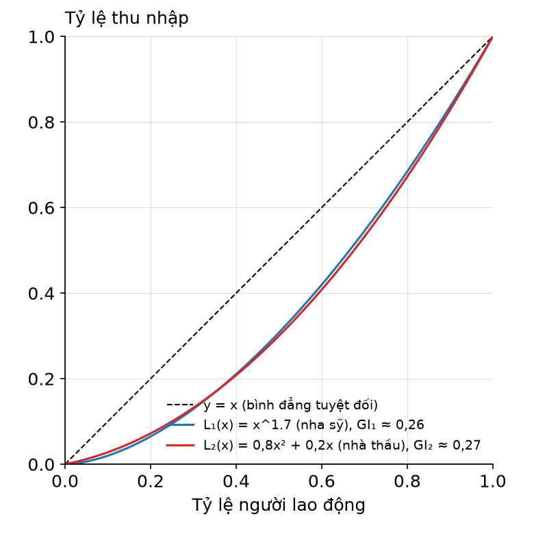

> ✅ **Lời giải (theo bài giảng):**
> - **Công thức:** GI = 2∫₀¹ [x − L(x)] dx; tính Gini của từng ngành rồi so sánh.
> - **Nha sỹ:** GI₁ = 2∫₀¹ [x − x^{1.7}] dx = 2[x²/2 − x^{2.7}/2.7]₀¹ = 2(1/2 − 1/2.7) = 2(0.5 − 0.3704) = 2(0.1296) ≈ **0.2593**.
> - **Nhà thầu:** x − L₂(x) = x − 0.8x² − 0.2x = 0.8x − 0.8x². GI₂ = 2∫₀¹ (0.8x − 0.8x²) dx = 2[0.4x² − 0.8x³/3]₀¹ = 2(0.4 − 0.2667) = 2(0.1333) ≈ **0.2667**.
> - **So sánh:** GI₁ = 0.2593 < GI₂ = 0.2667.
> - **Kết luận:** phân phối thu nhập của các **nha sỹ công bằng hơn** phân phối thu nhập của các nhà thầu.
> - ⚡ **Lỗi hay gặp:** quên nhân 2 (ra 0.1296 và 0.1333 — vẫn đúng thứ tự nhưng sai giá trị Gini); kết luận ngành có Gini lớn hơn là công bằng hơn; nguyên hàm x^{1.7} viết sai thành x^{2.7}/1.7.

**Câu 60.** Một nhà sản xuất xác định rằng t tháng sau khi giới thiệu một sản phẩm mới, doanh số của công ty là S(t) = 750t/√(4t² + 25) nghìn đô la. Tìm doanh số trung bình tháng của công ty trong 6 tháng đầu tiên sau khi giới thiệu sản phẩm mới. _(Ví dụ 4, Bài 7)_

> ✅ **Lời giải (theo bài giảng):**
> - **Công thức:** V = (1/(b − a)) ∫ₐᵇ S(t) dt với a = 0, b = 6.
> - **Tính tích phân (đổi biến):** đặt u = 4t² + 25 ⇒ du = 8t dt ⇒ t dt = du/8. ∫ 750t/√(4t² + 25) dt = (750/8)∫ u^{−1/2} du = (750/8)(2√u) = 187.5√(4t² + 25).
> - **Thay cận:** t = 6: √(144 + 25) = √169 = 13; t = 0: √25 = 5 ⇒ ∫₀⁶ S(t) dt = 187.5(13 − 5) = 1,500.
> - **Thay số:** V = (1/(6 − 0))·1,500 = 1,500/6.
> - **Kết quả:** **V = 250 nghìn đô la mỗi tháng**.
> - **Kết luận:** trong 6 tháng đầu, doanh số trung bình của công ty là 250 nghìn đô la mỗi tháng.
> - ⚡ **Lỗi hay gặp:** quên chia cho 6 (ra 1,500 là tổng doanh số 6 tháng); đổi biến quên hệ số 1/8.

**Câu 61.** Yuanxi có một niên kim trả 1,200 đô la mỗi năm và sinh lợi với lãi suất hàng năm 8%, được tính gộp liên tục. Tài khoản của Yuanxi có giá trị bao nhiêu vào thời điểm cuối 2 năm? Giả sử rằng niên kim được trả liên tục vào tài khoản. _(Ví dụ 5, Bài 7)_

> ✅ **Lời giải (theo bài giảng):**
> - **Công thức:** FV = ∫₀ᵀ f(t) e^{r(T − t)} dt.
> - **Lấy số:** f(t) = 1,200; T = 2; r = 0.08.
> - **Thay số:** FV = ∫₀² 1,200 e^{0.08(2 − t)} dt = 1,200e^{0.16} ∫₀² e^{−0.08t} dt = 1,200e^{0.16}·[e^{−0.08t}/(−0.08)]₀² = 1,200e^{0.16}·(1 − e^{−0.16})/0.08 = 15,000(e^{0.16} − 1).
> - **Tính:** e^{0.16} ≈ 1.17351 ⇒ FV ≈ 15,000(0.17351).
> - **Kết quả:** **FV ≈ 2,602.66 đô la**.
> - **Kết luận:** cuối 2 năm, tài khoản của Yuanxi có giá trị khoảng 2,602.66 đô la.
> - ⚡ **Lỗi hay gặp:** dùng công thức PV (e^{−rt}) ra ≈ 2,217.84; lấy 1,200 × 2 = 2,400 (bỏ qua tiền lãi); viết e^{0.08(t − 2)} sai dấu.

**Câu 62.** June đang phải đưa ra quyết định lựa chọn một trong hai dự án đầu tư. Dự án thứ nhất phải chi 9,000 đô la và được kỳ vọng tạo ra dòng thu nhập liên tục với tốc độ f₁(t) = 3,000e^{0.03t} đô la mỗi năm. Dự án thứ hai là một niên kim mà cô ấy phải trả 12,000 đô la, dự án này dự kiến tạo ra dòng thu nhập với tốc độ hằng f₂(t) = 4,000 đô la mỗi năm. Nếu lãi suất hiện hành cố định ở mức 5% mỗi năm và được tính gộp liên tục thì dự án nào tốt hơn trong khoảng thời gian 5 năm? _(Ví dụ 6, Bài 7)_

> ✅ **Lời giải (theo bài giảng):**
> - **Công thức:** giá trị ròng của dự án trong T năm = PV − C, với PV = ∫₀ᵀ f(t) e^{−rt} dt, C là chi phí ban đầu.
> - **Lấy số:** r = 0.05; T = 5; C₁ = 9,000; C₂ = 12,000.
> - **Dự án 1:** gộp mũ (3,000e^{0.03t})e^{−0.05t} = 3,000e^{−0.02t}. PV₁ = ∫₀⁵ 3,000e^{−0.02t} dt = 3,000·[e^{−0.02t}/(−0.02)]₀⁵ = 150,000(1 − e^{−0.1}) ≈ 150,000(0.095163) ≈ 14,274.39 ⇒ PV₁ − C₁ = 14,274.39 − 9,000 = **5,274.39 đô la**.
> - **Dự án 2:** PV₂ = ∫₀⁵ 4,000e^{−0.05t} dt = 4,000·[e^{−0.05t}/(−0.05)]₀⁵ = 80,000(1 − e^{−0.25}) ≈ 80,000(0.221199) ≈ 17,695.94 ⇒ PV₂ − C₂ = 17,695.94 − 12,000 = **5,695.94 đô la**.
> - **So sánh:** 5,695.94 > 5,274.39.
> - **Kết luận:** **dự án thứ hai** là dự án đầu tư tốt hơn.
> - ⚡ **Lỗi hay gặp:** cộng mũ sai thành e^{0.08t} hoặc e^{−0.08t}; dùng FV thay cho PV; so sánh PV mà quên trừ chi phí ban đầu.

**Câu 63.** Rashid là quản lý một trang trại. Anh ấy xác định rằng q tấn ngũ cốc sẽ được bán khi giá là p = 10(25 − q²) đô la mỗi tấn. Tìm tổng số tiền người mua sẵn lòng chi trả cho 3 tấn ngũ cốc. _(Ví dụ 7, Bài 7)_

> ✅ **Lời giải (theo bài giảng):**
> - **Công thức:** WS = ∫₀^{q₀} D(q) dq với D(q) = 10(25 − q²), q₀ = 3.
> - **Nguyên hàm:** ∫ 10(25 − q²) dq = 10(25q − q³/3).
> - **Thay số:** WS = 10[25q − q³/3]₀³ = 10(75 − 27/3) = 10(75 − 9) = 10(66).
> - **Kết quả:** **WS = 660 đô la**.
> - **Kết luận:** người tiêu dùng sẵn lòng trả cho Rashid 660 đô la để mua 3 tấn ngũ cốc.
> - ⚡ **Lỗi hay gặp:** trừ thêm p₀q₀ (nhầm với thặng dư tiêu dùng); tính giá p(3) = 160 rồi nhân 3 = 480 (nhầm số tiền chi thực tế với mức sẵn lòng chi).

**Câu 64.** Một nhà sản xuất lốp xe ước tính rằng q (nghìn) lốp sẽ được các nhà bán buôn mua khi giá là p = D(q) = −0.1q² + 90 đô la mỗi chiếc. Mặt khác, cùng số lượng lốp như thế sẽ được nhà sản xuất cung cấp khi giá là p = S(q) = 0.2q² + q + 50 đô la mỗi chiếc. _(Ví dụ 8, Bài 7)_
- a) Tìm mức giá cân bằng và lượng cung, lượng cầu ở mức giá đó.
- b) Xác định thặng dư của người tiêu dùng và thặng dư của nhà sản xuất tại mức giá cân bằng.

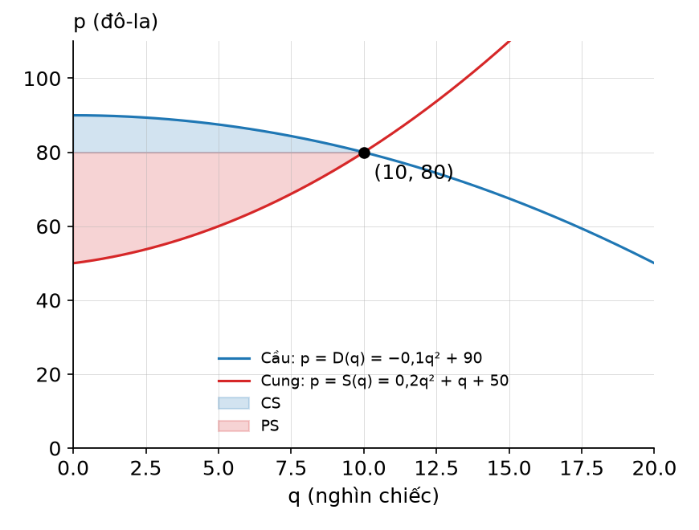

> ✅ **Lời giải (theo bài giảng):**
> **a)**
> - **Điều kiện cân bằng:** S(q) = D(q) ⇔ 0.2q² + q + 50 = −0.1q² + 90 ⇔ 0.3q² + q − 40 = 0.
> - **Giải:** Δ = 1 + 4(0.3)(40) = 49 ⇒ q = (−1 ± 7)/0.6 ⇒ q = 10 hoặc q ≈ −13.33 (loại vì q ≥ 0).
> - **Giá:** p₀ = D(10) = −0.1(100) + 90 = 80; kiểm tra S(10) = 0.2(100) + 10 + 50 = 80.
> - **Kết quả:** **q₀ = 10 nghìn lốp xe** (lượng cung = lượng cầu), **p₀ = 80 đô la** mỗi chiếc.
>
> **b)**
> - **Công thức:** CS = ∫₀^{q₀} D(q) dq − p₀q₀; PS = p₀q₀ − ∫₀^{q₀} S(q) dq; p₀q₀ = (10)(80) = 800.
> - **CS:** ∫₀¹⁰ (−0.1q² + 90) dq = [−0.1q³/3 + 90q]₀¹⁰ = −100/3 + 900 ≈ 866.67 ⇒ CS = 866.67 − 800 ≈ **66.67 nghìn đô la**.
> - **PS:** ∫₀¹⁰ (0.2q² + q + 50) dq = [0.2q³/3 + q²/2 + 50q]₀¹⁰ = 200/3 + 50 + 500 ≈ 616.67 ⇒ PS = 800 − 616.67 ≈ **183.33 nghìn đô la**.
> - **Đơn vị:** q tính bằng nghìn lốp, p bằng đô la/chiếc ⇒ CS, PS tính bằng nghìn đô la.
> - **Kết luận:** ⚠️ (bổ sung) tại giá cân bằng 80 đô la, người tiêu dùng được lợi khoảng 66,670 đô la, nhà sản xuất được lợi khoảng 183,330 đô la.
> - ⚡ **Lỗi hay gặp:** giữ nghiệm âm; tính PS = ∫ S(q) dq − p₀q₀ (ngược dấu, ra số âm); quên đơn vị nghìn đô la; tính p₀ chỉ từ một hàm mà không kiểm tra hàm còn lại.

## Bài 8 — Ví dụ trong bài giảng

> Nguồn: [Bài 8 — Một số chủ đề tích phân chọn lọc (Phần 1)](tai-lieu/bai-8-chu-de-tich-phan-chon-loc-phan-1.pdf). Lời giải theo bài giảng, bổ sung bước trung gian.

**Câu 65.** Sử dụng phương pháp tích phân từng phần để tính tích phân: ∫ x² ln x dx _(Ví dụ 1, Bài 8)_

> ✅ **Lời giải (theo bài giảng):**
> - **Công thức:** ∫ u dv = uv − ∫ v du.
> - **Chọn u, dv:** u = ln x, dv = x² dx ⟹ du = (1/x) dx, v = ∫ x² dx = x³/3.
> - **Thay vào công thức:** ∫ x² ln x dx = (ln x)(x³/3) − ∫ (x³/3)(1/x) dx = (1/3)x³ ln x − (1/3)∫ x² dx.
> - **Tính ∫ v du:** (1/3)∫ x² dx = (1/3)(x³/3) = x³/9.
> - **Kết quả:** **∫ x² ln x dx = (1/3)x³ ln x − (1/9)x³ + C**.
> - **Kiểm tra:** ⚠️ (bổ sung) đạo hàm: x² ln x + (1/3)x³·(1/x) − (1/3)x² = x² ln x. Trùng công thức 25 trong bảng tích phân với m = 2.
> - ⚡ **Lỗi hay gặp:** chọn u = x², dv = ln x dx (phải tính ∫ ln x dx trước, rối hơn); quên rút gọn (x³/3)(1/x) = x²/3; quên + C.

**Câu 66.** Tính tích phân I = ∫₀¹ (2x + 1)e^{3x} dx _(Ví dụ 2, Bài 8)_

> ✅ **Lời giải (theo bài giảng):**
> - **Công thức:** ∫ₐᵇ u dv = uv|ₐᵇ − ∫ₐᵇ v du.
> - **Chọn u, dv:** u = 2x + 1, dv = e^{3x} dx ⟹ du = 2 dx, v = ∫ e^{3x} dx = (1/3)e^{3x}.
> - **Thay vào công thức:** I = (2x + 1)(e^{3x}/3)|₀¹ − ∫₀¹ (e^{3x}/3)·2 dx = (2x + 1)(e^{3x}/3)|₀¹ − (2/3)(e^{3x}/3)|₀¹.
> - **Thay cận phần uv:** x = 1: 3·(e³/3) = e³; x = 0: 1·(e⁰/3) = 1/3 ⇒ e³ − 1/3.
> - **Thay cận phần ∫ v du:** (2/9)(e³ − e⁰) = (2/9)e³ − 2/9.
> - **Gộp:** I = e³ − 1/3 − (2/9)e³ + 2/9 = (7/9)e³ − 1/9.
> - **Kết quả:** **I = (7e³ − 1)/9** ≈ 15.51.
> - ⚡ **Lỗi hay gặp:** v = 3e^{3x} (lấy đạo hàm thay vì nguyên hàm); quên trừ giá trị tại cận 0 (e⁰ = 1, không phải 0); sai dấu khi mở ngoặc − (2/9)(e³ − 1).

**Câu 67.** Sử dụng phương pháp tích phân từng phần để tìm diện tích miền phẳng giới hạn bởi đường cong y = ln x, trục hoành và đường thẳng x = e. _(Ví dụ 3, Bài 8)_

> ✅ **Lời giải (theo bài giảng):**
> - **Xác định cận:** ln x = 0 ⇔ x = 1; ln x ≥ 0 khi 1 ≤ x ≤ e ⇒ A = ∫₁ᵉ ln x dx.
> - **Chọn u, dv:** u = ln x, dv = dx ⟹ du = (1/x) dx, v = x.
> - **Thay vào công thức:** A = x ln x|₁ᵉ − ∫₁ᵉ x·(1/x) dx = x ln x|₁ᵉ − ∫₁ᵉ dx = x ln x|₁ᵉ − x|₁ᵉ.
> - **Thay số:** [e ln e − 1·ln 1] − [e − 1] = (e − 0) − e + 1.
> - **Kết quả:** **A = 1** (đơn vị diện tích).
> - ⚡ **Lỗi hay gặp:** lấy cận dưới x = 0 (ln x không xác định tại 0; đường cong cắt trục hoành tại x = 1); quên v = x khi dv = dx.

**Câu 68.** Raza đang xem xét một khoản đầu tư trong 5 năm. Cô ấy ước tính rằng t năm sau kể từ bây giờ, khoản đầu tư sẽ tạo ra một dòng thu nhập liên tục với tốc độ 3,000 + 50t đô la mỗi năm. Nếu lãi suất hiện hành giữ ổn định ở mức 4% mỗi năm, được tính gộp liên tục trong suốt khoảng thời gian 5 năm thì khoản đầu tư của cô ấy có giá trị bao nhiêu ở thời điểm 5 năm sau kể từ bây giờ? _(Ví dụ 4, Bài 8)_

> ✅ **Lời giải (theo bài giảng):**
> - **Công thức:** giá trị khoản đầu tư sau 5 năm là giá trị tương lai FV = ∫₀ᵀ f(t)e^{r(T − t)} dt.
> - **Lấy số:** f(t) = 3,000 + 50t; r = 0.04; T = 5 ⇒ FV = ∫₀⁵ (3,000 + 50t)e^{0.04(5 − t)} dt.
> - **Chọn u, dv:** u = 3,000 + 50t, dv = e^{0.04(5 − t)} dt ⟹ du = 50 dt, v = e^{0.04(5 − t)}/(−0.04) = −25e^{0.04(5 − t)}.
> - **Thay vào công thức:** FV = (3,000 + 50t)(−25e^{0.04(5 − t)})|₀⁵ − ∫₀⁵ 50(−25e^{0.04(5 − t)}) dt = (−75,000 − 1,250t)e^{0.04(5 − t)}|₀⁵ + 1,250[e^{0.04(5 − t)}/(−0.04)]|₀⁵.
> - **Phần uv:** t = 5: (−75,000 − 6,250)e⁰ = −81,250; t = 0: −75,000e^{0.2} ≈ −91,605.21 ⇒ −81,250 − (−91,605.21) ≈ 10,355.21.
> - **Phần tích phân:** 1,250·(−25)[e⁰ − e^{0.2}] = −31,250(1 − 1.221403) ≈ 6,918.84.
> - **Kết quả:** **FV ≈ 10,355.21 + 6,918.84 ≈ 17,274.04**.
> - **Kết luận:** 5 năm sau kể từ bây giờ, khoản đầu tư của Raza có giá trị **$17,274**.
> - ⚡ **Lỗi hay gặp:** viết v = 25e^{0.04(5 − t)} (mất dấu âm); dùng e^{−rt} (công thức PV) thay cho e^{r(T − t)}; thay cận t = 5 mà quên e^{0.04(5 − 5)} = e⁰ = 1.

**Câu 69.** Sử dụng bảng tích phân để tính tích phân sau: I = ∫ 1/(6 − 3x²) dx _(Ví dụ 5, Bài 8)_

> ✅ **Lời giải (theo bài giảng):**
> - **Biến đổi:** 1/(6 − 3x²) = (1/3)·1/(2 − x²) ⇒ dạng a² − u² với a² = 2 ⇒ **a = √2**, u = x.
> - **Công thức (16):** ∫ du/(a² − u²) = (1/(2a)) ln|(a + u)/(a − u)| + C.
> - **Thay số:** ∫ 1/(6 − 3x²) dx = (1/3)∫ 1/(2 − x²) dx = (1/3)·(1/(2√2)) ln|(√2 + x)/(√2 − x)| + C.
> - **Kết quả:** **I = (1/3)(1/(2√2)) ln|(√2 + x)/(√2 − x)| + C** (⚠️ rút gọn: hệ số = 1/(6√2) = √2/12; slide để nguyên).
> - ⚡ **Lỗi hay gặp:** lấy a = 2 (ra 1/4 thay vì 1/(2√2)); quên hệ số 1/3 rút ra ngoài; chọn nhầm nhóm u² − a² (công thức 20, 21).

**Câu 70.** Vào lúc 6 giờ sáng, hai nhân viên phòng dịch vụ khách hàng của một công ty môi giới chứng khoán nghe tin đồn rằng một loại cổ phiếu mới sẽ được chào bán vào buổi trưa. Tin đồn lan truyền khắp 26 nhân viên của phòng dịch vụ khách hàng với tốc độ dN/dt = 0.025N(26 − N), với N(t) là số nhân viên phòng khách hàng đã nghe tin đồn vào t giờ sau kể từ lúc 6 giờ sáng. _(Ví dụ 6, Bài 8)_
- a) Tìm N(t).
- b) Đến giữa trưa, có bao nhiêu nhân viên phòng dịch vụ khách hàng chưa nghe tin đồn?

> ✅ **Lời giải (theo bài giảng):**
> **a)**
> - **Tách biến, lấy tích phân hai vế:** ∫ dN/(N(26 − N)) = ∫ 0.025 dt.
> - **Công thức 6** với u = N, a = 26, b = −1: (1/26) ln|N/(26 − N)| = 0.025t + C₁.
> - **Nhân hai vế với 26:** ln|N/(26 − N)| = 0.65t + 26C₁ (0.025 × 26 = 0.65).
> - **Mũ hoá:** N/(26 − N) = e^{0.65t}·e^{26C₁} = Ce^{0.65t} (đặt C = e^{26C₁}).
> - **Rút N:** N = (26 − N)Ce^{0.65t} ⇒ N(1 + Ce^{0.65t}) = 26Ce^{0.65t} ⇒ N(t) = 26Ce^{0.65t}/(1 + Ce^{0.65t}).
> - **Điều kiện ban đầu N(0) = 2:** 2 = 26C/(1 + C) ⇒ 2(1 + C) = 26C ⇒ 2 = 24C ⇒ C = 1/12.
> - **Kết quả:** N(t) = 26(1/12)e^{0.65t}/(1 + (1/12)e^{0.65t}) ⇒ **N(t) = 26e^{0.65t}/(12 + e^{0.65t})** (nhân tử và mẫu với 12).
>
> **b)**
> - **Lấy số:** giữa trưa là 6 giờ sau 6 giờ sáng ⇒ t = 6; 0.65 × 6 = 3.9.
> - **Thay số:** e^{3.9} ≈ 49.40 ⇒ N(6) = 26(49.40)/(12 + 49.40) ≈ 1,284.46/61.40 ≈ 20.92 ≈ 21.
> - **Kết quả:** đã có **21** người nghe ⇒ còn 26 − 21 = **5 nhân viên** chưa nghe tin đồn.
> - **Kết luận:** đến giữa trưa, có 5 nhân viên phòng dịch vụ khách hàng chưa nghe tin đồn.
> - ⚡ **Lỗi hay gặp:** để số mũ 0.025t (quên nhân 26); lấy t = 12 (giờ trưa) thay vì t = 6; trả lời 21 (số đã nghe) thay vì 5; bỏ mẫu (1 + C) khi thay N(0) = 2 nên ra C = 1/13 thay vì 1/12.

## Bài 9 — Ví dụ trong bài giảng

> Nguồn: [Bài 9 — Một số chủ đề tích phân chọn lọc (Phần 2)](tai-lieu/bai-9-chu-de-tich-phan-chon-loc-phan-2.pdf). Lời giải theo bài giảng, bổ sung bước trung gian.

**Câu 71.** Sử dụng quy tắc hình thang để tính gần đúng tích phân ∫₁² (eˣ/x) dx với n = 5. _(Ví dụ 1, Bài 9)_

> ✅ **Lời giải (theo bài giảng):**
> - **Công thức:** ∫ₐᵇ f(x) dx ≈ (Δx/2)[f(x₁) + 2f(x₂) + ⋯ + 2f(xₙ) + f(xₙ₊₁)], Δx = (b − a)/n.
> - **Lấy số:** f(x) = eˣ/x liên tục trên [1; 2]. a = 1, b = 2, n = 5 → Δx = (2 − 1)/5 = 0.2. Điểm chia: x₁ = 1 < x₂ = 1.2 < x₃ = 1.4 < x₄ = 1.6 < x₅ = 1.8 < x₆ = 2.
> - **Giá trị hàm:** f(1) = e¹/1 ≈ 2.71828; f(1.2) = e^{1.2}/1.2 ≈ 2.76676; f(1.4) = e^{1.4}/1.4 ≈ 2.89657; f(1.6) = e^{1.6}/1.6 ≈ 3.09565; f(1.8) = e^{1.8}/1.8 ≈ 3.36092; f(2) = e²/2 ≈ 3.69453.
> - **Thay số:** ∫₁² (eˣ/x) dx ≈ (0.2/2)[e¹/1 + 2e^{1.2}/1.2 + 2e^{1.4}/1.4 + 2e^{1.6}/1.6 + 2e^{1.8}/1.8 + e²/2]
>   = 0.1 × [2.71828 + 2(2.76676 + 2.89657 + 3.09565 + 3.36092) + 3.69453]
>   = 0.1 × [2.71828 + 2 × 12.11990 + 3.69453] = 0.1 × 30.65261.
> - **Kết quả:** **≈ 3.0653** (3.065260).
> - **Kết luận:** ⚠️ (bổ sung) Slide dừng ở dấu "≈", không ghi kết quả số; kết quả trên là tính lại.
> - ⚡ **Lỗi hay gặp:** chia 6 đoạn vì đếm 6 điểm (n = 5 đoạn, 6 điểm); quên hệ số 2 ở 4 điểm bên trong; nhân Δx thay vì Δx/2.

**Câu 72.** Sử dụng quy tắc Simpson để tính gần đúng tích phân ∫₁² (eˣ/x) dx với n = 4. _(Ví dụ 2, Bài 9)_

> ✅ **Lời giải (theo bài giảng):**
> - **Công thức:** n chẵn, ∫ₐᵇ f(x) dx ≈ (Δx/3)[f(x₁) + 4f(x₂) + 2f(x₃) + 4f(x₄) + f(x₅)] (với n = 4).
> - **Lấy số:** f(x) = eˣ/x liên tục trên [1; 2]. n = 4 → Δx = (2 − 1)/4 = 0.25. Điểm chia: x₁ = 1 < x₂ = 1.25 < x₃ = 1.5 < x₄ = 1.75 < x₅ = 2.
> - **Giá trị hàm:** f(1) ≈ 2.71828; f(1.25) = e^{1.25}/1.25 ≈ 2.79227; f(1.5) = e^{1.5}/1.5 ≈ 2.98779; f(1.75) = e^{1.75}/1.75 ≈ 3.28834; f(2) ≈ 3.69453.
> - **Thay số:** ∫₁² (eˣ/x) dx ≈ (0.25/3)[e¹/1 + 4e^{1.25}/1.25 + 2e^{1.5}/1.5 + 4e^{1.75}/1.75 + e²/2]
>   = (0.25/3) × [2.71828 + 4(2.79227 + 3.28834) + 2(2.98779) + 3.69453]
>   = (0.25/3) × [2.71828 + 24.32244 + 5.97558 + 3.69453] = (0.25/3) × 36.71083.
> - **Kết quả:** **≈ 3.059239**.
> - **Kết luận:** ⚠️ (bổ sung) Giá trị đúng của tích phân ≈ 3.059117: Simpson với n = 4 sát hơn hình thang với n = 5 (3.0653).
> - ⚡ **Lỗi hay gặp:** dùng hệ số hình thang (1, 2, 2, 2, 1) hoặc nhân Δx/2; đặt hệ số 4 vào x₃ (điểm giữa) thay vì x₂, x₄. Làm tròn trung gian 5 chữ số cho 3.05924, vẫn khớp slide.

**Câu 73.** Jack cần tính diện tích bể bơi để mua tấm bạt che cho bể bơi có hình dạng sau: [hình bể bơi; trục ngang đánh dấu 0, 4, 8, 12, 16, 20, 24, 28, 32, 36; các độ rộng đo được ghi trên hình lần lượt là 0, 9, 10, 8, 7, 10, 12, 13, 11, 0]. Giả sử Jack thực hiện phép đo được thể hiện như hình trên tại các điểm cách đều nhau 4 feet. Anh ấy có thể sử dụng quy tắc hình thang để tính diện tích của bể bơi này như thế nào? _(Ví dụ 3, Bài 9)_

> ✅ **Lời giải (theo bài giảng):**
> - **Mô hình:** chia bể thành hai nửa. Bờ trên là đồ thị f(x), bờ dưới là đồ thị g(x) trên [0; 36]. Diện tích S = ∫₀³⁶ [f(x) − g(x)] dx = ∫₀³⁶ h(x) dx, h(x) là độ rộng đo được.
> - **Lấy số (bảng):**
>
>   | x | 0 | 4 | 8 | 12 | 16 | 20 | 24 | 28 | 32 | 36 |
>   |---|---|---|---|---|---|---|---|---|---|---|
>   | h(x) | 0 | 9 | 10 | 8 | 7 | 10 | 12 | 13 | 11 | 0 |
>
> - **Công thức:** hình thang với Δx = 4, n = 36/4 = 9: S ≈ (Δx/2)[h(0) + 2h(4) + 2h(8) + 2h(12) + 2h(16) + 2h(20) + 2h(24) + 2h(28) + 2h(32) + h(36)].
> - **Thay số:** S ≈ (4/2)[0 + 2(9) + 2(10) + 2(8) + 2(7) + 2(10) + 2(12) + 2(13) + 2(11) + 0] = 2 × [2 × (9 + 10 + 8 + 7 + 10 + 12 + 13 + 11)] = 2 × (2 × 80) = 2 × 160.
> - **Kết quả:** **S ≈ 320 feet vuông**.
> - **Kết luận:** Diện tích bể bơi của Jack xấp xỉ 320 feet vuông.
> - ⚡ **Slide ghi** "… + 2h(28) + h(32) + h(36)" (in nhầm, đúng là 2h(32)); dòng thay số đã dùng 2(11), kết luận không đổi.
> - ⚡ **Lỗi hay gặp:** lấy n = 10 (đếm số lần đo) thay vì n = 9 khoảng; quên nhân Δx/2 = 2. ⚠️ (bổ sung) n = 9 lẻ nên không dùng được Simpson.

**Câu 74.** Tích phân suy rộng I = ∫₁^{+∞} (1/x²) dx hội tụ hay phân kỳ? _(Ví dụ 4, Bài 9)_

> ✅ **Lời giải (theo bài giảng):**
> - **Công thức:** ∫ₐ^{+∞} f(x) dx = lim_{N→+∞} ∫ₐᴺ f(x) dx.
> - **Nguyên hàm:** ∫ x⁻² dx = x⁻¹/(−1) = −1/x.
> - **Thay số:** I = lim_{N→+∞} ∫₁ᴺ x⁻² dx = lim_{N→+∞} (−1/x)|₁ᴺ = lim_{N→+∞} [(−1/N) − (−1/1)] = lim_{N→+∞} (1 − 1/N). Khi N → +∞, 1/N → 0.
> - **Kết quả:** **I = 1**.
> - **Kết luận:** Giới hạn hữu hạn nên tích phân suy rộng đã cho **hội tụ**.
> - ⚡ **Lỗi hay gặp:** sai dấu nguyên hàm (viết 1/x); thay cận ngược (1/N − 1 = −1).

**Câu 75.** Tích phân suy rộng I = ∫₀^{+∞} x e^{−2x} dx hội tụ hay phân kỳ? _(Ví dụ 5, Bài 9)_

> ✅ **Lời giải (theo bài giảng):**
> - **Công thức:** ∫₀^{+∞} x e^{−2x} dx = lim_{N→+∞} ∫₀ᴺ x e^{−2x} dx; tích phân từng phần ∫ u dv = uv − ∫ v du.
> - **Đặt:** u = x → du = dx; dv = e^{−2x} dx → v = −½e^{−2x}.
> - **Từng phần:** ∫₀ᴺ x e^{−2x} dx = −½x e^{−2x}|₀ᴺ + ½∫₀ᴺ e^{−2x} dx = (−½x e^{−2x} − ¼e^{−2x})|₀ᴺ (vì ∫ e^{−2x} dx = −½e^{−2x}).
> - **Thay cận:** tại N: −½N e^{−2N} − ¼e^{−2N}; tại 0: −½·0·1 − ¼·1 = −¼. Hiệu = −½N e^{−2N} − ¼e^{−2N} + ¼.
> - **Lấy giới hạn:** theo lim_{N→+∞} Nᵖe^{−kN} = 0: N e^{−2N} → 0 (p = 1, k = 2), e^{−2N} → 0 (p = 0, k = 2).
> - **Kết quả:** **I = 1/4**.
> - **Kết luận:** ⚠️ (bổ sung) Giới hạn hữu hạn nên tích phân suy rộng **hội tụ** (slide chỉ ghi kết quả 1/4).
> - ⚡ **Lỗi hay gặp:** quên trừ giá trị tại cận 0 (mất ¼); nghĩ N e^{−2N} → ∞ vì N → ∞ (thực ra e^{−2N} giảm nhanh hơn, tích → 0).

**Câu 76.** Tích phân suy rộng I = ∫_{−∞}⁰ 3e^{4x} dx hội tụ hay phân kỳ? _(Ví dụ 6, Bài 9)_

> ✅ **Lời giải (theo bài giảng):**
> - **Công thức:** ∫_{−∞}ᵇ f(x) dx = lim_{N→−∞} ∫_Nᵇ f(x) dx.
> - **Nguyên hàm:** ∫ 3e^{4x} dx = 3e^{4x}/4.
> - **Thay số:** I = lim_{N→−∞} ∫_N⁰ 3e^{4x} dx = lim_{N→−∞} (3e^{4x}/4)|_N⁰ = lim_{N→−∞} (3e⁰/4 − 3e^{4N}/4) = lim_{N→−∞} (3/4 − 3e^{4N}/4).
> - **Giới hạn:** N → −∞ thì 4N → −∞, nên lim_{N→−∞} 3e^{4N}/4 = 0.
> - **Kết quả:** **I = 3/4**.
> - **Kết luận:** Tích phân suy rộng đã cho **hội tụ**.
> - ⚡ **Lỗi hay gặp:** cho N → +∞ (sai chiều) rồi kết luận e^{4N} → ∞, phân kỳ; quên chia 4 khi lấy nguyên hàm.

**Câu 77.** Tính tích phân suy rộng sau: I = ∫_{−∞}^{+∞} x e^{−0.1x²} dx _(Ví dụ 7, Bài 9)_

> ✅ **Lời giải (theo bài giảng):**
> - **Công thức:** chọn c, I = I₁ + I₂ với I₁ = ∫_{−∞}^c f(x) dx, I₂ = ∫_c^{+∞} f(x) dx, khi cả hai hội tụ.
> - **Bước 1:** f(x) = x e^{−0.1x²} liên tục trên ℝ. Chọn c = 0.
> - **Bước 2 (nguyên hàm):** d(−0.1x²) = −0.2x dx → x dx = −5 d(−0.1x²). Do đó ∫ x e^{−0.1x²} dx = −5∫ e^{−0.1x²} d(−0.1x²) = **−5e^{−0.1x²} + C**.
> - **Bước 3a:** I₁ = lim_{N→−∞} ∫_N⁰ x e^{−0.1x²} dx = lim_{N→−∞} (−5e^{−0.1x²})|_N⁰ = lim_{N→−∞} (−5e⁰ + 5e^{−0.1N²}) = lim_{N→−∞} (−5 + 5e^{−0.1N²}) = **−5** (N² → +∞ nên e^{−0.1N²} → 0).
> - **Bước 3b:** I₂ = lim_{N→+∞} ∫₀ᴺ x e^{−0.1x²} dx = lim_{N→+∞} (−5e^{−0.1x²})|₀ᴺ = lim_{N→+∞} (−5e^{−0.1N²} + 5) = **5**.
> - **Kết quả:** I₁ và I₂ đều hội tụ nên **I = I₁ + I₂ = −5 + 5 = 0**.
> - **Kết luận:** Tích phân suy rộng hội tụ và bằng 0.
> - ⚡ **Lỗi hay gặp:** tính thẳng lim ∫_{−N}^{N} rồi kết luận mà không kiểm tra I₁, I₂ hội tụ riêng; sai hệ số nguyên hàm (−5, không phải −0.05 hay 5).

**Câu 78.** Quản lý của một hãng sản xuất thiết bị điện tử ước tính rằng, tỷ lệ các thiết bị tồn tại lâu hơn t tháng được cho bởi tích phân suy rộng ∫_t^{+∞} 0.008e^{−0.008x} dx. Tỷ lệ các thiết bị tồn tại lâu hơn 5 năm lớn hơn hay nhỏ hơn tỷ lệ thiết bị hỏng trong vòng không quá 10 năm? _(Ví dụ 8, Bài 9)_

> ✅ **Lời giải (theo bài giảng):**
> - **Công thức:** ∫_t^{+∞} 0.008e^{−0.008x} dx = lim_{N→+∞} ∫_tᴺ 0.008e^{−0.008x} dx; nguyên hàm ∫ 0.008e^{−0.008x} dx = 0.008 · e^{−0.008x}/(−0.008) = −e^{−0.008x}.
> - **Đổi đơn vị:** t tính theo tháng: 5 năm = 60 tháng; 10 năm = 120 tháng.
> - **Tồn tại lâu hơn 5 năm:** ∫₆₀^{+∞} 0.008e^{−0.008x} dx = lim_{N→+∞} (−e^{−0.008x})|₆₀ᴺ = lim_{N→+∞} (−e^{−0.008N} + e^{−0.48}) = e^{−0.48} ≈ **0.6188** (0.008 × 60 = 0.48; e^{−0.008N} → 0).
> - **Tồn tại lâu hơn 10 năm:** ∫₁₂₀^{+∞} 0.008e^{−0.008x} dx = lim_{N→+∞} (−e^{−0.008N} + e^{−0.96}) = e^{−0.96} ≈ 0.3829 (0.008 × 120 = 0.96).
> - **Hỏng trong vòng không quá 10 năm:** "tồn tại lâu hơn 10 năm" + "hỏng trong vòng không quá 10 năm" = 1 → tỷ lệ hỏng = 1 − e^{−0.96} ≈ 1 − 0.3829 = **0.6171**.
> - **So sánh:** 0.6171 < 0.6188.
> - **Kết luận:** Tỷ lệ các thiết bị tồn tại lâu hơn 5 năm **lớn hơn** tỷ lệ thiết bị hỏng trong vòng không quá 10 năm.
> - ⚡ **Slide ghi** 1 − e^{−0.96} = 0.6179 (in nhầm), kết luận không đổi.
> - ⚡ **Lỗi hay gặp:** thay t = 5 và t = 10 (năm) thay vì 60 và 120 (tháng); so sánh e^{−0.48} với e^{−0.96} (tỷ lệ tồn tại lâu hơn 10 năm) thay vì với 1 − e^{−0.96}. Slide tr. 20 ghi đề "hỏng trong vòng **dưới** 10 năm", tr. 21–22 ghi "**không quá** 10 năm"; ⚠️ (bổ sung) với tích phân hai cách hiểu cho cùng kết quả.

## Bài 10 — Ví dụ trong bài giảng

> Nguồn: [Bài 10 — Hàm số nhiều biến và đạo hàm riêng](tai-lieu/bai-10-ham-so-nhieu-bien-va-dao-ham-rieng.pdf). Lời giải theo bài giảng, bổ sung bước trung gian.

**Câu 79.** Cho hàm f(x, y) = (3x² + 5y)/(x − y). _(Ví dụ 1, Bài 10)_
- a) Tìm tập xác định của hàm f(x, y).
- b) Tính giá trị f(1, 2).

> ✅ **Lời giải (theo bài giảng):**
> **a)**
> - **Quy tắc:** không chỉ định thì tập xác định là mọi (x, y) làm biểu thức xác định; f là phân thức nên mẫu x − y ≠ 0.
> - **Kết quả:** **D = {(x, y) | x ≠ y}**.
> - **Kết luận:** D là tập tất cả những điểm trong mặt phẳng xy, ngoại trừ các điểm nằm trên đường thẳng y = x.
>
> **b)**
> - **Thay số:** x = 1, y = 2: f(1, 2) = (3·1² + 5·2)/(1 − 2) = (3 + 10)/(−1).
> - **Kết quả:** **f(1, 2) = −13**.
> - ⚡ **Lỗi hay gặp:** đảo x, y (tính f(2, 1) = (12 + 5)/1 = 17); quên dấu âm của mẫu.

**Câu 80.** Một cửa hàng thể thao bán hai loại vợt tennis, nhãn hiệu Serena Williams và Maria Sharapova. Nếu mỗi vợt nhãn hiệu Williams được bán với giá x đô la và mỗi vợt nhãn hiệu Sharapova được bán với giá y đô la thì cầu tương ứng đối với mỗi loại vợt là D₁ = 300 − 20x + 30y và D₂ = 200 + 40x − 10y vợt mỗi năm. Xác định hàm tổng doanh thu của cửa hàng. _(Ví dụ 2, Bài 10)_

> ✅ **Lời giải (theo bài giảng):**
> - **Công thức:** doanh thu = giá × lượng bán của từng loại rồi cộng: R(x, y) = x·D₁ + y·D₂.
> - **Thay số:** R(x, y) = x(300 − 20x + 30y) + y(200 + 40x − 10y).
> - **Khai triển:** x(300 − 20x + 30y) = 300x − 20x² + 30xy; y(200 + 40x − 10y) = 200y + 40xy − 10y². Cộng lại: −20x² − 10y² + (30 + 40)xy + 300x + 200y.
> - **Kết quả:** **R(x, y) = −20x² − 10y² + 70xy + 300x + 200y** (đô la).
> - **Kết luận:** ⚠️ (bổ sung) Đây là hàm tổng doanh thu mỗi năm của cửa hàng theo giá x, y của hai loại vợt.
> - ⚡ **Lỗi hay gặp:** nhân nhầm x với D₂ và y với D₁ (giá Williams x đi với cầu Williams D₁); quên số hạng 40xy nên ra 30xy.

**Câu 81.** Thảo luận về các đường mức của hàm f(x, y) = x² + y². _(Ví dụ 3, Bài 10)_

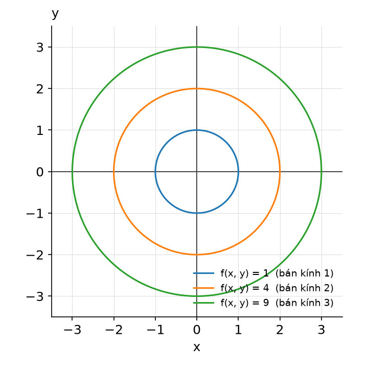

> ✅ **Lời giải (theo bài giảng):**
> - **Định nghĩa:** đường mức tại mức C là tập các điểm (x, y) trong mặt phẳng xy thoả f(x, y) = C.
> - **Thay hàm:** x² + y² = C. Đồ thị f là paraboloid; mặt phẳng z = C cắt paraboloid theo một đường tròn, chiếu xuống mặt phẳng xy được x² + y² = C.
> - **Kết quả:** với C > 0, x² + y² = C là **đường tròn tâm O, bán kính √C**. Slide vẽ C = 1, 4, 9 → bán kính 1, 2, 3.
> - **Kết luận:** Các đường mức của hàm f(x, y) là các **đường tròn đồng tâm O** trong mặt phẳng xy.
> - ⚡ **Lỗi hay gặp:** lấy bán kính bằng C (đúng là √C: C = 4 → bán kính 2). ⚠️ (bổ sung) C = 0 chỉ là điểm O, C < 0 không có đường mức.

**Câu 82.** Giả sử sản lượng của một nhà máy được cho bởi hàm sản xuất Cobb-Douglas Q(K, L) = 60K^{1/3}L^{2/3}, trong đó K là đầu tư vốn được đo bằng đơn vị $1,000 và L lượng lao động được đo bằng số giờ làm việc. _(Ví dụ 4, Bài 10)_
- a) Tính sản lượng của nhà máy khi đầu tư vốn là $512,000 và 1,000 giờ lao động được sử dụng.
- b) Chứng tỏ sản lượng ở phần (a) sẽ tăng gấp đôi nếu cả đầu tư vốn và quy mô lao động đều tăng gấp đôi.

> ✅ **Lời giải (theo bài giảng):**
> **a)**
> - **Đổi đơn vị:** K tính theo $1,000 → $512,000 là K = 512; L = 1,000.
> - **Thay số:** 512^{1/3} = 8 (vì 8³ = 512); 1,000^{2/3} = (1,000^{1/3})² = 10² = 100. Q(512; 1,000) = 60 × 8 × 100.
> - **Kết quả:** **Q(512; 1,000) = 48,000**.
>
> **b)**
> - **Thay số:** gấp đôi: K = 1,024, L = 2,000. Q(1,024; 2,000) = 60·(2·512)^{1/3}·(2·1,000)^{2/3} = 60·2^{1/3}·2^{2/3}·512^{1/3}·1,000^{2/3} = 2^{1/3 + 2/3}·48,000 = 2 × 48,000.
> - **Kết quả:** **Q(1,024; 2,000) = 96,000 = 2Q(512; 1,000)**.
> - **Kết luận:** Sản lượng tăng gấp đôi khi cả vốn và lao động tăng gấp đôi (vì α + β = 1/3 + 2/3 = 1).
> - ⚡ **Lỗi hay gặp:** thay K = 512,000 (quên đơn vị $1,000); tính trực tiếp 1,024^{1/3} ≈ 10.08 rồi làm tròn sớm, nên tách thừa số 2 như trên.

**Câu 83.** Giả sử lợi ích của một người tiêu dùng khi có x đơn vị hàng hóa thứ nhất và y đơn vị của hàng hóa thứ hai là U(x, y) = x^{3/2}y. Khi người tiêu dùng mua 16 đơn vị hàng hóa thứ nhất và 20 đơn vị hàng hóa thứ hai, xác định lợi ích của người tiêu dùng và vẽ đường bàng quan tương ứng với mức lợi ích đó. _(Ví dụ 5, Bài 10)_

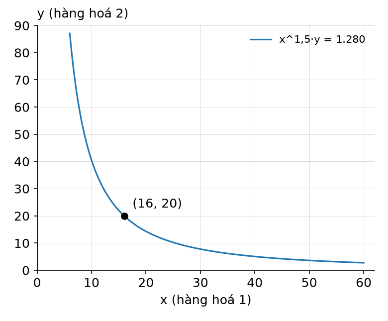

> ✅ **Lời giải (theo bài giảng):**
> - **Công thức:** lợi ích U(x, y) = x^{3/2}y; đường bàng quan là đường mức U(x, y) = C.
> - **Thay số:** 16^{3/2} = (√16)³ = 4³ = 64. U(16, 20) = 64 × 20.
> - **Kết quả:** **U(16, 20) = 1,280**.
> - **Đường bàng quan:** x^{3/2}y = 1,280 hay **y = 1,280x^{−3/2}**. Slide vẽ đường cong giảm dần (x > 0), đi qua điểm (16, 20), nằm trong họ đường bàng quan.
> - **Kết luận:** ⚠️ (bổ sung) Mọi kết hợp (x, y) trên đường này cho người tiêu dùng cùng mức lợi ích 1,280 như khi mua (16, 20).
> - ⚡ **Lỗi hay gặp:** tính 16^{3/2} = 16 × 1.5 = 24 (sai; đúng là 64); viết y = 1,280x^{3/2} (sai dấu số mũ).

**Câu 84.** Khi sử dụng x lao động lành nghề và y lao động giản đơn, một nhà máy sản xuất được Q(x, y) = 3x + 2y đơn vị sản phẩm mỗi ngày. Hiện tại, nhà máy sử dụng 10 lao động lành nghề và 20 lao động giản đơn. _(Ví dụ 6, Bài 10)_
- a) Xác định mức sản lượng hàng ngày hiện tại của nhà máy.
- b) Tìm một phương trình thể hiện mối liên hệ giữa x và y khi nhà máy duy trì sản lượng hàng ngày ở mức hiện tại.
- c) Ta nên thay đổi lượng lao động giản đơn y như thế nào để duy trì mức sản lượng hiện tại khi số lao động lành nghề x tăng thêm 2 lao động?

> ✅ **Lời giải (theo bài giảng):**
> **a)**
> - **Thay số:** Q(10, 20) = 3·10 + 2·20 = 30 + 40.
> - **Kết quả:** **Q = 70** đơn vị sản phẩm mỗi ngày.
>
> **b)**
> - **Công thức:** đường đẳng lượng Q(x, y) = C với C = 70.
> - **Kết quả:** **3x + 2y = 70**.
>
> **c)**
> - **Thay số:** x mới = 10 + 2 = 12, giữ trên đường đẳng lượng: 3(10 + 2) + 2y = 70 → 36 + 2y = 70 → 2y = 34.
> - **Kết quả:** **y = 17**; thay đổi 17 − 20 = −3.
> - **Kết luận:** Vì 20 − 17 = 3 nên để duy trì mức sản lượng hiện tại khi số lao động lành nghề tăng thêm 2 lao động, nhà máy cần **giảm 3 lao động giản đơn**.
> - ⚡ **Lỗi hay gặp:** trả lời "y = 17" mà không nói giảm 3; tăng x thêm 2 nhưng thay x = 2.

**Câu 85.** Tính các đạo hàm riêng của hàm z = f(x, y). _(Ví dụ 7, Bài 10)_
- a) f(x, y) = x² + 2xy² + 2y/(3x)
- b) f(x, y) = yˣ

> ✅ **Lời giải (theo bài giảng):**
> **a)**
> - **Theo x (y hằng số):** (x²)ₓ = 2x; (2xy²)ₓ = 2y²; (2y/(3x))ₓ = (2y/3)·(x⁻¹)ₓ = (2y/3)·(−x⁻²) = −2y/(3x²).
> - **Kết quả:** **fₓ(x, y) = 2x + 2y² − 2y/(3x²)**.
> - **Theo y (x hằng số):** (x²)_y = 0; (2xy²)_y = 2x·2y = 4xy; (2y/(3x))_y = 2/(3x).
> - **Kết quả:** **f_y(x, y) = 4xy + 2/(3x)**.
>
> **b)**
> - **Theo x (y hằng số):** yˣ là hàm mũ cơ số y, (aˣ)' = aˣ ln a → **∂z/∂x = yˣ ln y**.
> - **Theo y (x hằng số):** yˣ là hàm luỹ thừa số mũ x, (yⁿ)' = n·yⁿ⁻¹ → **∂z/∂y = x·y^{x−1}**.
> - ⚡ **Lỗi hay gặp:** quên x² có đạo hàm theo y bằng 0; đảo hai công thức ở câu b; viết (2y/(3x))ₓ = 2y/3 (quên x ở mẫu).

**Câu 86.** Sản lượng hàng tháng tại một nhà máy được cho bởi hàm Cobb-Douglas Q(K, L) = 50K^{0.4}L^{0.6}, trong đó, K là đầu tư vốn tính theo đơn vị $1,000 và L là quy mô lao động, tính theo số giờ lao động. _(Ví dụ 8, Bài 10)_
- a) Tìm sản lượng cận biên của vốn và sản lượng cận biên của lao động khi đầu tư vốn là $750,000 và quy mô lao động sử dụng là 991 giờ.
- b) Nhà sản xuất nên tăng vốn hay lao động để sản lượng tăng nhiều hơn?

> ✅ **Lời giải (theo bài giảng):**
> **a)**
> - **Công thức:** sản lượng cận biên của vốn Q_K = ∂Q/∂K; của lao động Q_L = ∂Q/∂L.
> - **Đạo hàm:** Q_K = 50·0.4·K^{0.4−1}L^{0.6} = **20K^{−0.6}L^{0.6}**; Q_L = 50·0.6·K^{0.4}L^{0.6−1} = **30K^{0.4}L^{−0.4}**.
> - **Đổi đơn vị:** $750,000 → K = 750; L = 991.
> - **Thay số:** Q_K = 20·(991/750)^{0.6} ≈ 20 × 1.18197; Q_L = 30·(750/991)^{0.4} ≈ 30 × 0.89453.
> - **Kết quả:** **Q_K(750, 991) ≈ 23.64**; **Q_L(750, 991) ≈ 26.84**.
>
> **b)**
> - **So sánh:** Q_L ≈ 26.84 > Q_K ≈ 23.64.
> - **Kết luận:** Theo kết quả câu (a), **tăng lao động** sẽ giúp nhà sản xuất tăng sản lượng nhiều hơn.
> - ⚡ **Lỗi hay gặp:** thay K = 750,000; viết số mũ Q_K là 0.6 thay vì −0.6; gộp K^{−0.6}L^{0.6} thành (K/L)^{0.6} (đúng là (L/K)^{0.6}).

**Câu 87.** Giả sử hàm cầu đối với bột mì trong một cộng đồng dân cư được cho bởi D₁(p₁, p₂) = 500 + 10/(p₁ + 2) − 5p₂ trong khi đó lượng cầu tương ứng đối với bánh mì là D₂(p₁, p₂) = 400 − 2p₁ + 7/(p₂ + 3), trong đó, p₁ là giá của một pound bột mì và p₂ là giá của một ổ bánh mì, đều tính theo đô-la. Xác định hai hàng hóa bột mì và bánh mì là thay thế, bổ sung hay không phải loại nào. _(Ví dụ 9, Bài 10)_

> ✅ **Lời giải (theo bài giảng):**
> - **Tiêu chí:** thay thế khi ∂D₁/∂p₂ > 0 và ∂D₂/∂p₁ > 0; bổ sung khi ∂D₁/∂p₂ < 0 và ∂D₂/∂p₁ < 0.
> - **Đạo hàm chéo:** ∂D₁/∂p₂: 500 và 10/(p₁ + 2) không chứa p₂ nên bằng 0, (−5p₂)' = −5 → **∂D₁/∂p₂ = −5**. ∂D₂/∂p₁: 400 và 7/(p₂ + 3) không chứa p₁, (−2p₁)' = −2 → **∂D₂/∂p₁ = −2**.
> - **Kết quả:** cả hai đạo hàm chéo đều **âm** (−5 < 0, −2 < 0).
> - **Kết luận:** Bánh mì và bột mì là các **hàng hóa bổ sung**.
> - ⚡ **Lỗi hay gặp:** tính ∂D₁/∂p₁ = −10/(p₁ + 2)² và ∂D₂/∂p₂ (đạo hàm theo giá của chính nó) rồi kết luận; chỉ xét một đạo hàm chéo.

**Câu 88.** Tính các đạo hàm riêng cấp hai của hàm: f(x, y) = x³ − 4xy² + 2y³ _(Ví dụ 10, Bài 10)_

> ✅ **Lời giải (theo bài giảng):**
> - **Đạo hàm cấp 1:** fₓ = 3x² − 4y² (2y³ là hằng số theo x); f_y = −4x·2y + 2·3y² = −8xy + 6y² (x³ là hằng số theo y).
> - **fₓₓ** = (fₓ)ₓ = (3x² − 4y²)ₓ = **6x**.
> - **fₓᵧ** = (fₓ)_y = (3x² − 4y²)_y = **−8y**.
> - **f_yx** = (f_y)ₓ = (−8xy + 6y²)ₓ = **−8y**.
> - **f_yy** = (f_y)_y = (−8xy + 6y²)_y = **−8x + 12y**.
> - **Kết luận:** ⚠️ (bổ sung) Hai đạo hàm hỗn hợp bằng nhau (fₓᵧ = f_yx = −8y), dùng để tự kiểm tra.
> - ⚡ **Lỗi hay gặp:** quên đạo hàm của −4xy² theo y là −8xy (không phải −4y²); tính f_yy quên số hạng −8x.

**Câu 89.** Một cửa hàng y tế bán hai loại vitamin A và B với giá bán lần lượt là x và y đô la mỗi chai. Biết rằng cầu đối với vitamin A là Q(x, y) = 300 − 20x² + 30y chai mỗi tháng. Ước tính rằng t tháng sau, giá của 2 loại vitamin A và B tương ứng là: x = 2 + 0.05t và y = 2 + 0.1√t. Cầu đối với vitamin A sẽ thay đổi với tốc độ như thế nào theo thời gian ở thời điểm 4 tháng sau, kể từ bây giờ? _(Ví dụ 11, Bài 10)_

> ✅ **Lời giải (theo bài giảng):**
> - **Công thức:** dQ/dt = (∂Q/∂x)(dx/dt) + (∂Q/∂y)(dy/dt).
> - **Đạo hàm:** ∂Q/∂x = −40x; ∂Q/∂y = 30; dx/dt = 0.05; dy/dt = 0.1·1/(2√t) = 0.05/√t.
> - **Ghép:** dQ/dt = −40x(0.05) + 30(0.05/√t).
> - **Lấy số:** t = 4: x = 2 + 0.05·4 = 2.2; y = 2 + 0.1·√4 = 2.2; √t = 2.
> - **Thay số:** dQ/dt = −40(2.2)(0.05) + 30(0.05/2) = −4.4 + 0.75.
> - **Kết quả:** **dQ/dt = −3.65** (chai/tháng).
> - **Kết luận:** 4 tháng sau kể từ bây giờ, cầu đối với vitamin A sẽ **giảm** với tốc độ 3.65 chai mỗi tháng.
> - ⚡ **Slide ghi** "(∂Q/∂y)(dy/∂t)" (in nhầm, đúng là dy/dt), kết luận không đổi.
> - ⚡ **Lỗi hay gặp:** quên chia 2 khi đạo hàm √t (ra 0.1/√t → dQ/dt = −2.9); thay t = 4 vào x mà quên tính x = 2.2 (thay x = 2).

**Câu 90.** Sản lượng hàng ngày của một nhà máy là Q = 60K^{1/2}L^{1/3} đơn vị, trong đó K là đầu tư vốn (tính theo đơn vị $1,000) và L là quy mô lao động (tính theo giờ lao động). Hiện tại, đầu tư vốn của nhà máy là $900,000 và 1,000 giờ lao động được sử dụng mỗi ngày. Tính gần đúng mức thay đổi của sản lượng khi nhà máy tăng đầu tư vốn thêm $1,000 và giảm đi 2 giờ lao động. _(Ví dụ 12, Bài 10)_

> ✅ **Lời giải (theo bài giảng):**
> - **Công thức:** ΔQ ≈ (∂Q/∂K)ΔK + (∂Q/∂L)ΔL.
> - **Đạo hàm:** ∂Q/∂K = 60·½·K^{−1/2}L^{1/3} = 30K^{−1/2}L^{1/3}; ∂Q/∂L = 60·⅓·K^{1/2}L^{−2/3} = 20K^{1/2}L^{−2/3}.
> - **Đổi đơn vị:** $900,000 → K = 900; L = 1,000; tăng $1,000 → ΔK = 1; giảm 2 giờ → ΔL = −2.
> - **Thay số:** 900^{1/2} = 30, 1,000^{1/3} = 10, 1,000^{−2/3} = 1/100. ∂Q/∂K = 30 × (1/30) × 10 = 10; ∂Q/∂L = 20 × 30 × (1/100) = 6. ΔQ ≈ 10(1) + 6(−2) = 10 − 12.
> - **Kết quả:** **ΔQ ≈ −2** (đơn vị).
> - **Kết luận:** Khi nhà máy tăng đầu tư vốn thêm $1,000 và giảm đi 2 giờ lao động, sản lượng hàng ngày của nhà máy **giảm xấp xỉ 2 đơn vị**.
> - ⚡ **Lỗi hay gặp:** lấy ΔK = 1,000 hoặc K = 900,000; quên dấu âm của ΔL (ra +22). ⚠️ (bổ sung) Thay đổi thực Q(901, 998) − Q(900, 1,000) ≈ −2.017.

**Câu 91.** Nhà đầu tư Ethan sẽ nhận được U(x, y) đơn vị lợi ích khi sở hữu x đơn vị cổ phiếu và y đơn vị trái phiếu, trong đó: U(x, y) = (2x + 3)(y + 5). Hiện tại, Ethan đang sở hữu 27 đơn vị cổ phiếu và 12 đơn vị trái phiếu. _(Ví dụ 13, Bài 10)_
- a) Tìm các hàm lợi ích cận biên Uₓ và U_y.
- b) Tính Uₓ và U_y tại các giá trị hiện tại của x và y.
- c) Ước tính mức thay đổi lợi ích của Ethan nếu anh ấy có thêm 3 đơn vị cổ phiếu và bớt 2 đơn vị trái phiếu từ danh mục đầu tư của mình.

> ✅ **Lời giải (theo bài giảng):**
> **a)**
> - **Đạo hàm:** theo x (y hằng số, (y + 5) là hệ số): Uₓ = 2(y + 5). Theo y (x hằng số, (2x + 3) là hệ số): U_y = 2x + 3.
> - **Kết quả:** **Uₓ = 2(y + 5)** và **U_y = 2x + 3**.
>
> **b)**
> - **Thay số:** x = 27, y = 12: Uₓ = 2(12 + 5) = 2 × 17; U_y = 2(27) + 3 = 54 + 3.
> - **Kết quả:** **Uₓ = 34** và **U_y = 57**.
>
> **c)**
> - **Công thức:** ΔU ≈ Uₓ·Δx + U_y·Δy.
> - **Lấy số:** x = 27, y = 12, Δx = 3, Δy = −2 (bớt 2 trái phiếu).
> - **Thay số:** ΔU ≈ 34(3) + 57(−2) = 102 − 114.
> - **Kết quả:** **ΔU ≈ −12**.
> - **Kết luận:** Lợi ích của Ethan **giảm khoảng 12 đơn vị**.
> - ⚡ **Lỗi hay gặp:** lấy Δy = +2; tính hiệu trực tiếp U(30, 10) − U(27, 12) = 945 − 969 = −24 (⚠️ bổ sung: đó là thay đổi thực, đề hỏi ước tính theo số gia nên đáp án là −12).

## Bài 11 — Ví dụ trong bài giảng

> Nguồn: [Bài 11 — Cực trị của hàm số nhiều biến (Phần 1)](tai-lieu/bai-11-cuc-tri-ham-nhieu-bien-phan-1.pdf). Lời giải theo bài giảng, bổ sung bước trung gian.

**Câu 92.** Tìm các điểm tới hạn của hàm f(x, y) = y² − x² _(Ví dụ 1, Bài 11)_

> ✅ **Lời giải (theo bài giảng):**
> - **Công thức:** điểm tới hạn là nghiệm của hệ fₓ = 0, f_y = 0.
> - **Đạo hàm riêng:** fₓ = −2x (y² là hằng số theo x); f_y = 2y (x² là hằng số theo y).
> - **Thay số:** −2x = 0 ⇔ x = 0; 2y = 0 ⇔ y = 0.
> - **Kết quả:** điểm tới hạn duy nhất là **(0, 0)**.
> - **Kết luận:** tuy nhiên (0, 0) lại là **điểm yên ngựa** (không phải cực trị). ⚠️ (bổ sung) Theo trục x (y = 0): f = −x² đạt cực đại tại 0; theo trục y (x = 0): f = y² đạt cực tiểu tại 0 → cực đại theo một hướng, cực tiểu theo hướng khác. Phân loại bằng D ở Ví dụ 2.
> - ⚡ **Lỗi hay gặp:** kết luận "(0, 0) là cực trị" chỉ vì đạo hàm riêng bằng 0. Điểm tới hạn chỉ là **ứng viên**.

**Câu 93.** Phân loại các điểm tới hạn của hàm: f(x, y) = y² − x² _(Ví dụ 2, Bài 11)_

> ✅ **Lời giải (theo bài giảng):**
> - **Công thức:** D(x, y) = fₓₓ·f_yy − (fₓ_y)²; D < 0 → yên ngựa.
> - **Lấy số:** từ Ví dụ 1, điểm tới hạn duy nhất là (0, 0). fₓ = −2x, f_y = 2y → **fₓₓ = −2, f_yy = 2, fₓ_y = (−2x)'_y = 0**.
> - **Thay số:** D(x, y) = (−2)(2) − 0² = −4 → D(0, 0) = −4.
> - **Kết quả:** **D(0, 0) = −4 < 0**.
> - **Kết luận:** điểm (0, 0) là **điểm yên ngựa**.
> - ⚡ **Lỗi hay gặp:** thấy fₓₓ = −2 < 0 liền kết luận cực đại. Phải xét **D trước**: D < 0 thì yên ngựa, không xét fₓₓ.

**Câu 94.** Tìm tất cả điểm tới hạn của hàm: f(x, y) = x³ − y³ − 3xy và phân loại mỗi điểm tương ứng với cực đại tương đối, cực tiểu tương đối hay điểm yên ngựa. _(Ví dụ 3, Bài 11)_

> ✅ **Lời giải (theo bài giảng):**
> - **Bước 1, điểm tới hạn:** fₓ = 3x² − 3y; f_y = −3y² − 3x. Hệ { 3x² − 3y = 0 ; −3y² − 3x = 0 } ⇔ { y = x² ; x = −y² }.
> - Thay y = x² vào phương trình sau: x = −(x²)² ⇔ x⁴ + x = 0 ⇔ x(x³ + 1) = 0 ⇔ x = 0 hoặc x = −1.
>   - x = 0 → y = 0² = 0 → **(0, 0)**.
>   - x = −1 → y = (−1)² = 1 → **(−1, 1)**.
> - **Bước 2, đạo hàm cấp hai:** fₓₓ = (3x² − 3y)'ₓ = 6x; f_yy = (−3y² − 3x)'_y = −6y; fₓ_y = (3x² − 3y)'_y = −3.
> - **Lập D:** D(x, y) = 6x·(−6y) − (−3)² = −36xy − 9.
> - **Thay số:**
>   - D(0, 0) = −36·0·0 − 9 = −9 < 0.
>   - D(−1, 1) = −36·(−1)·1 − 9 = 36 − 9 = 27 > 0; fₓₓ(−1, 1) = 6·(−1) = −6 < 0.
> - **Kết quả:** **(0, 0) là điểm yên ngựa; f đạt cực đại tương đối tại (−1, 1)**.
> - **Kết luận:** ⚠️ (bổ sung) giá trị cực đại f(−1, 1) = (−1)³ − 1³ − 3(−1)(1) = −1 − 1 + 3 = 1 (slide không tính).
> - ⚡ **Lỗi hay gặp:** chia hai vế x⁴ + x = 0 cho x làm mất điểm (0, 0); viết (fₓ_y)² = −9 thay vì 9; quên thay từng điểm vào D vì D chứa x, y.

**Câu 95.** Kevin quản lý một cửa hàng tạp hóa bán hai loại thức ăn cho mèo, loại nội địa có chi phí 30 cents mỗi hộp và loại nhập khẩu có chi phí 40 cents mỗi hộp. Nếu Kevin bán loại nội địa với giá x cents mỗi hộp và loại nhập khẩu với giá y cents mỗi hộp thì mỗi ngày, cửa hàng sẽ bán được 70 − 5x + 4y hộp loại nội địa và 80 + 6x − 7y hộp loại nhập khẩu. Kevin nên định giá bán mỗi loại như thế nào để tối đa hóa tổng lợi nhuận từ việc bán thức ăn cho mèo hàng ngày? (Giả sử rằng lợi nhuận hàng ngày lớn nhất xảy ra ở điểm cực đại tương đối.) _(Ví dụ 4, Bài 11)_

> ✅ **Lời giải (theo bài giảng):**
> - **Công thức:** Lợi nhuận = Lợi nhuận từ loại nội địa + Lợi nhuận từ loại nhập khẩu; mỗi phần = (số hộp bán) × (giá bán − chi phí).
> - **Lập hàm:** f(x, y) = (70 − 5x + 4y)(x − 30) + (80 + 6x − 7y)(y − 40).
>   - (70 − 5x + 4y)(x − 30) = −5x² + 4xy + 220x − 120y − 2,100.
>   - (80 + 6x − 7y)(y − 40) = 6xy − 7y² − 240x + 360y − 3,200.
>   - Cộng lại: **f(x, y) = −5x² + 10xy − 7y² − 20x + 240y − 5,300**.
> - **Điểm tới hạn:** fₓ = −10x + 10y − 20 = 0 ; f_y = 10x − 14y + 240 = 0.
>   - Từ phương trình đầu: y = x + 2. Thay vào phương trình sau: 10x − 14(x + 2) + 240 = 0 ⇔ −4x + 212 = 0 ⇔ x = 53 → y = 55.
>   - Điểm tới hạn duy nhất **(53, 55)**.
> - **Đạo hàm cấp hai:** fₓₓ = −10, f_yy = −14, fₓ_y = 10 → D = (−10)(−14) − 10² = 140 − 100 = 40.
> - **Thay số:** D(53, 55) = 40 > 0; fₓₓ(53, 55) = −10 < 0 → f đạt **cực đại tương đối** tại (53, 55).
> - **Kết quả:** Kevin nên đặt giá **53 cents** mỗi hộp loại nội địa và **55 cents** mỗi hộp loại nhập khẩu.
> - **Kết luận:** ⚠️ (bổ sung) tại giá này bán 70 − 265 + 220 = 25 hộp nội địa và 80 + 318 − 385 = 13 hộp nhập khẩu; lợi nhuận tối đa f(53, 55) = 25·23 + 13·15 = 770 cents = $7.70 mỗi ngày.
> - ⚡ **Slide ghi** "đặt giá bán $53 mỗi hộp loại nội địa và $53 mỗi hộp loại nhập khẩu" (in nhầm), đúng là 53 cents và 55 cents; kết luận "cực đại tại (53, 55)" không đổi.
> - ⚡ **Lỗi hay gặp:** quên trừ chi phí (lấy số lượng × giá bán là doanh thu, không phải lợi nhuận); sai dấu khi khai triển; đọc −5,300 thành −5.3.

**Câu 96.** Giám đốc kinh doanh của một công ty xác định được ba điểm phục vụ khách hàng quan trọng nhất của công ty đặt tại các điểm A, B và C với các toạ độ tương ứng là (1, 5), (0, 0) và (8, 0) theo đơn vị đo trên mỗi trục là mile. Công ty nên đặt kho hàng tại điểm W có toạ độ (x, y) là bao nhiêu để tối thiểu hoá tổng bình phương các khoảng cách từ W đến các điểm A, B và C? _(Ví dụ 5, Bài 11)_

> ✅ **Lời giải (theo bài giảng):**
> - **Công thức:** bình phương khoảng cách từ W(x, y) đến (a, b) là (x − a)² + (y − b)².
> - **Lập hàm:** f(x, y) = [(x − 1)² + (y − 5)²] + [x² + y²] + [(x − 8)² + y²].
>   - (x − 1)² + (y − 5)² = x² − 2x + 1 + y² − 10y + 25.
>   - (x − 8)² + y² = x² − 16x + 64 + y².
>   - Cộng lại: **f(x, y) = 3x² + 3y² − 18x − 10y + 90**.
> - **Điểm tới hạn:** fₓ = 6x − 18 = 0 ⇔ x = 3; f_y = 6y − 10 = 0 ⇔ y = 5/3 → điểm tới hạn duy nhất **(3, 5/3)**.
> - **Đạo hàm cấp hai:** fₓₓ = 6, f_yy = 6, fₓ_y = 0 → D = 6·6 − 0² = 36.
> - **Thay số:** D(3, 5/3) = 36 > 0; fₓₓ(3, 5/3) = 6 > 0 → f đạt **cực tiểu tương đối** tại (3, 5/3).
> - **Kết quả:** công ty nên đặt kho hàng tại **W(3, 5/3)**.
> - **Kết luận:** ⚠️ (bổ sung) W chính là trọng tâm tam giác ABC: ((1 + 0 + 8)/3, (5 + 0 + 0)/3) = (3, 5/3); tổng bình phương khoảng cách nhỏ nhất f(3, 5/3) = 164/3 ≈ 54.67 mile².
> - ⚡ **Lỗi hay gặp:** dùng khoảng cách √(…) thay vì bình phương khoảng cách; quên số hạng y² của điểm C(8, 0) (khai triển ra 2y² thay vì 3y²).

**Câu 97.** Tìm cực đại và cực tiểu tuyệt đối của hàm f(x, y) = 4xy − x² − 4y + 9 trên miền hình tam giác R có các đỉnh A(0, 0), B(8, 0) và C(0, 16). _(Ví dụ 6, Bài 11)_

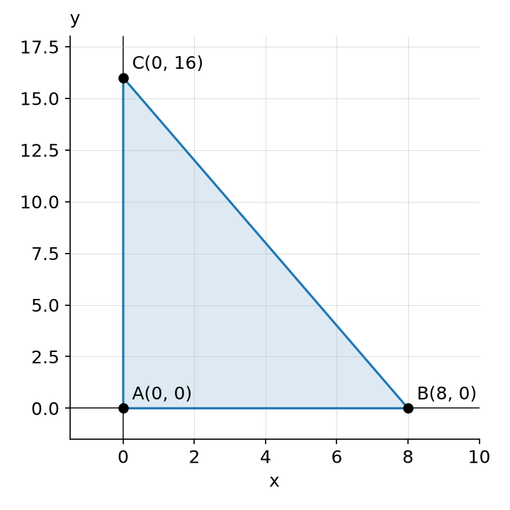

> ✅ **Lời giải (theo bài giảng):**
> - **Bước 1, điểm tới hạn:** fₓ = 4y − 2x = 0 ; f_y = 4x − 4 = 0 ⇔ { x = 2y ; x = 1 } → nghiệm duy nhất **(1, 1/2) ∈ R**.
> - **Bước 2, biên** gồm ba đoạn AB, AC, BC:
>   - **AB:** y = 0, 0 ≤ x ≤ 8 → u(x) = f(x, 0) = −x² + 9; u'(x) = −2x = 0 chỉ tại x = 0 (đầu mút) → ứng viên **(0, 0), (8, 0)**.
>   - **AC:** x = 0, 0 ≤ y ≤ 16 → v(y) = f(0, y) = −4y + 9; v'(y) = −4 ≠ 0 → ứng viên **(0, 0), (0, 16)**.
>   - **BC:** đường qua (8, 0) và (0, 16) là y = −2x + 16, 0 ≤ x ≤ 8 → w(x) = 4x(−2x + 16) − x² − 4(−2x + 16) + 9 = −8x² + 64x − x² + 8x − 64 + 9 = −9x² + 72x − 55; w'(x) = −18x + 72 = 0 ⇔ x = 4 → y = −8 + 16 = 8 → ứng viên **(4, 8)** cùng hai đầu mút (8, 0), (0, 16).
> - **Bước 3, thay số:**
>   - f(1, 1/2) = 4·1·(1/2) − 1 − 2 + 9 = 8.
>   - f(0, 0) = 9.
>   - f(8, 0) = −64 + 9 = −55.
>   - f(0, 16) = −64 + 9 = −55.
>   - f(4, 8) = 128 − 16 − 32 + 9 = 89.
> - **Kết quả:** trên miền tam giác R, f đạt **cực đại tuyệt đối bằng 89 tại (4, 8)**; **cực tiểu tuyệt đối bằng −55 tại (8, 0) và (0, 16)**.
> - **Kết luận:** cực trị tuyệt đối đều nằm **trên biên**; điểm tới hạn bên trong (1, 1/2) chỉ cho giá trị 8.
> - ⚡ **Slide ghi** trên biên BC "cực trị chỉ có thể xảy ra tại: (4,8), (0,0) và (8,0)" (in nhầm), đầu mút đúng là (0, 16); kết luận không đổi vì (0, 16) đã có từ biên AC.
> - ⚡ **Lỗi hay gặp:** chỉ lấy điểm đạo hàm bằng 0 mà quên đầu mút; viết sai phương trình cạnh BC; dùng D để kết luận cực trị tuyệt đối.

## Bài 12 — Ví dụ trong bài giảng

> Nguồn: [Bài 12 — Cực trị của hàm số nhiều biến (Phần 2)](tai-lieu/bai-12-cuc-tri-ham-nhieu-bien-phan-2.pdf). Lời giải theo bài giảng, bổ sung bước trung gian.

**Câu 98.** Tìm giá trị cực tiểu của hàm: f(x, y) = x² − y² với điều kiện ràng buộc: x² + y² = 4 _(Ví dụ 1, Bài 12)_

> ✅ **Lời giải (theo bài giảng):**
> - **Công thức:** hệ Lagrange fₓ = λgₓ ; f_y = λg_y ; g(x, y) = k.
> - **Xác định:** f = x² − y², g = x² + y², k = 4 → fₓ = 2x, f_y = −2y, gₓ = 2x, g_y = 2y.
> - **Hệ:** { 2x = λ·2x ; −2y = λ·2y ; x² + y² = 4 } ⇔ { x(1 − λ) = 0 ; y(1 + λ) = 0 ; x² + y² = 4 }.
>   - x = 0 → y ≠ 0 (vì x² + y² = 4) → λ = −1, y² = 4 → **y = ±2**.
>   - λ = 1 → y(1 + 1) = 0 → y = 0 → x² = 4 → **x = ±2**.
>   - (x = y = 0 không thoả ràng buộc nên loại.)
> - **Nghiệm:** 4 nghiệm (0, 2, −1), (0, −2, −1), (2, 0, 1), (−2, 0, 1).
> - **Thay số:** f(0, 2) = f(0, −2) = 0 − 4 = −4 ; f(2, 0) = f(−2, 0) = 4 − 0 = 4.
> - **Kết quả:** giá trị **cực tiểu bằng −4 tại (0, ±2)** (và cực đại bằng 4 tại (±2, 0)).
> - **Kết luận:** hàm f = x² − y² với ràng buộc x² + y² = 4 đạt cực đại 4 tại (±2, 0) và cực tiểu −4 tại (0, ±2).
> - ⚡ **Lỗi hay gặp:** chia 2x = 2λx cho x được λ = 1 rồi bỏ mất trường hợp x = 0 (mất luôn điểm cực tiểu); quên phương trình ràng buộc.

**Câu 99.** Tìm giá trị cực đại của hàm: f(x, y) = xy² với điều kiện: x + y² = 1 _(Ví dụ 2, Bài 12)_

> ✅ **Lời giải (theo bài giảng):**
> - **Xác định:** f = xy², g = x + y², k = 1 → fₓ = y², f_y = 2xy, gₓ = 1, g_y = 2y.
> - **Hệ:** { y² = λ·1 ; 2xy = λ·2y ; x + y² = 1 }. Phương trình 2 ⇔ 2y(x − λ) = 0.
>   - y = 0 → λ = y² = 0, x = 1 − 0 = 1 → nghiệm **(1, 0, 0)**.
>   - x = λ → y² = λ = x → x + x = 1 → x = 1/2, y² = 1/2 → y = ±1/√2, λ = 1/2 → nghiệm **(1/2, ±1/√2, 1/2)**.
> - **Thay số:** f(1, 0) = 1·0 = 0 ; f(1/2, ±1/√2) = (1/2)·(1/2) = 1/4.
> - **Kết quả:** **cực đại bằng 1/4 tại (1/2, ±1/√2)**; cực tiểu bằng 0 tại (1, 0).
> - **Kết luận:** giá trị cực đại cần tìm là **1/4**.
> - ⚠️ (bổ sung) Đường ràng buộc x = 1 − y² không bị chặn, trên đó f = y² − y⁴ → −∞ khi |y| → ∞, nên "cực tiểu 0 tại (1, 0)" chỉ là cực tiểu địa phương, không phải giá trị nhỏ nhất; cực đại 1/4 là giá trị lớn nhất.
> - ⚡ **Lỗi hay gặp:** chia 2xy = 2λy cho y làm mất nghiệm (1, 0, 0); quên dấu ± của y.

**Câu 100.** Tìm giá trị cực đại và cực tiểu của hàm: f(x, y) = xy với điều kiện ràng buộc: x² + y² = 8 _(Ví dụ 3, Bài 12)_

> ✅ **Lời giải (theo bài giảng):**
> - **Xác định:** f = xy, g = x² + y², k = 8 → fₓ = y, f_y = x, gₓ = 2x, g_y = 2y.
> - **Hệ:** { y = 2λx ; x = 2λy ; x² + y² = 8 }.
>   - Thay x = 2λy vào phương trình đầu: y = 4λ²y ⇔ y(1 − 4λ²) = 0. Nếu y = 0 thì x = 0, không thoả ràng buộc → loại. Vậy λ² = 1/4 ⇔ λ = ±1/2.
>   - λ = 1/2 → y = x → 2x² = 8 → x = ±2 → (2, 2), (−2, −2).
>   - λ = −1/2 → y = −x → 2x² = 8 → (2, −2), (−2, 2).
> - **Nghiệm:** (2, 2, 1/2), (−2, 2, −1/2), (2, −2, −1/2), (−2, −2, 1/2).
> - **Thay số:** f(2, 2) = f(−2, −2) = 4 ; f(−2, 2) = f(2, −2) = −4.
> - **Kết quả:** **cực đại bằng 4 tại (2, 2) và (−2, −2)**; **cực tiểu bằng −4 tại (−2, 2) và (2, −2)**.
> - **Kết luận:** như kết quả.
> - ⚡ **Lỗi hay gặp:** chỉ lấy x = y = 2 mà quên các tổ hợp dấu; ghép sai λ với điểm (λ = y/(2x)).

**Câu 101.** Một người tiêu dùng chi $600 để mua sắm hai loại hàng hoá, trong đó hàng hoá thứ nhất có giá $20 mỗi đơn vị và hàng hoá thứ hai có giá $30 mỗi đơn vị. Giả sử lợi ích người tiêu dùng thu được khi có x đơn vị hàng hoá thứ nhất và y đơn vị hàng hoá thứ hai là U(x, y) = 10x^0.6·y^0.4. Người đó nên mua bao nhiêu đơn vị mỗi loại để thu được lợi ích tối đa? _(Ví dụ 4, Bài 12)_

> ✅ **Lời giải (theo bài giảng):**
> - **Xác định:** tìm (x, y) để U(x, y) = 10x^0.6·y^0.4 đạt cực đại với ràng buộc **20x + 30y = 600** (g = 20x + 30y, k = 600, gₓ = 20, g_y = 30).
> - **Đạo hàm:** Uₓ = 10·0.6·x^(−0.4)·y^0.4 = 6x^(−0.4)·y^0.4 ; U_y = 10·0.4·x^0.6·y^(−0.6) = 4x^0.6·y^(−0.6).
> - **Hệ:** { 6x^(−0.4)·y^0.4 = 20λ ; 4x^0.6·y^(−0.6) = 30λ ; 20x + 30y = 600 }.
> - **Khử λ:** chia phương trình 1 cho phương trình 2: (6x^(−0.4)y^0.4)/(4x^0.6y^(−0.6)) = (6/4)·(y/x) = 3y/(2x) = 20/30 = 2/3 ⇔ 9y = 4x ⇔ **4x = 9y**. Từ phương trình 1: λ = 0.3x^(−0.4)·y^0.4.
> - **Thay vào ràng buộc:** x = 9y/4 → 20·(9y/4) + 30y = 45y + 30y = 75y = 600 → y = 8 → x = 9·8/4 = 18.
> - **Kết quả:** **x = 18, y = 8**, λ = 0.3(18)^(−0.4)·8^0.4.
> - **Kết luận:** để tối đa hoá lợi ích, người tiêu dùng nên mua **18 đơn vị hàng hoá thứ nhất và 8 đơn vị hàng hoá thứ hai**.
> - ⚠️ (bổ sung) λ = 0.3·(8/18)^0.4 ≈ 0.2169; lợi ích tối đa U(18, 8) = 10·18^0.6·8^0.4 ≈ 130.14. Kiểm tra: 20·18 + 30·8 = 360 + 240 = 600.
> - ⚡ **Lỗi hay gặp:** đạo hàm x^0.6 thành 0.6x^1.6 hoặc 0.6x^(−0.6); chia ngược tỷ số giá (ra 3/2 thay vì 2/3) → 9x = 4y, sai đáp án.

**Câu 102.** Một nhà sản xuất dành $600,000 cho việc sản xuất một loại sản phẩm và xác định được rằng nếu x đơn vị vốn và y đơn vị lao động được phân bổ cho sản xuất thì sản lượng thu được là f(x, y) = 120x^(4/5)·y^(1/5) đơn vị. Giả sử rằng chi phí cho mỗi đơn vị vốn là $3,000 và chi phí cho mỗi đơn vị lao động là $5,000. Xác định số đơn vị vốn và lao động được phân bổ cho sản xuất để nhà sản xuất thu được sản lượng tối đa. _(Ví dụ 5, Bài 12)_

> ✅ **Lời giải (theo bài giảng):**
> - **Xác định:** tìm x, y để f(x, y) = 120x^(4/5)·y^(1/5) đạt cực đại với ràng buộc **3,000x + 5,000y = 600,000** (gₓ = 3,000, g_y = 5,000).
> - **Đạo hàm:** fₓ = 120·(4/5)·x^(−1/5)·y^(1/5) = 96x^(−1/5)·y^(1/5) ; f_y = 120·(1/5)·x^(4/5)·y^(−4/5) = 24x^(4/5)·y^(−4/5).
> - **Hệ:** { 96x^(−1/5)·y^(1/5) = 3,000λ ; 24x^(4/5)·y^(−4/5) = 5,000λ ; 3,000x + 5,000y = 600,000 }.
> - **Khử λ:** chia phương trình 1 cho phương trình 2: (96/24)·(y/x) = 4y/x = 3,000/5,000 = 3/5 ⇔ **4y/(3x) = 1/5** ⇔ 20y = 3x ⇔ x = 20y/3. Từ phương trình 1: λ = (96/3,000)·x^(−1/5)·y^(1/5) = 0.032x^(−1/5)·y^(1/5).
> - **Thay vào ràng buộc:** 3,000·(20y/3) + 5,000y = 20,000y + 5,000y = 25,000y = 600,000 → y = 24 → x = 20·24/3 = 160.
> - **Kết quả:** **x = 160, y = 24**, λ = 0.032(160)^(−1/5)·(24)^(1/5) ≈ 0.0219.
> - **Kết luận:** để tối đa hoá sản lượng, nhà sản xuất nên phân bổ **160 đơn vị vốn và 24 đơn vị lao động**.
> - ⚠️ (bổ sung) sản lượng tối đa f(160, 24) ≈ 13,138 đơn vị. Kiểm tra: 3,000·160 + 5,000·24 = 480,000 + 120,000 = 600,000.
> - ⚡ **Lỗi hay gặp:** nhầm x là lao động, y là vốn; đạo hàm (x^(4/5))' thành (4/5)x^(1/5) (phải là x^(−1/5)).

**Câu 103.** Bộ phận quản lý đường cao tốc dự định quây rào một khu vực dừng nghỉ cho những người lái xe ô tô dọc theo một con đường cao tốc lớn. Khu vực dừng nghỉ có dạng hình chữ nhật, với diện tích 5,000 m² và ba mặt không kề với đường cao tốc sẽ được rào lại. Hỏi tổng chiều dài cần rào lại có giá trị nhỏ nhất là bao nhiêu? (Hình: cạnh x dọc theo đường cao tốc, hai cạnh y vuông góc với đường; cạnh dọc đường cao tốc không rào.) _(Ví dụ 6, Bài 12)_

> ✅ **Lời giải (theo bài giảng):**
> - **Lập hàm:** gọi x, y là các cạnh (x dọc đường cao tốc). Tổng chiều dài rào ba mặt: **f(x, y) = x + 2y**; ràng buộc diện tích **xy = 5,000** (g = xy, k = 5,000).
> - **Đạo hàm:** fₓ = 1, f_y = 2, gₓ = y, g_y = x.
> - **Hệ:** { 1 = λy ; 2 = λx ; xy = 5,000 }. Chia phương trình 2 cho phương trình 1: x/y = 2 ⇔ x = 2y; λ = 1/y.
> - **Thay vào ràng buộc:** 2y·y = 5,000 → y² = 2,500 → y = 50 (độ dài dương) → x = 100, λ = 1/50.
> - **Kết quả:** khu dừng nghỉ tối ưu dài **100 m** (dọc đường cao tốc), rộng **50 m**; rào tối thiểu f(100, 50) = 100 + 2(50) = **200 m**.
> - **Kết luận:** cần tối thiểu **200 m** rào chắn.
> - ⚡ **Lỗi hay gặp:** lấy chu vi 2x + 2y (rào cả bốn mặt); lấy cả nghiệm y = −50.

**Câu 104.** Giả sử nhà sản xuất trong Ví dụ 5 về phân bổ tối ưu các nguồn lực có thêm $1,000 chi tiêu cho vốn và lao động để sản xuất loại sản phẩm trên, tức là tổng ngân sách sản xuất bằng $601,000. Hãy ước tính tác động của việc tăng ngân sách đến mức sản lượng tối đa. _(Ví dụ 7, Bài 12)_

> ✅ **Lời giải (theo bài giảng):**
> - **Công thức:** λ = dM/dk → ΔM ≈ λ·Δk (M là sản lượng tối đa, k là ngân sách).
> - **Lấy số:** từ Ví dụ 5: x = 160, y = 24, λ = 0.032(160)^(−1/5)·(24)^(1/5) = 0.032·(24/160)^(1/5) = 0.032·0.15^(1/5) ≈ 0.032·0.6843 ≈ 0.0219; Δk = 601,000 − 600,000 = 1,000.
> - **Ý nghĩa λ:** tăng ngân sách thêm $1 thì sản lượng cực đại tăng xấp xỉ 0.0219 đơn vị.
> - **Thay số:** ΔM ≈ (0.0219)(1000) = 21.9.
> - **Kết quả:** sản lượng cực đại tăng xấp xỉ **21.9 đơn vị**.
> - **Kết luận:** ⚠️ (bổ sung) giải lại chính xác với ngân sách $601,000, sản lượng tối đa tăng ≈ 21.896 đơn vị, khớp ước tính.
> - ⚡ **Lỗi hay gặp:** lấy λ (0.0219) làm đáp án mà quên nhân Δk = 1,000; hiểu λ là thay đổi của x hoặc y.

**Câu 105.** Mike đang làm một chiếc hộp được trang trí công phu từ vật liệu có giá $1 mỗi inch vuông cho mặt đáy, $2 mỗi inch vuông cho các mặt bên và $5 mỗi inch vuông cho nắp hộp. Nếu thể tích của chiếc hộp là 96 inches khối thì Mike nên chọn các kích thước của chiếc hộp như thế nào để tối thiểu hóa tổng chi phí làm hộp? Tổng chi phí tối thiểu đó bằng bao nhiêu? (Hình: hộp chữ nhật có chiều cao x, chiều dài y, chiều rộng z.) _(Ví dụ 8, Bài 12)_

> ✅ **Lời giải (theo bài giảng):**
> - **Lập hàm:** x, y, z là chiều cao, chiều dài, chiều rộng. Đáy và nắp diện tích yz; mặt bên gồm hai mặt xy và hai mặt xz.
>   - C(x, y, z) = 1(yz) + 2(2xy + 2xz) + 5yz = **6yz + 4xy + 4xz**; ràng buộc **xyz = 96**.
> - **Đạo hàm:** Cₓ = 4y + 4z, C_y = 6z + 4x, C_z = 6y + 4x; gₓ = yz, g_y = xz, g_z = xy.
> - **Hệ:** { 4y + 4z = λyz ; 6z + 4x = λxz ; 6y + 4x = λxy ; xyz = 96 }.
>   - ⚠️ (bước trung gian bổ sung) Từ phương trình 2 và 3: λ = (6z + 4x)/(xz) = (6y + 4x)/(xy) → y(6z + 4x) = z(6y + 4x) → 4xy = 4xz → **y = z**.
>   - Phương trình 1: 8y = λy² → λ = 8/y. Phương trình 2: 6y + 4x = (8/y)·x·y = 8x → 6y = 4x → x = 3y/2.
>   - Ràng buộc: (3y/2)·y·y = 96 → y³ = 64 → **y = 4** → z = 4, x = 6, λ = 8/4 = 2.
> - **Thay số:** C(6, 4, 4) = 1·16 + 2·(48 + 48) + 5·16 = 16 + 192 + 80 = 288.
> - **Kết quả:** **x = 6, y = 4, z = 4, λ = 2**; chi phí tối thiểu **$288**.
> - **Kết luận:** hộp có chiều cao **6 inches**, đáy là **hình vuông cạnh 4 inches**, chi phí tối thiểu $288.
> - ⚡ **Slide ghi** "Chi phí tối thiểu là C(6,4,4) = $228" (in nhầm), đúng là $288; kích thước tối ưu không đổi.
> - ⚡ **Lỗi hay gặp:** tính mặt bên chỉ 2 mặt (2xy) hoặc quên nhân giá $2; cộng nhầm giá đáy và nắp (đáy $1, nắp $5 → 6yz).

**Câu 106.** Giả sử Mike trong Ví dụ 8 muốn tăng thể tích chiếc hộp được thiết kế thêm 1 inch khối, tức là thể tích chiếc hộp bằng 97 inches khối. Hãy ước tính tác động của việc tăng thể tích đến chi phí tối thiểu để làm chiếc hộp. _(Ví dụ 9, Bài 12)_

> ✅ **Lời giải (theo bài giảng):**
> - **Công thức:** λ = dM/dk → ΔM ≈ λ·Δk (M là chi phí tối thiểu, k là thể tích).
> - **Lấy số:** từ Ví dụ 8: x = 6, y = 4, z = 4, **λ = 2**; chi phí tối thiểu C(6, 4, 4) = $288; Δk = 97 − 96 = 1.
> - **Thay số:** ΔM ≈ 2·1 = 2 → chi phí mới ≈ 288 + 2 = 290.
> - **Kết quả:** chi phí tối thiểu tăng xấp xỉ **$2**; hộp 97 inches khối có chi phí tối thiểu xấp xỉ **$290**.
> - **Kết luận:** ⚠️ (bổ sung) giải lại chính xác với thể tích 97: chi phí tối thiểu ≈ $289.9965, tăng ≈ $1.9965 ≈ λ.
> - ⚡ **Slide ghi** "C(6, 4, 4) = $228" và "xấp xỉ bằng $230" (in nhầm theo lỗi Ví dụ 8), đúng là $288 và ≈ $290; kết luận "tăng xấp xỉ λ = $2" không đổi.
> - ⚡ **Lỗi hay gặp:** lấy λ = 2 làm chi phí mới; quên rằng λ ở đây là **chi phí cận biên** theo thể tích (đơn vị $ / inch khối).

## Trắc nghiệm hệ thống — lần 1 (LTTN Bài 2)

> Đáp án theo phần "The correct answer is" của hệ thống. Chỉ ghi các câu mới.

**Câu 107.** Kết quả của giới hạn lim_{x→1} (x² − 4x + 3)/(x² − 3x + 2) là giá trị nào trong số các giá trị sau? _(Hệ thống — LTTN Bài 2)_

- A. −2
- B. 3
- **C. 2** ✅
- D. −3

> 💡 ✅ Đáp án hệ thống. **Cách tính:**
> 1. Thay x = 1 vào tử và mẫu đều ra 0 (dạng 0/0) ⇒ phải **phân tích nhân tử và rút gọn**.
> 2. Tử: x² − 4x + 3 = (x − 1)(x − 3). Mẫu: x² − 3x + 2 = (x − 1)(x − 2).
> 3. Rút gọn (x − 1): lim_{x→1} (x − 3)/(x − 2).
> 4. Thay x = 1: (1 − 3)/(1 − 2) = (−2)/(−1) = **2**.
> 5. ⚡ Phương án nhiễu −2 là quên đổi dấu khi chia hai số âm; 3 và −3 là nhầm lấy hệ số của x.

**Câu 108.** Nồng độ thuốc trong máu của một bệnh nhân t giờ sau khi tiêm là C(t) = 0.5/(t^1.3 + 1) + 0.015 (mg/ml). Nồng độ thuốc tồn dư, tức là nồng độ thuốc vẫn còn trong cơ thể bệnh nhân trong dài hạn sẽ là: _(Hệ thống — LTTN Bài 2)_

- A. 0.012 (mg/ml)
- B. 0.05 (mg/ml)
- C. 0.01 (mg/ml)
- **D. 0.015 (mg/ml)** ✅

> 💡 ✅ Đáp án hệ thống. **Cách tính:** nồng độ **dài hạn** là **lim_{t→+∞} C(t)**.
> 1. Khi t → +∞ thì t^1.3 → +∞, nên 0.5/(t^1.3 + 1) → **0**.
> 2. lim_{t→+∞} C(t) = 0 + 0.015 = **0.015 (mg/ml)**.
> 3. ⚡ Phương án nhiễu 0.01 và 0.012 là làm tròn sai hoặc tính nhầm hằng số cộng thêm; 0.05 là quên cộng mà chỉ lấy hệ số 0.5 chia cho một số nào đó.

**Câu 109.** HNX là mã cổ phiếu của một công ty được niêm yết trên thị trường chứng khoán. Qua phân tích thị trường, giá cổ phiếu HNX (tính bằng đô-la) có thể biểu diễn được dưới dạng hàm xác định từng khúc: S(t) = 14.7 + 0.5t khi t ≤ 5; S(t) = 14.2t² − 128t − 80 khi t > 5, với t là số năm kể từ năm 2010. Theo hàm số trên, giá cổ phiếu HNX vào năm 2020 (t = 10) là bao nhiêu? _(Hệ thống — LTTN Bài 2)_

- A. 30 (đô-la)
- **B. 60 (đô-la)** ✅
- C. 40 (đô-la)
- D. 50 (đô-la)

> 💡 ✅ Đáp án hệ thống. **Cách tính:**
> 1. t = 10 > 5 ⇒ dùng **nhánh thứ hai**: S(t) = 14.2t² − 128t − 80.
> 2. Thay số: S(10) = 14.2(100) − 128(10) − 80 = 1,420 − 1,280 − 80.
> 3. Kết quả: S(10) = **60 (đô-la)**.
> 4. ⚡ Phương án nhiễu: dùng nhầm nhánh thứ nhất 14.7 + 0.5(10) = 19.7 (không có trong đáp án nhưng là lỗi hay gặp); 30, 40, 50 là tính sai một trong các phép nhân/trừ.

**Câu 110.** Dân số của một vùng được mô hình hóa bởi hàm P(t) = 20t/(t² + 10t + 5) − 60/(2t + 1) + 100 (nghìn người) trong đó t là số năm kể từ thời điểm hiện tại. Dân số trong dài hạn của vùng đó là: _(Hệ thống — LTTN Bài 2)_

- A. 20 (nghìn người)
- **B. 100 (nghìn người)** ✅
- C. 30 (nghìn người)
- D. 50 (nghìn người)

> 💡 ✅ Đáp án hệ thống. **Cách tính:** dân số dài hạn là **lim_{t→+∞} P(t)**.
> 1. 20t/(t² + 10t + 5): bậc tử (1) nhỏ hơn bậc mẫu (2) ⇒ phân thức → **0** khi t → +∞.
> 2. 60/(2t + 1): mẫu → +∞ ⇒ phân thức → **0**.
> 3. lim_{t→+∞} P(t) = 0 − 0 + 100 = **100 (nghìn người)**.
> 4. ⚡ Phương án nhiễu 20, 30, 50 là lấy nhầm hệ số của t trong các phân thức làm giới hạn, trong khi cả hai phân thức đều tiến tới 0.

**Câu 111.** Một nghiên cứu về môi trường của một vùng cho biết mức carbon monoxide trung bình hàng ngày trong không khí là c(p) = 0.5p + 1 (ppm) khi dân số là p (nghìn người). Ước tính rằng t năm sau kể từ bây giờ, dân số của vùng sẽ là p(t) = 10 + 0.1t² nghìn người. Hàm biểu diễn mức carbon monoxide trong không khí theo thời gian là hàm nào trong các hàm dưới đây? _(Hệ thống — LTTN Bài 2)_

- A. c(t) = 0.05t² + 11
- B. c(t) = 0.5t² + 6
- **C. c(t) = 0.05t² + 6** ✅
- D. c(t) = 0.01t² + 6

> 💡 ✅ Đáp án hệ thống. **Cách tính:** hàm hợp c(t) = c(p(t)), thay p = p(t) vào công thức c(p).
> 1. c(p(t)) = 0.5·(10 + 0.1t²) + 1.
> 2. Khai triển: 0.5·10 + 0.5·0.1t² + 1 = 5 + 0.05t² + 1.
> 3. Kết quả: **c(t) = 0.05t² + 6**.
> 4. ⚡ Phương án nhiễu: quên nhân 0.5 vào 0.1t² (ra 0.5t² + 6); cộng nhầm 5 + 1 thành 11 thay vì 6 (c(t) = 0.05t² + 11).

**Câu 112.** Hàm nào sau đây là đạo hàm của hàm số y = x³ − √x + 1/x? _(Hệ thống — LTTN Bài 2)_

- **A. y' = 3x² − 1/(2√x) − 1/x²** ✅
- B. y' = 3x² − 1/√x + 1/x²
- C. y' = x² − 1/(2√x) − 1/x²
- D. y' = 3x² + 1/(2√x) − 1/x²

> 💡 ✅ Đáp án hệ thống. **Cách tính:** đổi căn và phân số sang lũy thừa: y = x³ − x^(1/2) + x^(−1).
> 1. (x³)' = 3x².
> 2. (x^(1/2))' = (1/2)x^(−1/2) = 1/(2√x), nên (−x^(1/2))' = −1/(2√x).
> 3. (x^(−1))' = −x^(−2) = −1/x².
> 4. Kết quả: **y' = 3x² − 1/(2√x) − 1/x²**.
> 5. ⚡ Phương án nhiễu: quên hệ số 3 ở số hạng đầu; đổi dấu sai ở số hạng căn hoặc nghịch đảo.

**Câu 113.** Dân số của một địa phương ở thời điểm t năm sau kể từ năm 2015 được mô hình hóa bởi hàm P(t) = (26t + 10)/(t + 5) (triệu người). Tốc độ tăng dân số của địa phương đó vào thời điểm cuối năm 2025 gần nhất với giá trị nào sau đây? ❌ _(Hệ thống — LTTN Bài 2)_

- A. 1.12 triệu người/năm
- **B. 0.53 triệu người/năm** ✅
- C. 1.51 triệu người/năm
- D. 0.48 triệu người/năm

> 💡 ✅ Đáp án hệ thống. **Cách tính:** tốc độ tăng dân số là đạo hàm P'(t), dùng **quy tắc thương**.
> 1. P'(t) = [26(t + 5) − (26t + 10)·1]/(t + 5)² = (26t + 130 − 26t − 10)/(t + 5)² = 120/(t + 5)².
> 2. Cuối năm 2025 kể từ năm 2015 ⇒ t = 2025 − 2015 = **10**.
> 3. Thay số: P'(10) = 120/(10 + 5)² = 120/225.
> 4. Kết quả: P'(10) = 0.5333… ≈ **0.53 (triệu người/năm)**.
> 5. ⚡ Phương án nhiễu 0.48 là làm tròn sai hoặc tính nhầm (10 + 5)² thành một số khác; 1.12 và 1.51 là quên bình phương mẫu.

**Câu 114.** Cho hàm số y = u/(u + 1), trong đó u = 3x² + 1. Đạo hàm dy/dx có kết quả là: _(Hệ thống — LTTN Bài 2)_

- A. x/(3x² + 2)²
- B. x/(3x² − 2)²
- C. −x/(3x² + 2)²
- **D. 6x/(3x² + 2)²** ✅

> 💡 ✅ Đáp án hệ thống. **Cách tính:** dùng **quy tắc hàm hợp** dy/dx = (dy/du)·(du/dx).
> 1. dy/du = [(u + 1) − u·1]/(u + 1)² = 1/(u + 1)² (quy tắc thương với y = u/(u+1)).
> 2. du/dx = 6x.
> 3. dy/dx = 6x/(u + 1)² = 6x/(3x² + 1 + 1)² = **6x/(3x² + 2)²**.
> 4. ⚡ Phương án nhiễu: quên nhân du/dx = 6x (chỉ còn x hoặc thiếu hệ số 6); đổi dấu mẫu thành (3x² − 2)².

**Câu 115.** Độ dốc của tiếp tuyến với đồ thị hàm số y = (3 − x)e^(2x) tại điểm x₀ = 0 bằng bao nhiêu? _(Hệ thống — LTTN Bài 2)_

- A. 1
- B. 2
- **C. 5** ✅
- D. −1

> 💡 ✅ Đáp án hệ thống. **Cách tính:** độ dốc tiếp tuyến tại x₀ là y'(x₀), dùng **quy tắc tích** kết hợp **quy tắc hàm hợp** cho e^(2x).
> 1. y' = (3 − x)'·e^(2x) + (3 − x)·(e^(2x))' = −e^(2x) + (3 − x)·2e^(2x).
> 2. Rút gọn: y' = e^(2x)[−1 + 2(3 − x)] = e^(2x)(5 − 2x).
> 3. Thay x₀ = 0: y'(0) = e⁰·(5 − 0) = 1·5 = **5**.
> 4. ⚡ Phương án nhiễu: quên đạo hàm e^(2x) ra hệ số 2 (nhân thiếu); tính (3 − x)' sai dấu.

**Câu 116.** Tốc độ thay đổi tương đối của f(x) = x + 2/x theo x tại x = 1 là: _(Hệ thống — LTTN Bài 2)_

- A. 1
- B. 1/2
- C. 1/3
- **D. −1/3** ✅

> 💡 ✅ Đáp án hệ thống. **Cách tính:** tốc độ thay đổi tương đối = f'(x)/f(x).
> 1. f(x) = x + 2x^(−1) ⇒ f'(x) = 1 − 2x^(−2) = 1 − 2/x².
> 2. Thay x = 1: f(1) = 1 + 2 = 3; f'(1) = 1 − 2 = −1.
> 3. Tốc độ thay đổi tương đối = f'(1)/f(1) = −1/3.
> 4. Kết quả: **−1/3**.
> 5. ⚡ Phương án nhiễu: quên đổi dấu của đạo hàm của 2/x (ra +1 thay vì −1); lấy f'(1)/1 thay vì chia cho f(1).

**Câu 117.** Một nhà sản xuất bán một loại sản phẩm với giá $110 mỗi đơn vị. Tổng chi phí bao gồm chi phí cố định $7,500 cộng với chi phí sản xuất $60 mỗi đơn vị. Để hòa vốn, nhà sản xuất cần phải bán được bao nhiêu đơn vị sản phẩm? _(Hệ thống — LTTN Bài 2)_

- **A. 150 (đơn vị)** ✅
- B. 120 (đơn vị)
- C. 140 (đơn vị)
- D. 100 (đơn vị)

> 💡 ✅ Đáp án hệ thống. **Cách tính:** hoà vốn là khi **doanh thu = chi phí**, R(x) = C(x).
> 1. R(x) = 110x; C(x) = 7,500 + 60x.
> 2. Phương trình hoà vốn: 110x = 7,500 + 60x.
> 3. Giải: 50x = 7,500 ⇒ x = **150 (đơn vị)**.
> 4. ⚡ Phương án nhiễu: chia 7,500 cho 110 hoặc cho (110 − 60) sai một bước.

**Câu 118.** Giả sử tổng chi phí để sản xuất q đơn vị một loại sản phẩm là C(q) (nghìn đô-la), với C(q) = 0.01q² + 0.9q + 5. Tổng chi phí để sản xuất 10 đơn vị sản phẩm đó bằng bao nhiêu? _(Hệ thống — LTTN Bài 2)_

- **A. 15 (nghìn đô-la)** ✅
- B. 12 (nghìn đô-la)
- C. 20 (nghìn đô-la)
- D. 250 (nghìn đô-la)

> 💡 ✅ Đáp án hệ thống. **Cách tính:** thay q = 10 trực tiếp vào C(q) (đây là giá trị hàm, không phải cận biên).
> 1. C(10) = 0.01(10)² + 0.9(10) + 5 = 0.01(100) + 9 + 5.
> 2. = 1 + 9 + 5.
> 3. Kết quả: C(10) = **15 (nghìn đô-la)**.
> 4. ⚡ Phương án nhiễu: dùng C'(q) (cận biên) thay vì C(q) (chi phí thực tế); bỏ sót số hạng hằng số 5.

**Câu 119.** Một nhà sản xuất ước tính rằng chi phí để sản xuất mỗi đơn vị một loại hàng hóa là $14 và hàng hóa đó được bán với giá $23 mỗi đơn vị. Chi phí cố định để sản xuất loại hàng hóa đó là $1,200. Hàm số biểu diễn sự phụ thuộc của lợi nhuận P vào số đơn vị hàng hóa bán được x là hàm nào sau đây? _(Hệ thống — LTTN Bài 2)_

- **A. P(x) = 9x − 1,200** ✅
- B. P(x) = 9x + 1,200
- C. P(x) = 23x − 1,200
- D. P(x) = 14x − 1,200

> 💡 ✅ Đáp án hệ thống. **Cách tính:** P(x) = R(x) − C(x).
> 1. Doanh thu: R(x) = 23x (giá bán mỗi đơn vị).
> 2. Chi phí: C(x) = 14x + 1,200 (chi phí biến đổi + chi phí cố định).
> 3. Lợi nhuận: P(x) = 23x − (14x + 1,200) = 9x − 1,200.
> 4. Kết quả: **P(x) = 9x − 1,200**.
> 5. ⚡ Phương án nhiễu: lấy R(x) = 14x (nhầm giá bán với chi phí); quên dấu trừ trước 1,200.

**Câu 120.** Nghiên cứu thị trường chỉ ra rằng các nhà sản xuất sẽ cung cấp x (nghìn) đơn vị một loại hàng hóa ra thị trường khi giá của loại hàng hóa đó là p = x² + 10x + 3 đô-la mỗi đơn vị và người tiêu dùng sẽ mua x đơn vị hàng hoá đó khi giá là p = 31 − x² đô-la mỗi đơn vị. Mức sản xuất để thị trường đạt được trạng thái cân bằng là mức nào sau đây? _(Hệ thống — LTTN Bài 2)_

- A. x = 4 (nghìn đơn vị)
- B. x = 3 (nghìn đơn vị)
- C. x = 7 (nghìn đơn vị)
- **D. x = 2 (nghìn đơn vị)** ✅

> 💡 ✅ Đáp án hệ thống. **Cách tính:** cân bằng thị trường là khi **giá cung = giá cầu**.
> 1. Phương trình: x² + 10x + 3 = 31 − x².
> 2. Chuyển vế: 2x² + 10x − 28 = 0 ⇔ x² + 5x − 14 = 0.
> 3. Phân tích: (x + 7)(x − 2) = 0 ⇒ x = −7 (loại, âm) hoặc x = **2**.
> 4. Kết quả: **x = 2 (nghìn đơn vị)**.
> 5. ⚡ Phương án nhiễu: không loại nghiệm âm x = −7; giải nhầm phương trình bậc hai.

**Câu 121.** Một nghiên cứu thị trường chỉ ra rằng người tiêu dùng sẽ mua x nghìn đơn vị một loại máy pha cà phê khi đơn giá là p(x) = −0.27x + 51 (đô-la). Chi phí để sản xuất x nghìn đơn vị đó là C(x) = 2.23x² + 3.5x + 85 (nghìn đô-la). Lợi nhuận thu được từ việc bán 10 nghìn đơn vị máy pha cà phê là giá trị nào trong các giá trị sau đây? _(Hệ thống — LTTN Bài 2)_

- A. 30 (nghìn đô-la)
- **B. 140 (nghìn đô-la)** ✅
- C. 40 (nghìn đô-la)
- D. 50 (nghìn đô-la)

> 💡 ✅ Đáp án hệ thống. **Cách tính:** lợi nhuận P(x) = R(x) − C(x), với R(x) = x·p(x) (đơn vị x nghìn, R ra nghìn đô-la).
> 1. R(x) = x(−0.27x + 51) = −0.27x² + 51x.
> 2. Thay x = 10: R(10) = −0.27(100) + 510 = −27 + 510 = 483 (nghìn đô-la).
> 3. C(10) = 2.23(100) + 3.5(10) + 85 = 223 + 35 + 85 = 343 (nghìn đô-la).
> 4. P(10) = R(10) − C(10) = 483 − 343 = **140 (nghìn đô-la)**.
> 5. ⚡ Phương án nhiễu: quên bình phương x trong R(x) hoặc C(x); nhầm đơn vị nghìn và đơn vị thường.

**Câu 122.** Quản lý của một hãng sản xuất máy nghe nhạc xác định được rằng khi x nghìn chiếc máy nghe nhạc được sản xuất thì sẽ bán được hết với mức giá p(x) = 1,500/(0.3x² + 2) đô la mỗi máy. Tại mức sản xuất 5,000 máy nghe nhạc, kết luận nào đây là đúng? _(Hệ thống — LTTN Bài 2)_

- A. Giá bán bằng 0
- B. Giá bán đang tăng
- **C. Giá bán đang giảm** ✅
- D. Tất cả kết luận trên đều sai

> 💡 ✅ Đáp án hệ thống. **Cách tính:** xét dấu đạo hàm p'(x) tại x = 5 (5,000 máy = 5 nghìn máy).
> 1. p(x) = 1,500(0.3x² + 2)^(−1) ⇒ dùng **quy tắc hàm hợp**: p'(x) = 1,500·(−1)(0.3x² + 2)^(−2)·0.6x = −900x/(0.3x² + 2)².
> 2. Với x = 5 > 0, mẫu (0.3x² + 2)² luôn dương ⇒ p'(5) < 0.
> 3. p'(5) < 0 nghĩa là **giá bán đang giảm** khi mức sản xuất tăng.
> 4. ⚡ Phương án nhiễu: nhầm dấu khi đạo hàm hàm hợp mũ âm (quên dấu trừ).

**Câu 123.** Đạo hàm cấp hai của hàm số f(t) = t(2t − 1)² là: _(Hệ thống — LTTN Bài 2)_

- A. 24t + 8
- B. 20t − 8
- **C. 24t − 8** ✅
- D. 8(t − 18)

> 💡 ✅ Đáp án hệ thống. **Cách tính:** khai triển trước khi đạo hàm hai lần.
> 1. f(t) = t(4t² − 4t + 1) = 4t³ − 4t² + t.
> 2. Đạo hàm cấp một: f'(t) = 12t² − 8t + 1.
> 3. Đạo hàm cấp hai: f''(t) = 24t − 8.
> 4. Kết quả: **f''(t) = 24t − 8**.
> 5. ⚡ Phương án nhiễu: đạo hàm sai hệ số (20t − 8 là quên 12t² → 24t sai thành 20t); 24t + 8 đổi nhầm dấu hằng số.

**Câu 124.** Một nghiên cứu về hiệu quả làm việc tại một ca sáng ở một nhà máy chỉ ra rằng, t giờ sau khi bắt đầu làm việc vào lúc 8 giờ sáng, một công nhân điển hình sẽ sản xuất được Q(t) = −t³ + 9t² + 15t đơn vị sản phẩm. Tốc độ sản xuất của công nhân vào thời điểm 9 giờ sáng thay đổi với tốc độ là: _(Hệ thống — LTTN Bài 2)_

- A. 10 đơn vị mỗi giờ, mỗi giờ
- **B. 12 đơn vị mỗi giờ, mỗi giờ** ✅
- C. 20 đơn vị mỗi giờ, mỗi giờ
- D. 15 đơn vị mỗi giờ, mỗi giờ

> 💡 ✅ Đáp án hệ thống. **Cách tính:** "tốc độ sản xuất thay đổi với tốc độ" là **đạo hàm cấp hai** Q''(t) (tốc độ của tốc độ).
> 1. Q'(t) = −3t² + 18t + 15 (tốc độ sản xuất).
> 2. Q''(t) = −6t + 18.
> 3. 9 giờ sáng là 1 giờ sau khi bắt đầu lúc 8 giờ ⇒ t = 1.
> 4. Thay số: Q''(1) = −6(1) + 18 = **12 (đơn vị mỗi giờ, mỗi giờ)**.
> 5. ⚡ Phương án nhiễu: lấy Q'(1) = 30 (tốc độ sản xuất, không phải tốc độ thay đổi của tốc độ) rồi tính sai; nhầm t = 9.

**Câu 125.** Theo hồ sơ, x năm sau kể từ năm 2020, mức thuế tài sản trung bình của mỗi căn hộ 4 phòng ngủ ở vùng ngoại ô của một thành phố lớn là T(x) = 3x² + 40x + 1,800 đô-la. Tốc độ thay đổi phần trăm của mức thuế tài sản trung bình vào năm 2030 là: _(Hệ thống — LTTN Bài 2)_

- **A. 4% mỗi năm** ✅
- B. 2% mỗi năm
- C. 5% mỗi năm
- D. 1% mỗi năm

> 💡 ✅ Đáp án hệ thống. **Cách tính:** tốc độ thay đổi phần trăm = 100·T'(x)/T(x).
> 1. x = 2030 − 2020 = **10**.
> 2. T'(x) = 6x + 40 ⇒ T'(10) = 60 + 40 = 100.
> 3. T(10) = 3(100) + 40(10) + 1,800 = 300 + 400 + 1,800 = 2,500.
> 4. Tốc độ phần trăm = 100·100/2,500 = 10,000/2,500 = **4% mỗi năm**.
> 5. ⚡ Phương án nhiễu: quên nhân 100 (ra 0.04, bị làm tròn nhầm thành 1% hoặc 2%); dùng x = 2030 thay vì 10.

**Câu 126.** Tổng chi phí để sản xuất q đơn vị một loại hàng hóa tại một nhà máy là C(q) = 0.25q² + 2q + 500 đô-la. Người ta xác định được rằng t giờ sau khi bắt đầu quá trình vận hành sản xuất, số lượng hàng hóa được sản xuất là q(t) = t² + 50t đơn vị. Tốc độ thay đổi của chi phí sản xuất theo thời gian ở thời điểm 1 giờ sau khi bắt đầu sản xuất là: _(Hệ thống — LTTN Bài 2)_

- **A. 1,430 (đô-la mỗi giờ)** ✅
- B. 1,230 (đô-la mỗi giờ)
- C. 430 (đô-la mỗi giờ)
- D. 143 (đô-la mỗi giờ)

> 💡 ✅ Đáp án hệ thống. **Cách tính:** dùng **quy tắc hàm hợp**: dC/dt = (dC/dq)·(dq/dt).
> 1. dC/dq = 0.5q + 2; dq/dt = 2t + 50.
> 2. Tại t = 1: q(1) = 1² + 50(1) = 51.
> 3. dC/dq tại q = 51: 0.5(51) + 2 = 25.5 + 2 = 27.5.
> 4. dq/dt tại t = 1: 2(1) + 50 = 52.
> 5. dC/dt = 27.5 × 52 = **1,430 (đô-la mỗi giờ)**.
> 6. ⚡ Phương án nhiễu: quên tính q(1) = 51 mà thay t = 1 trực tiếp vào dC/dq; nhân thiếu một thừa số.

## Trắc nghiệm hệ thống — lần 2 (LTTN Bài 3)

> Đáp án theo phần "The correct answer is" của hệ thống. Chỉ ghi các câu mới.

**Câu 127.** Tổng chi phí để sản xuất x đơn vị một loại hàng hóa là C(x) = x³/3 + 2x² + 10 (đô-la). Mức chi phí để sản xuất ra đơn vị hàng hoá thứ 31 xấp xỉ là: _(Hệ thống — LTTN Bài 3)_

- **A. 1,020 (đô-la/đơn vị)** ✅
- B. 1,120 (đô-la /đơn vị)
- C. 1,220 (đô-la /đơn vị)
- D. 1,320 (đô-la /đơn vị)

> 💡 ✅ Đáp án hệ thống. **Cách tính:** chi phí đơn vị thứ x₀ + 1 ước tính bằng **chi phí cận biên C'(x₀)**.
> 1. Đơn vị thứ 31 ⇒ x₀ = 30.
> 2. C'(x) = x² + 4x.
> 3. Thay số: C'(30) = 30² + 4(30) = 900 + 120.
> 4. Kết quả: C'(30) = **1,020 (đô-la/đơn vị)**.
> 5. ⚡ Phương án nhiễu: lấy x₀ = 31 (thay vì 30); cộng nhầm hằng số 10 vào kết quả cận biên.

**Câu 128.** Cho hàm cầu đối với một loại hàng hóa là p(x) = (5 + 8x)/(4 + x) (đô-la). Hàm doanh thu cận biên là: _(Hệ thống — LTTN Bài 3)_

- A. (8x² − 63x + 20)/(4 + x)² (đô-la /đơn vị)
- B. (8x² − 64x + 20)/(4 + x)² (đô-la /đơn vị)
- C. (8x² + 63x + 20)/(4 + x)² (đô-la /đơn vị)
- **D. (8x² + 64x + 20)/(4 + x)² (đô-la /đơn vị)** ✅

> 💡 ✅ Đáp án hệ thống. **Cách tính:** doanh thu R(x) = x·p(x), doanh thu cận biên = R'(x), dùng **quy tắc thương**.
> 1. R(x) = x(5 + 8x)/(4 + x) = (8x² + 5x)/(4 + x).
> 2. Đặt tử N = 8x² + 5x (N' = 16x + 5), mẫu D = 4 + x (D' = 1).
> 3. R'(x) = (N'D − ND')/D² = [(16x + 5)(4 + x) − (8x² + 5x)]/(4 + x)².
> 4. Khai triển (16x + 5)(4 + x) = 16x² + 69x + 20; trừ (8x² + 5x): 16x² + 69x + 20 − 8x² − 5x = 8x² + 64x + 20.
> 5. Kết quả: R'(x) = **(8x² + 64x + 20)/(4 + x)²**.
> 6. ⚡ Phương án nhiễu: nhầm dấu hoặc hệ số khi khai triển (16x + 5)(4 + x), ra ±63x thay vì +64x.

**Câu 129.** Tổng chi phí để sản xuất q đơn vị một loại hàng hóa là C(q) = 0.002q³ − 0.03q² + 30q + 5,000 đô-la. Chi phí thực tế để sản xuất đơn vị hàng hoá thứ 100 là: _(Hệ thống — LTTN Bài 3)_

- A. 84.432 (đô-la)
- **B. 83.432 (đô-la)** ✅
- C. 85.432 (đô-la)
- D. 86.432 (đô-la)

> 💡 ✅ Đáp án hệ thống. **Cách tính:** chi phí **thực tế** của đơn vị thứ 100 là C(100) − C(99) (khác với ước tính bằng C'(99)).
> 1. C(100) = 0.002(100³) − 0.03(100²) + 30(100) + 5,000 = 0.002(1,000,000) − 0.03(10,000) + 3,000 + 5,000 = 2,000 − 300 + 3,000 + 5,000 = 9,700.
> 2. C(99) = 0.002(99³) − 0.03(99²) + 30(99) + 5,000 = 0.002(970,299) − 0.03(9,801) + 2,970 + 5,000 = 1,940.598 − 294.03 + 2,970 + 5,000 = 9,616.568.
> 3. Hiệu: C(100) − C(99) = 9,700 − 9,616.568 = **83.432 (đô-la)**.
> 4. ⚡ Phương án nhiễu: dùng cận biên C'(100) hoặc C'(99) để ước tính thay vì tính hiệu thực tế.

**Câu 130.** Một doanh nghiệp sản xuất có tổng doanh thu hàng tháng là R(q) = 350q − 0.04q² (đô-la) khi q trăm đơn vị hàng hoá được sản xuất mỗi tháng. Hiện tại, doanh nghiệp đang sản xuất 7,000 đơn vị hàng hoá mỗi tháng và có kế hoạch giảm mức sản xuất hàng tháng đi 73 đơn vị. Sử dụng công thức xấp xỉ số gia, mức thay đổi của tổng doanh thu hàng tháng được ước tính sẽ: _(Hệ thống — LTTN Bài 3)_

- A. giảm 253.412 (đô-la)
- B. giảm 252.412 (đô-la)
- **C. giảm 251.412 (đô-la)** ✅
- D. giảm 254.412 (đô-la)

> 💡 ✅ Đáp án hệ thống. **Cách tính:** dùng công thức xấp xỉ số gia ΔR ≈ R'(q₀)·Δq, với q tính bằng **trăm đơn vị**.
> 1. Đổi đơn vị: 7,000 đơn vị ⇒ q₀ = 70 (trăm); giảm 73 đơn vị ⇒ Δq = −0.73 (trăm).
> 2. R'(q) = 350 − 0.08q ⇒ R'(70) = 350 − 0.08(70) = 350 − 5.6 = 344.4.
> 3. ΔR ≈ R'(70)·Δq = 344.4 × (−0.73).
> 4. Kết quả: ΔR ≈ **−251.412**, tức là **giảm 251.412 (đô-la)**.
> 5. ⚡ Phương án nhiễu: quên đổi 73 đơn vị thành 0.73 (trăm); làm tròn sai một chữ số thập phân.

**Câu 131.** Mức thuế tài sản trung bình đối với một căn hộ ba phòng ngủ ở một khu vực là T(x) = 40x^(3/2) + 60x + 2,400 (đô-la), trong đó x là số năm kể từ năm 2010. Phần trăm thay đổi của thuế tài sản trong nửa đầu năm 2023 ước tính là: _(Hệ thống — LTTN Bài 3)_

- A. 7.32%
- B. 2.17%
- **C. 2.73%** ✅
- D. 7.23%

> 💡 ✅ Đáp án hệ thống. **Cách tính:** % thay đổi ≈ 100·T'(x₀)·Δx/T(x₀).
> 1. x₀ = 2023 − 2010 = 13; nửa đầu năm ⇒ Δx = 0.5.
> 2. T'(x) = 60x^(1/2) + 60 ⇒ T'(13) = 60√13 + 60 ≈ 60(3.6056) + 60 ≈ 216.33 + 60 = 276.33.
> 3. T(13) = 40(13^1.5) + 60(13) + 2,400 ≈ 40(46.872) + 780 + 2,400 ≈ 1,874.88 + 780 + 2,400 = 5,054.88.
> 4. % thay đổi = 100 × 276.33 × 0.5 / 5,054.88 ≈ **2.73%**.
> 5. ⚡ Phương án nhiễu: quên nhân Δx = 0.5 (ra gấp đôi, 7.32% hoặc 7.23%); tính sai căn bậc hai của 13.

**Câu 132.** Cho hàm y = f(x) được xác định bởi phương trình y² + 3xy − 4x² = 9. Đạo hàm của y theo biến x là: _(Hệ thống — LTTN Bài 3)_

- **A. y' = (8x − 3y)/(3x + 2y)** ✅
- B. y' = (8x + 3y)/(3x + 2y)
- C. y' = (−8x + 3y)/(3x + 2y)
- D. y' = (−8x − 3y)/(3x + 2y)

> 💡 ✅ Đáp án hệ thống. **Cách tính:** đạo hàm ẩn, lấy đạo hàm hai vế theo x (y là hàm của x).
> 1. Đạo hàm 2 vế: 2y·y' + (3y + 3x·y') − 8x = 0 (dùng quy tắc tích cho 3xy).
> 2. Gom các số hạng chứa y': y'(2y + 3x) = 8x − 3y.
> 3. Kết quả: **y' = (8x − 3y)/(3x + 2y)**.
> 4. ⚡ Phương án nhiễu: quên nhân dy/dx khi đạo hàm y² (ra thiếu y' ở một số hạng); nhầm dấu khi chuyển vế 3y.

**Câu 133.** Một dự án về dân số ước lượng được rằng, t năm sau kể từ thời điểm hiện tại, dân số của một khu vực là P(t) = −t³ + 8t² + 52t + 300 (nghìn người). Tốc độ thay đổi của dân số thay đổi xấp xỉ bao nhiêu trong tháng đầu tiên của năm thứ ba? _(Hệ thống — LTTN Bài 3)_

- **A. Tăng 0.33 (nghìn người/ năm²)** ✅
- B. Tăng 0.43 (nghìn người/ năm²)
- C. Tăng 0.53 (nghìn người/ năm²)
- D. Tăng 0.23 (nghìn người/ năm²)

> 💡 ✅ Đáp án hệ thống. **Cách tính:** "tốc độ thay đổi của dân số thay đổi" là **đạo hàm cấp hai** P''(t); dùng xấp xỉ số gia ΔP' ≈ P''(t₀)·Δt.
> 1. P'(t) = −3t² + 16t + 52 (tốc độ thay đổi dân số); P''(t) = −6t + 16.
> 2. Năm thứ ba bắt đầu tại t = 2 (hết năm 1 và năm 2); tháng đầu tiên ⇒ Δt = 1/12.
> 3. P''(2) = −6(2) + 16 = −12 + 16 = 4.
> 4. ΔP' ≈ P''(2)·Δt = 4 × (1/12) = 1/3 ≈ **0.33**, tức là **tăng 0.33 (nghìn người/năm²)**.
> 5. ⚡ Phương án nhiễu: lấy t₀ = 3 thay vì 2 (nhầm "năm thứ ba" với t = 3); quên chia cho 12 (ra 4 thay vì 0.33).

**Câu 134.** Độ dốc của tiếp tuyến với đồ thị hàm số y = f(x) được xác định bởi phương trình (x² + 2y)³ = 2xy² + 64 tại điểm (0, 2) là: _(Hệ thống — LTTN Bài 3)_

- A. 1/15
- B. 1/13
- C. 1/14
- **D. 1/12** ✅

> 💡 ✅ Đáp án hệ thống. **Cách tính:** đạo hàm ẩn hai vế theo x, dùng **quy tắc hàm hợp** cho vế trái và **quy tắc tích** cho vế phải.
> 1. Đạo hàm: 3(x² + 2y)²·(2x + 2y') = 2y² + 4xy·y' (vì 2xy² có đạo hàm 2y² + 2x·2y·y').
> 2. Tại (0, 2): x² + 2y = 0 + 4 = 4.
> 3. Vế trái: 3·(4)²·(2·0 + 2y') = 3·16·2y' = 96y'. Vế phải: 2(2)² + 4(0)(2)y' = 8 + 0 = 8.
> 4. Phương trình: 96y' = 8 ⇒ y' = 8/96 = **1/12**.
> 5. ⚡ Phương án nhiễu: quên số hạng 4xy·y' ở vế phải; tính sai (x² + 2y)² tại điểm (0, 2).

**Câu 135.** Sản lượng của một nhà máy là Q = 0.05x² + 0.16xy + 0.03y² đơn vị mỗi ngày, trong đó x là số giờ lao động có kỹ năng, y là số giờ lao động giản đơn được sử dụng. Hiện tại nhà máy sử dụng 50 giờ lao động có kỹ năng và 100 giờ lao động giản đơn mỗi ngày. Mức thay đổi lao động giản đơn ước tính là bao nhiêu khi nhà máy tăng thêm 1 giờ lao động có kỹ năng mà vẫn duy trì mức sản lượng hiện tại? _(Hệ thống — LTTN Bài 3)_

- A. Giảm 0.5 giờ
- B. Giảm 2.5 giờ
- **C. Giảm 1.5 giờ** ✅
- D. Giảm 1.0 giờ

> 💡 ✅ Đáp án hệ thống. **Cách tính:** giữ Q không đổi ⇒ Q(x, y) = Q₀ xác định hàm ẩn y = y(x); Δy ≈ dy/dx tại điểm hiện tại, với dy/dx = −Q_x/Q_y.
> 1. Q_x = 0.1x + 0.16y; Q_y = 0.16x + 0.06y.
> 2. Tại (50, 100): Q_x = 0.1(50) + 0.16(100) = 5 + 16 = 21; Q_y = 0.16(50) + 0.06(100) = 8 + 6 = 14.
> 3. dy/dx = −Q_x/Q_y = −21/14 = −1.5.
> 4. Tăng 1 giờ lao động có kỹ năng: Δx = 1 ⇒ Δy ≈ −1.5 × 1 = −1.5, tức là **giảm 1.5 giờ**.
> 5. ⚡ Phương án nhiễu: tính nhầm Q_x hoặc Q_y (quên một số hạng chứa x hoặc y); lấy tỉ số ngược Q_y/Q_x.

**Câu 136.** Khi giá của một loại hàng hoá là p đô-la mỗi đơn vị thì cầu của người tiêu dùng là x trăm đơn vị hàng hoá, với x² + 4xp + p² = 214. Tốc độ thay đổi của lượng cầu x theo thời gian là bao nhiêu khi giá của hàng hoá là $5 mỗi đơn vị và đang tăng với tốc độ 40 cents mỗi tháng? _(Hệ thống — LTTN Bài 3)_

- A. giảm 43.71 (đô-la / tháng)
- **B. giảm 44.71 (đô-la / tháng)** ✅
- C. giảm 42.71 (đô-la / tháng)
- D. giảm 45.71 (đô-la / tháng)

> 💡 ✅ Đáp án hệ thống. **Cách tính:** bài toán các tốc độ liên quan: x và p đều là hàm của thời gian t.
> 1. Tại p = 5: x² + 20x + 25 = 214 ⇒ x² + 20x − 189 = 0. Giải: Δ = 400 + 756 = 1,156 = 34² ⇒ x = (−20 + 34)/2 = 7 (loại nghiệm âm).
> 2. Đạo hàm 2 vế theo t: 2x·x' + 4(x'·p + x·p') + 2p·p' = 0 ⇒ x'(2x + 4p) = −4x·p' − 2p·p'.
> 3. Đổi đơn vị: 40 cents/tháng = 0.4 đô-la/tháng ⇒ p' = 0.4.
> 4. Thay số: tử = −(4·7·0.4 + 2·5·0.4) = −(11.2 + 4) = −15.2; mẫu = 2(7) + 4(5) = 14 + 20 = 34.
> 5. x' = −15.2/34 ≈ −0.4471 (trăm đơn vị/tháng), tức là lượng cầu **giảm khoảng 44.71 đơn vị/tháng**.
> 6. ⚠️ Đơn vị hệ thống ghi "đô-la/tháng" nhưng x đo bằng số lượng (trăm đơn vị hàng hoá), nên đơn vị đúng của đáp số là "đơn vị/tháng"; có thể là lỗi đề. ⚡ Phương án nhiễu: quên đổi 40 cents thành 0.4 đô-la; bỏ sót số hạng 2p·p' khi đạo hàm p².

## Trắc nghiệm hệ thống — lần 1+2 (LTTN Bài 5)

> Đáp án theo phần "The correct answer is" của hệ thống. Chỉ ghi các câu mới.

**Câu 137.** Cho hàm số y = f(x) xác định, liên tục và khả vi trên khoảng (a, b). Nếu tại số tới hạn x₀ ∈ (a, b), đạo hàm f'(x) đổi dấu từ dương sang âm khi x đi qua x₀, thì: _(Hệ thống — LTTN Bài 5)_

- A. f(x) đạt cực tiểu tương đối tại x₀
- **B. f(x) đạt cực đại tương đối tại x₀** ✅
- C. x₀ là điểm uốn của đồ thị hàm số f(x)
- D. f(x) không đạt cực trị tại x₀

> 💡 ✅ Đáp án hệ thống. **Lý thuyết:** đây là nội dung kiểm tra cực trị bằng đạo hàm cấp một.
> 1. Nếu f'(x) đổi dấu từ **dương sang âm** khi x qua x₀ (hàm đang tăng rồi chuyển sang giảm) thì x₀ là **cực đại tương đối**.
> 2. Ngược lại, đổi dấu từ **âm sang dương** (đang giảm chuyển sang tăng) thì x₀ là **cực tiểu tương đối**.
> 3. Nếu f' **không đổi dấu** (cùng dấu hai bên) thì x₀ không phải cực trị.
> 4. **Kết quả: f(x) đạt cực đại tương đối tại x₀.**
> 5. ⚡ Lỗi hay gặp: nhớ ngược hai chiều dấu.

**Câu 138.** Cho hàm số y = f(x) có đạo hàm cấp hai f''(x) trên khoảng (c, d). Đồ thị hàm số y = f(x) có bề lõm hướng xuống trên khoảng (c, d) khi: _(Hệ thống — LTTN Bài 5)_

- A. f''(x) > 0 với mọi x ∈ (c, d)
- **B. f''(x) < 0 với mọi x ∈ (c, d)** ✅
- C. f'(x) < 0 với mọi x ∈ (c, d)
- D. f'(x) > 0 với mọi x ∈ (c, d)

> 💡 ✅ Đáp án hệ thống. **Lý thuyết:** dấu của đạo hàm cấp hai quyết định bề lõm.
> 1. **f''(x) > 0** trên khoảng ⟹ đồ thị **lõm lên** (như hình chữ U).
> 2. **f''(x) < 0** trên khoảng ⟹ đồ thị **lõm xuống** (như mái vòm).
> 3. Dấu của f'(x) (tăng/giảm) không quyết định bề lõm, chỉ quyết định hàm tăng hay giảm.
> 4. **Kết quả: f''(x) < 0 với mọi x ∈ (c, d).**
> 5. ⚡ Lỗi hay gặp: nhầm lõm lên/lõm xuống; dùng dấu f'(x) thay vì f''(x).

**Câu 139.** Lợi nhuận (đơn vị: nghìn đô la) mà một công ty thu được từ việc bán một mẫu điện thoại thông minh mới ở thời điểm x tháng sau khi ra mắt thị trường được mô hình hóa bởi công thức: P(x) = 100x/(x² + 25). Sau bao nhiêu tháng, lợi nhuận của công ty đạt mức cao nhất? Mức lợi nhuận cao nhất đó là bao nhiêu? _(Hệ thống — LTTN Bài 5)_

- A. Sau 10 tháng và Pₘₐₓ = 20 (nghìn USD)
- B. Sau 25 tháng và Pₘₐₓ = 25 (nghìn USD)
- C. Sau 3 tháng và Pₘₐₓ = 5 (nghìn USD)
- **D. Sau 5 tháng và Pₘₐₓ = 10 (nghìn USD)** ✅

> 💡 ✅ Đáp án hệ thống. **Cách tính:** dùng quy tắc thương để đạo hàm rồi tìm cực đại.
> 1. P'(x) = [100(x² + 25) − 100x·2x]/(x² + 25)² = (2.500 − 100x²)/(x² + 25)².
> 2. Giải P'(x) = 0 (x > 0): 2.500 − 100x² = 0 ⟹ x² = 25 ⟹ x = 5 (loại x = −5).
> 3. P' đổi dấu từ dương sang âm qua x = 5 ⟹ cực đại tương đối, cũng là cực đại tuyệt đối trên x > 0.
> 4. Thay số: P(5) = 100(5)/(25 + 25) = 500/50 = 10.
> 5. **Kết quả: sau 5 tháng, Pₘₐₓ = 10 (nghìn USD).**

**Câu 140.** Đồ thị của hàm f(x) = 2x⁴ − 8x³ + 12x² − 7x + 5 có bao nhiêu điểm uốn? _(Hệ thống — LTTN Bài 5)_

- A. 3
- **B. 0** ✅
- C. 2
- D. 1

> 💡 ✅ Đáp án hệ thống. **Cách tính:**
> 1. f'(x) = 8x³ − 24x² + 24x − 7.
> 2. f''(x) = 24x² − 48x + 24 = 24(x² − 2x + 1) = 24(x − 1)².
> 3. f''(x) = 0 chỉ tại x = 1 (nghiệm kép). Vì (x − 1)² ≥ 0 với mọi x, nên **f''(x) ≥ 0 ở cả hai phía** của x = 1 — f'' **không đổi dấu** qua x = 1.
> 4. Không đổi dấu ⟹ x = 1 **không phải điểm uốn**.
> 5. **Kết quả: đồ thị không có điểm uốn (0 điểm uốn).**
> 6. ⚡ Lỗi hay gặp: thấy f''(x) = 0 có nghiệm liền kết luận có điểm uốn mà không kiểm tra đổi dấu.

**Câu 141.** Các khoảng mà đồ thị của hàm f(x) = 3x⁴ − 8x³ + 6x² − 5x + 1 có bề lõm hướng lên là: _(Hệ thống — LTTN Bài 5)_

- A. (1/3; 2)
- B. (1/3; 1)
- C. (−∞; 7/12) và (2/3, +∞)
- **D. (−∞; 1/3) và (1, +∞)** ✅

> 💡 ✅ Đáp án hệ thống. **Cách tính:**
> 1. f'(x) = 12x³ − 24x² + 12x − 5.
> 2. f''(x) = 36x² − 48x + 12 = 12(3x² − 4x + 1) = 12(3x − 1)(x − 1).
> 3. f''(x) = 0 tại x = 1/3 và x = 1. Vì hệ số bậc hai dương, f''(x) > 0 **ngoài khoảng** hai nghiệm.
> 4. **Kết quả: lõm lên trên (−∞; 1/3) và (1, +∞)**; lõm xuống trên (1/3, 1).
> 5. ⚡ Lỗi hay gặp: tính sai đạo hàm cấp hai (quên hệ số), hoặc lấy lõm lên là khoảng giữa hai nghiệm (ngược dấu).

**Câu 142.** Một công ty bán bình nước giữ nhiệt với giá $20 mỗi chiếc và bán được 1.000 chiếc mỗi tháng. Qua khảo sát, công ty ước tính rằng mỗi lần tăng giá thêm $2, họ sẽ bán ít hơn 100 chiếc mỗi tháng. Chi phí sản xuất mỗi bình là $12. Hỏi công ty nên bán bình nước với giá bao nhiêu để lợi nhuận hàng tháng lớn nhất? _(Hệ thống — LTTN Bài 5)_

- **A. $26** ✅
- B. $24
- C. $25
- D. $27

> 💡 ✅ Đáp án hệ thống. **Cách tính:**
> 1. Đặt x là số lần tăng giá $2. Giá bán = 20 + 2x; lượng bán = 1.000 − 100x; lợi nhuận mỗi chiếc = (20 + 2x) − 12 = 8 + 2x.
> 2. Tổng lợi nhuận: P(x) = (8 + 2x)(1.000 − 100x) = 8.000 + 1.200x − 200x².
> 3. P'(x) = 1.200 − 400x = 0 ⟹ x = 3.
> 4. P''(x) = −400 < 0 ⟹ x = 3 là cực đại.
> 5. Giá bán tối ưu = 20 + 2(3) = **$26**.
> 6. ⚡ Lỗi hay gặp: quên trừ chi phí $12 khi tính lợi nhuận mỗi chiếc; nhầm x là giá bán thay vì số lần tăng.

**Câu 143.** Một hãng hàng không xác định rằng, khi giá của một vé khứ hồi giữa Los Angeles và San Francisco là p đô-la (0 ≤ p ≤ 160), cầu hàng ngày đối với loại vé đó là q = 256 − 0,01p². Mức giá p tại đó cầu co giãn đơn vị là: _(Hệ thống — LTTN Bài 5)_

- A. 94.36 đô la
- B. 93.36 đô la
- C. 91.36 đô la
- **D. 92.36 đô la** ✅

> 💡 ✅ Đáp án hệ thống. **Cách tính:** cầu co giãn đơn vị khi E(p) = 1.
> 1. E(p) = −(p/q)(dq/dp). dq/dp = −0,02p.
> 2. E(p) = −(p/(256 − 0,01p²))·(−0,02p) = 0,02p²/(256 − 0,01p²).
> 3. Đặt E(p) = 1: 0,02p² = 256 − 0,01p² ⟹ 0,03p² = 256 ⟹ p² = 8.533,33.
> 4. p = √8.533,33 ≈ **92,36 đô la**.
> 5. ⚡ Lỗi hay gặp: quên điều kiện 0 ≤ p ≤ 160 (p ≈ 92,36 thoả mãn); tính nhầm hệ số 0,02 hoặc 0,01.

**Câu 144.** Trong các kết luận sau, kết luận nào đúng khi giải bài toán tìm cực trị tuyệt đối của hàm số f(x) = x³ − 6x² + 9x + 1 trên khoảng 1 ≤ x ≤ 5? _(Hệ thống — LTTN Bài 5)_

- **A. Cực đại tuyệt đối là f(5) và cực tiểu tuyệt đối là f(3)** ✅
- B. Cực đại tuyệt đối là f(5) và cực tiểu tuyệt đối là f(1)
- C. Cực đại tuyệt đối là f(3) và cực tiểu tuyệt đối là f(1)
- D. Cực đại tuyệt đối là f(1) và không có cực tiểu tuyệt đối

> 💡 ✅ Đáp án hệ thống. **Cách tính:**
> 1. f'(x) = 3x² − 12x + 9 = 3(x − 1)(x − 3) = 0 ⟹ x = 1 hoặc x = 3 (cả hai thuộc [1, 5]).
> 2. Thay số tại số tới hạn và hai mút: f(1) = 1 − 6 + 9 + 1 = 5; f(3) = 27 − 54 + 27 + 1 = 1; f(5) = 125 − 150 + 45 + 1 = 21.
> 3. So sánh 5, 1, 21: lớn nhất là 21 (tại x = 5), nhỏ nhất là 1 (tại x = 3).
> 4. **Kết quả: cực đại tuyệt đối là f(5) = 21, cực tiểu tuyệt đối là f(3) = 1.**
> 5. ⚡ Lỗi hay gặp: quên tính giá trị tại hai mút (chỉ so hai số tới hạn).

**Câu 145.** Ước tính rằng chi phí để xây một tòa nhà văn phòng cao n tầng (n là số nguyên) là C(n) = 3n² + 240n + 900 nghìn đô-la. Hỏi nên xây tòa nhà đó bao nhiêu tầng để giảm thiểu chi phí trung bình cho mỗi tầng? _(Hệ thống — LTTN Bài 5)_

- **A. 17 tầng** ✅
- B. 16 tầng
- C. 19 tầng
- D. 18 tầng

> 💡 ✅ Đáp án hệ thống. **Cách tính:** chi phí bình quân mỗi tầng A(n) = C(n)/n.
> 1. A(n) = 3n + 240 + 900/n.
> 2. A'(n) = 3 − 900/n² = 0 ⟹ n² = 300 ⟹ n = √300 ≈ 17,32.
> 3. n phải nguyên, so sánh A(17) và A(18): A(17) = 51 + 240 + 900/17 ≈ 343,94; A(18) = 54 + 240 + 900/18 = 344.
> 4. A(17) < A(18) ⟹ chọn n = 17.
> 5. **Kết quả: 17 tầng.**
> 6. ⚡ Lỗi hay gặp: lấy tròn √300 ≈ 17,32 lên thành 18 mà không so sánh trực tiếp hai giá trị nguyên lân cận.

**Câu 146.** Tại một nhà máy, chi phí để sản xuất q nghìn đơn vị một loại hàng hóa là C(q) = 3q² + 5q + 75 nghìn đô la. Để tối thiểu hóa chi phí bình quân, nhà máy đó cần sản xuất và bán được số đơn vị sản phẩm là: _(Hệ thống — LTTN Bài 5)_

- A. 4.5 nghìn
- **B. 5 nghìn** ✅
- C. 5.3 nghìn
- D. 4.8 nghìn

> 💡 ✅ Đáp án hệ thống. **Cách tính:** A(q) = C(q)/q.
> 1. A(q) = 3q + 5 + 75/q.
> 2. A'(q) = 3 − 75/q² = 0 ⟹ q² = 25 ⟹ q = 5 (loại q = −5).
> 3. A''(q) = 150/q³ > 0 tại q = 5 ⟹ cực tiểu.
> 4. **Kết quả: q = 5 nghìn đơn vị.**
> 5. ⚡ Lỗi hay gặp: nhầm q = 5 là 5 đơn vị thay vì 5 nghìn đơn vị.

**Câu 147.** Khoảng đơn điệu tăng của hàm số y = e^(−2x)/(x − 5) là: _(Hệ thống — LTTN Bài 5)_

- A. (9/2; 5)
- B. (1; 5)
- **C. (1; 9/2)** ✅
- D. (5; +∞)

> 💡 ✅ Đáp án hệ thống. **Cách tính:** dùng quy tắc thương.
> 1. y' = [−2e^(−2x)(x − 5) − e^(−2x)]/(x − 5)² = e^(−2x)(9 − 2x)/(x − 5)².
> 2. Vì e^(−2x) > 0 và (x − 5)² > 0 (x ≠ 5), dấu của y' là dấu của (9 − 2x): y' > 0 khi x < 9/2.
> 3. Theo tính toán, hàm tăng trên toàn bộ (−∞; 9/2) (đã kiểm tra lại bằng đạo hàm số, dương suốt từ rất âm đến 9/2). Hệ thống chốt khoảng **(1; 9/2)** là đáp án đúng.
> 4. **Kết quả theo hệ thống: (1; 9/2).**
> 5. ⚠️ Cần xác minh: chưa lý giải được vì sao cận dưới là 1 thay vì −∞ bằng tính toán thuần tuý với đúng hàm số đã cho; có thể đề gốc có thêm điều kiện miền (ví dụ x > 0 hoặc x > 1) không hiển thị đầy đủ trong bản chụp màn hình. Khi làm bài trên hệ thống, cứ chọn (1; 9/2).

**Câu 148.** Hàm số y = (2x − 1)³(x + 2)² có bao nhiêu điểm cực trị tương đối? _(Hệ thống — LTTN Bài 5)_

- **A. 2** ✅
- B. 3
- C. 4
- D. 0

> 💡 ✅ Đáp án hệ thống. **Cách tính:** dùng quy tắc tích và quy tắc hàm hợp.
> 1. y' = 3(2x − 1)²·2·(x + 2)² + (2x − 1)³·2(x + 2) = 2(2x − 1)²(x + 2)[3(x + 2) + (2x − 1)] = 2(2x − 1)²(x + 2)(5x + 5) = 10(2x − 1)²(x + 2)(x + 1).
> 2. Số tới hạn: x = 1/2 (nghiệm kép), x = −2, x = −1.
> 3. Tại x = 1/2: nhân tử (2x − 1)² không đổi dấu (luôn ≥ 0) ⟹ y' **không đổi dấu** qua x = 1/2 ⟹ không phải cực trị.
> 4. Tại x = −2: y' đổi dấu từ dương sang âm ⟹ **cực đại tương đối**.
> 5. Tại x = −1: y' đổi dấu từ âm sang dương ⟹ **cực tiểu tương đối**.
> 6. **Kết quả: 2 điểm cực trị tương đối** (tại x = −2 và x = −1).
> 7. ⚡ Lỗi hay gặp: đếm cả x = 1/2 là cực trị vì chỉ nhìn thấy có nghiệm mà không kiểm tra đổi dấu.

**Câu 149.** Số tới hạn của hàm y = e^(−3x)/(4 − x) là _(Hệ thống — LTTN Bài 5)_

- A. x = 21/3
- B. x = 3/11
- C. x = 4
- **D. x = 11/3** ✅

> 💡 ✅ Đáp án hệ thống. **Cách tính:** dùng quy tắc thương.
> 1. y' = [−3e^(−3x)(4 − x) − e^(−3x)(−1)]/(4 − x)² = e^(−3x)[−3(4 − x) + 1]/(4 − x)² = e^(−3x)(3x − 11)/(4 − x)².
> 2. Số tới hạn là nghiệm của tử số (và thuộc tập xác định x ≠ 4): 3x − 11 = 0 ⟹ x = 11/3.
> 3. **Kết quả: x = 11/3** (kiểm tra số: 11/3 ≈ 3,667 ≠ 4, hợp lệ).
> 4. ⚡ Lỗi hay gặp: nhầm x = 4 (điểm hàm không xác định, không phải số tới hạn) là đáp án.

**Câu 150.** Cho hàm f(x) có đồ thị như hình vẽ dưới đây (các điểm đánh dấu tại x = −4, −2, 1, 2). Các khoảng mà f''(x) có giá trị dương là

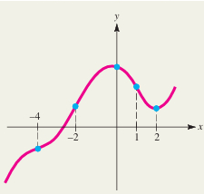 ❌ _(Hệ thống — LTTN Bài 5)_

- A. (−∞, −4) ∪ (−2, 1)
- B. (−∞, −2) ∪ (0, +∞)
- **C. (−4, −2) ∪ (1, +∞)** ✅
- D. (−4, 1)

> 💡 ✅ Đáp án hệ thống. **Cách đọc đồ thị:** f''(x) > 0 là những khoảng đồ thị **lõm lên** (bề lõm hướng lên, như hình chữ U); f''(x) < 0 là lõm xuống.
> 1. Các điểm đánh dấu trên đồ thị (x = −4, −2, 1) là các **điểm uốn** (nơi bề lõm đổi chiều); x = 2 chỉ là điểm tham chiếu thêm, không phải điểm uốn.
> 2. Quan sát hình: đồ thị lõm xuống trên (−∞, −4), lõm lên trên (−4, −2), lõm xuống trên (−2, 1), rồi lõm lên trên (1, +∞).
> 3. **Kết quả: f''(x) > 0 trên (−4, −2) ∪ (1, +∞).**
> 4. ⚠️ Đây là câu đọc đồ thị trực tiếp (không có công thức f(x) cụ thể), nên hình được giữ nguyên như ảnh gốc, không vẽ lại từ công thức.

## Trắc nghiệm hệ thống — lần 1+2 (LTTN Bài 6)

> Đáp án theo phần "The correct answer is" của hệ thống. Hai lượt làm (14:12:25 và 14:12:42) có nội dung và đáp án hoàn toàn giống nhau (cả hai đều 10/10), nên chỉ giữ 1 bản, không lặp lại câu nào.

**Câu 151.** Cho F(x) là một nguyên hàm của hàm số f(x) = 2e⁻³ˣ + ∛(x²). Biết F(0) = 1. Giá trị F(1) là: _(Hệ thống — LTTN Bài 6)_

- **A. −2/(3e³) + 34/15** ✅
- B. −2/(3e³) + 3/5
- C. −6e³ + 34/15
- D. −6e³ + 3/5

> 💡 ✅ Đáp án hệ thống. **Cách tính:** F(x) là nguyên hàm của f(x) = 2e⁻³ˣ + x²ᐟ³ (vì ∛(x²) = x²ᐟ³), dùng điều kiện F(0) = 1 để tìm hằng số rồi tính F(1).
> 1. Nguyên hàm: ∫2e⁻³ˣdx = −(2/3)e⁻³ˣ; ∫x²ᐟ³dx = (3/5)x⁵ᐟ³. Vậy F(x) = −(2/3)e⁻³ˣ + (3/5)x⁵ᐟ³ + C.
> 2. Thay x = 0: F(0) = −2/3 + 0 + C = 1 ⇒ C = 5/3.
> 3. Thay x = 1: F(1) = −(2/3)e⁻³ + 3/5 + 5/3 = −2/(3e³) + 9/15 + 25/15 = −2/(3e³) + 34/15.
> 4. **Kết quả:** F(1) = −2/(3e³) + 34/15 → đáp án A.
> 5. ⚡ Lỗi hay gặp: quên cộng hằng số C hoặc cộng sai 3/5 + 5/3 (ra 3/5 như phương án B).

**Câu 152.** Chi phí cận biên của việc sản xuất q đơn vị một loại sản phẩm của một nhà sản xuất là C′(q) = 3q² − 30q + 200 đô-la mỗi đơn vị. Biết rằng chi phí để sản xuất 3 đơn vị đầu tiên là $1000. Tính chi phí để sản xuất 6 đơn vị đầu tiên? _(Hệ thống — LTTN Bài 6)_

- **A. $1384** ✅
- B. $1500
- C. $1200
- D. $1426

> 💡 ✅ Đáp án hệ thống. **Cách tính:** Tính tổng chi phí C(q) từ chi phí cận biên C′(q) = 3q² − 30q + 200, dùng điều kiện C(3) = 1000 để tìm hằng số, rồi tính C(6).
> 1. Nguyên hàm: C(q) = ∫(3q² − 30q + 200)dq = q³ − 15q² + 200q + K.
> 2. Thay q = 3: C(3) = 27 − 135 + 600 + K = 492 + K = 1000 ⇒ K = 508.
> 3. Thay q = 6: C(6) = 216 − 540 + 1200 + 508 = 1384.
> 4. **Kết quả:** chi phí sản xuất 6 đơn vị đầu tiên là $1384 → đáp án A.
> 5. ⚡ Phương án nhiễu: $1200 (c) là quên cộng hằng số K; $1500, $1426 do sai dấu hoặc sai hệ số khi lấy nguyên hàm.

**Câu 153.** Một nguyên hàm của hàm số f(x) = ∛((4x+1)²) là: _(Hệ thống — LTTN Bài 6)_

- A. (2/3)(4x+1)⁻¹ᐟ³
- B. (3/5)(4x+1)⁵ᐟ³
- **C. (3/20)(4x+1)⁵ᐟ³** ✅
- D. (1/4)(4x+1)⁻¹ᐟ³

> 💡 ✅ Đáp án hệ thống. **Cách tính:** f(x) = (4x+1)²ᐟ³, đổi biến u = 4x + 1 (du = 4dx) để lấy nguyên hàm.
> 1. ∫(4x+1)²ᐟ³dx = (1/4)∫u²ᐟ³du = (1/4)·(3/5)u⁵ᐟ³ + C = (3/20)(4x+1)⁵ᐟ³ + C.
> 2. **Kết quả:** nguyên hàm là (3/20)(4x+1)⁵ᐟ³ → đáp án C.
> 3. ⚡ Phương án nhiễu: (3/5)(4x+1)⁵ᐟ³ (b) là quên nhân hệ số 1/4 do đổi biến.

**Câu 154.** Biết ∫x²e²ˣ³dx = ke²ˣ³ + C. Giá trị của k là: _(Hệ thống — LTTN Bài 6)_

- A. 2/3
- B. 1/2
- **C. 1/6** ✅
- D. 3/4

> 💡 ✅ Đáp án hệ thống. **Cách tính:** Đổi biến u = 2x³ (du = 6x²dx) cho ∫x²e²ˣ³dx.
> 1. x²dx = du/6 nên ∫x²e²ˣ³dx = (1/6)∫eᵘdu = (1/6)eᵘ + C = (1/6)e²ˣ³ + C.
> 2. **Kết quả:** k = 1/6 → đáp án C.
> 3. ⚡ Phương án nhiễu: 2/3 (a) do nhầm hệ số đạo hàm của x³ là 3 thay vì 6 (= 3×2).

**Câu 155.** Biết ∫₁²(e⁻³ˣ + 1/√x)dx = ae⁻³ + be⁻⁶ + 2√2 − 2. Giá trị a + b là: _(Hệ thống — LTTN Bài 6)_

- A. 1/2
- **B. 0** ✅
- C. 2
- D. 3/4

> 💡 ✅ Đáp án hệ thống. **Cách tính:** Tính riêng từng phần của ∫₁²(e⁻³ˣ + 1/√x)dx rồi so hệ số a, b.
> 1. ∫e⁻³ˣdx từ 1 đến 2 = [−(1/3)e⁻³ˣ] = −(1/3)e⁻⁶ + (1/3)e⁻³ ⇒ hệ số của e⁻³ là a = 1/3, hệ số của e⁻⁶ là b = −1/3.
> 2. ∫x⁻¹ᐟ²dx từ 1 đến 2 = [2√x] = 2√2 − 2 (khớp phần còn lại của đề).
> 3. **Kết quả:** a + b = 1/3 + (−1/3) = 0 → đáp án B.
> 4. ⚡ Phương án nhiễu: 1/2, 2, 3/4 là các giá trị do nhầm dấu hoặc hệ số khi lấy nguyên hàm của e⁻³ˣ.

**Câu 156.** Người ta ước lượng được tốc độ thay đổi giá p (đô-la) của mỗi đơn vị một loại hàng hóa là dp/dx = −100x/√(21+x²), trong đó x là cầu của người tiêu dùng (số lượng hàng hóa được mua ở mức giá p), đo bằng (trăm) đơn vị. Giả sử lượng cầu là 200 đơn vị (x = 2) khi giá p = $20 mỗi đơn vị. Hàm cầu p(x) là: _(Hệ thống — LTTN Bài 6)_

- A. p(x) = −200√(21+x²) + 520
- **B. p(x) = −100√(21+x²) + 520** ✅
- C. p(x) = −100√(21+x²) + 460
- D. p(x) = −200√(21+x²) + 460

> 💡 ✅ Đáp án hệ thống. **Cách tính:** Hàm cầu p(x) là nguyên hàm của dp/dx = −100x/√(21+x²), dùng điều kiện p(2) = 20 để tìm hằng số.
> 1. Nhận xét d/dx[√(21+x²)] = x/√(21+x²), nên ∫−100x/√(21+x²)dx = −100√(21+x²) + C.
> 2. Thay x = 2, p = 20: −100√(21+4) + C = −100·5 + C = −500 + C = 20 ⇒ C = 520.
> 3. **Kết quả:** p(x) = −100√(21+x²) + 520 → đáp án B.
> 4. ⚡ Phương án nhiễu: hệ số −200 (a, d) do nhầm hệ số 100 thành 200; hằng số 460 (c, d) do tính sai p(2).

**Câu 157.** Diện tích của miền phẳng nằm bên dưới đường cong f(x) = √x(x+2) trên đoạn 0 ≤ x ≤ 1 là: _(Hệ thống — LTTN Bài 6)_

- **A. 26/15** ✅
- B. 13/5
- C. 2
- D. 30/9

> 💡 ✅ Đáp án hệ thống. **Cách tính:** Diện tích = ∫₀¹f(x)dx với f(x) = √x(x+2) = x³ᐟ² + 2x¹ᐟ².
> 1. ∫(x³ᐟ² + 2x¹ᐟ²)dx = (2/5)x⁵ᐟ² + (4/3)x³ᐟ² + C.
> 2. Tính từ 0 đến 1: 2/5 + 4/3 = 6/15 + 20/15 = 26/15.
> 3. **Kết quả:** diện tích = 26/15 → đáp án A.
> 4. ⚡ Phương án nhiễu: 13/5 (b) = đúng gấp đôi/sai rút gọn so với 26/15; 30/9 (d) do cộng sai mẫu số khi quy đồng.

**Câu 158.** Cho hàm f(x) liên tục trên đoạn −1 ≤ x ≤ 6, biết ∫₋₁⁶f(x)dx = 3 và ∫₃⁶f(x)dx = 7. Giá trị của ∫₋₁³f(x)dx là _(Hệ thống — LTTN Bài 6)_

- A. 20
- B. 10
- C. −6
- **D. −4** ✅

> 💡 ✅ Đáp án hệ thống. **Cách tính:** Dùng tính chất tách cận của tích phân xác định: ∫₋₁⁶f(x)dx = ∫₋₁³f(x)dx + ∫₃⁶f(x)dx.
> 1. Thay số: 3 = ∫₋₁³f(x)dx + 7.
> 2. **Kết quả:** ∫₋₁³f(x)dx = 3 − 7 = −4 → đáp án D.
> 3. ⚡ Phương án nhiễu: 10 (b) do cộng nhầm 3 + 7; 20, −6 (a, c) do nhầm dấu hoặc nhầm phép toán khi tách cận.

**Câu 159.** Chi phí cận biên của một nhà máy là C′(q) = 5q(q − 4) đô-la mỗi đơn vị khi mức sản xuất là q đơn vị. Nếu mức sản xuất tăng từ 6 đơn vị lên 12 đơn vị thì tổng chi phí sản xuất tăng bao nhiêu đô-la? _(Hệ thống — LTTN Bài 6)_

- A. 2060
- B. 1260
- C. 2100
- **D. 1440** ✅

> 💡 ✅ Đáp án hệ thống. **Cách tính:** Tổng chi phí tăng khi sản lượng tăng từ 6 lên 12 là ∫₆¹²C′(q)dq với C′(q) = 5q(q−4) = 5q² − 20q.
> 1. Nguyên hàm: ∫(5q² − 20q)dq = (5/3)q³ − 10q².
> 2. Tại q = 12: (5/3)·1728 − 10·144 = 2880 − 1440 = 1440.
> 3. Tại q = 6: (5/3)·216 − 10·36 = 360 − 360 = 0.
> 4. **Kết quả:** chi phí tăng = 1440 − 0 = 1440 đô-la → đáp án D.
> 5. ⚡ Phương án nhiễu: 2060, 1260, 2100 do tính sai nguyên hàm hoặc quên trừ giá trị tại q = 6.

**Câu 160.** Một khối protein có khối lượng m (gram) phân hủy thành các axit amin với tốc độ: dm/dt = −20/(t+5)² (g/giờ). Mức thay đổi ròng của khối protein này trong 3 giờ đầu là: ĐÁP ÁN: _(Hệ thống — LTTN Bài 6)_

- **A. 1.5 gram** ✅
- B. 2 gram
- C. 1 gram
- D. 2.5 gram

> 💡 ✅ Đáp án hệ thống. **Cách tính:** Mức thay đổi ròng = ∫₀³(dm/dt)dt với dm/dt = −20/(t+5)².
> 1. Nguyên hàm: ∫−20/(t+5)²dt = 20/(t+5) + C.
> 2. Tính từ 0 đến 3: 20/(3+5) − 20/(0+5) = 20/8 − 20/5 = 2,5 − 4 = −1,5.
> 3. **Kết quả:** khối lượng giảm 1,5 gram trong 3 giờ đầu → đáp án A (1.5 gram).
> 4. ⚡ Phương án nhiễu: 2, 1, 2.5 gram do tính sai nguyên hàm hoặc nhầm cận tích phân.

## Trắc nghiệm hệ thống — lần 1 (LTTN tổng hợp)

> Đáp án theo phần "The correct answer is" của hệ thống. Chỉ ghi các câu mới.

**Câu 161.** Một người tiêu dùng chi $280 để mua sắm hai loại hàng hóa, hàng hóa thứ nhất có giá $2 mỗi đơn vị và hàng hóa thứ hai có giá $5 mỗi đơn vị. Giả sử rằng lợi ích mà người đó thu được từ việc có x đơn vị hàng hóa thứ nhất và y đơn vị hàng hóa thứ hai là U(x,y) = 100x^0.25y^0.75. Người đó nên mua bao nhiêu đơn vị hàng hóa mỗi loại để thu được lợi ích tối đa? _(Hệ thống — LTTN tổng hợp lần 1)_

- A. x = 45; y = 38
- B. x = 30; y = 44
- C. x = 50; y = 36
- **D. x = 35; y = 42** ✅

> 💡 ✅ Đáp án hệ thống. **Cách tính:** Bài toán tối đa hóa hàm Cobb-Douglas U(x,y)=100x^0.25y^0.75 với ràng buộc ngân sách 2x+5y=280.
> 1. Với hàm Cobb-Douglas U=x^a y^b, nghiệm tối ưu theo ràng buộc p₁x+p₂y=I là x*=a/(a+b)·I/p₁, y*=b/(a+b)·I/p₂.
> 2. Thay số: a=0.25; b=0.75; a+b=1; I=280; p₁=2; p₂=5.
> 3. x*=0.25·280/2=35; y*=0.75·280/5=42.
> 4. **Kết quả:** x=35; y=42 → đáp án D.
> 5. ⚡ Lỗi hay gặp: nhầm vai trò số mũ giữa x và y dẫn tới phân bổ ngược (ví dụ chọn x=45;y=38).

**Câu 162.** Giá trị của tích phân ∫₀² √(4-x²)dx là _(Hệ thống — LTTN tổng hợp lần 1)_

- A. 4π
- **B. π** ✅
- C. 8π
- D. π/2

> 💡 ✅ Đáp án hệ thống. **Cách tính:** Tích phân ∫₀²√(4-x²)dx là diện tích một phần của hình tròn.
> 1. Hàm y=√(4-x²) là nửa trên đường tròn x²+y²=4 (bán kính R=2).
> 2. Cận x từ 0 đến 2 ứng với một phần tư đường tròn (góc phần tư thứ nhất).
> 3. Diện tích cả hình tròn là πR²=4π; một phần tư là 4π/4=π.
> 4. **Kết quả:** π → đáp án B.
> 5. ⚡ Lỗi hay gặp: lấy diện tích cả hình tròn (4π) hoặc nửa hình tròn thay vì một phần tư.

**Câu 163.** Hàm số y=(2x-1)³(x+2)² có bao nhiêu điểm cực trị tương đối? _(Hệ thống — LTTN tổng hợp lần 1)_

- **A. 2** ✅
- B. 3
- C. 4
- D. 0

> 💡 ✅ Đáp án hệ thống. **Cách tính:**
> 1. Đạo hàm: y'=3(2x-1)²·2·(x+2)²+(2x-1)³·2(x+2)=2(2x-1)²(x+2)[3(x+2)+(2x-1)]=10(2x-1)²(x+2)(x+1).
> 2. Nghiệm của y'=0: x=1/2 (bội 2, không đổi dấu), x=-2 (bội 1), x=-1 (bội 1).
> 3. Chỉ nghiệm bội lẻ làm y' đổi dấu mới là cực trị: x=-2 và x=-1.
> 4. **Kết quả:** 2 điểm cực trị tương đối → đáp án A.
> 5. ⚡ Lỗi hay gặp: đếm cả nghiệm bội chẵn x=1/2 làm cực trị (ra 3).

**Câu 164.** Nhiệt độ ở một vùng trong khoảng thời gian từ 6 giờ sáng đến 6 giờ tối được mô hình hóa bởi hàm: T(t) = 3 - (1/3)(t-4)² với 0 ≤ t ≤ 12 [bản chụp gốc của hệ thống bị lỗi hiển thị ký tự "≤", hiện ra dạng "với 02"], với t là số giờ kể từ 6 giờ sáng. Nhiệt độ trung bình suốt thời gian làm việc (từ 8 giờ sáng tới 5 giờ chiều) là bao nhiêu? _(Hệ thống — LTTN tổng hợp lần 1)_

- **A. -4/3** ✅
- B. -5/3
- C. -2
- D. -7/3

> 💡 ✅ Đáp án hệ thống. **Cách tính:** Giá trị trung bình của T(t) trên [a,b] là (1/(b-a))∫ₐᵇT(t)dt.
> 1. 8 giờ sáng ứng với t=2 (tính từ 6 giờ sáng); 5 giờ chiều ứng với t=11.
> 2. ∫₂¹¹[3-(1/3)(t-4)²]dt = [3t-(1/9)(t-4)³] từ 2 đến 11.
> 3. Tại t=11: 33-343/9=-46/9. Tại t=2: 6+8/9=62/9. Hiệu: -46/9-62/9=-108/9=-12.
> 4. Trung bình = -12/(11-2) = -12/9 = -4/3.
> 5. **Kết quả:** -4/3 → đáp án A.
> 6. ⚡ Lỗi hay gặp: lấy sai cận tích phân (dùng t=0 đến 12 thay vì 2 đến 11).

**Câu 165.** Hàm số hai biến là một quy tắc cho tương ứng: _(Hệ thống — LTTN tổng hợp lần 1)_

- A. mỗi con số thuộc tập D ⊂ R cho trước với một và chỉ một cặp số có thứ tự (x,y).
- B. hai số x, y thuộc tập D ⊂ R cho trước với một và chỉ một số thực.
- **C. mỗi cặp số có thứ tự (x,y) trong tập D đã cho với một và chỉ một số thực.** ✅
- D. tất cả cặp số có thứ tự (x,y) trong tập D đã cho với một và chỉ một số thực.

> 💡 ✅ Đáp án hệ thống. **Cách tính:** Câu lý thuyết định nghĩa hàm hai biến.
> 1. Hàm hai biến f là quy tắc cho tương ứng mỗi cặp số có thứ tự (x,y) thuộc miền xác định D với một và chỉ một số thực z=f(x,y).
> 2. Phương án C diễn đạt đúng định nghĩa này.
> 3. **Kết quả:** đáp án C.
> 4. ⚡ Lỗi hay gặp: nhầm chiều tương ứng (phương án A nói mỗi số ứng với một cặp, ngược định nghĩa).

**Câu 166.** Một nghiên cứu về hiệu quả làm việc tại một ca sáng ở một nhà máy chỉ ra rằng, t giờ sau khi bắt đầu làm việc vào lúc 8 giờ sáng, một công nhân điển hình sẽ sản xuất được Q(t) = -t³+9t²+15t đơn vị sản phẩm. Tốc độ sản xuất của công nhân vào thời điểm 9 giờ sáng thay đổi với tốc độ là: _(Hệ thống — LTTN tổng hợp lần 1)_

- A. 10 đơn vị mỗi giờ, mỗi giờ
- **B. 12 đơn vị mỗi giờ, mỗi giờ** ✅
- C. 20 đơn vị mỗi giờ, mỗi giờ
- D. 15 đơn vị mỗi giờ, mỗi giờ

> 💡 ✅ Đáp án hệ thống. **Cách tính:** "Tốc độ sản xuất thay đổi với tốc độ" nghĩa là cần tính đạo hàm cấp hai Q''(t) tại t=1 (9 giờ sáng, vì t tính từ 8 giờ sáng).
> 1. Q'(t)=-3t²+18t+15 (tốc độ sản xuất).
> 2. Q''(t)=-6t+18 (tốc độ thay đổi của tốc độ sản xuất).
> 3. Thay t=1: Q''(1)=-6+18=12.
> 4. **Kết quả:** 12 đơn vị/giờ/giờ → đáp án B.
> 5. ⚡ Lỗi hay gặp: tính Q'(1)=30 (chỉ là tốc độ sản xuất, không phải tốc độ thay đổi của nó).

**Câu 167.** Số tới hạn của hàm y = e^(-3x)/(4-x) là _(Hệ thống — LTTN tổng hợp lần 1)_

- A. x = 21/3
- B. x = 3/11
- C. x = 4
- **D. x = 11/3** ✅

> 💡 ✅ Đáp án hệ thống. **Cách tính:** Số tới hạn là nghiệm của y'=0 (trong miền xác định).
> 1. Dùng quy tắc thương: y'=[(-3e^(-3x))(4-x)-e^(-3x)(-1)]/(4-x)²=e^(-3x)[-3(4-x)+1]/(4-x)²=e^(-3x)(3x-11)/(4-x)².
> 2. Vì e^(-3x)>0 luôn, y'=0 khi 3x-11=0 ⇒ x=11/3.
> 3. Tại x=4 hàm không xác định nên không phải số tới hạn.
> 4. **Kết quả:** x=11/3 → đáp án D.
> 5. ⚡ Lỗi hay gặp: nhầm điểm hàm không xác định x=4 là số tới hạn.

**Câu 168.** Cho hàm số f(x,y) = 72x^(2/3)y^(1/2). Khi đó f_xx(8,4) + f_yy(8,4) = _(Hệ thống — LTTN tổng hợp lần 1)_

- A. -2
- **B. -11** ✅
- C. -9
- D. 12

> 💡 ✅ Đáp án hệ thống. **Cách tính:**
> 1. f_x=48x^(-1/3)y^(1/2) ⇒ f_xx=-16x^(-4/3)y^(1/2).
> 2. f_y=36x^(2/3)y^(-1/2) ⇒ f_yy=-18x^(2/3)y^(-3/2).
> 3. Tại (8,4): x^(-4/3)=1/16, y^(1/2)=2 ⇒ f_xx=-16·(1/16)·2=-2.
> 4. x^(2/3)=4, y^(-3/2)=1/8 ⇒ f_yy=-18·4·(1/8)=-9.
> 5. Tổng: f_xx+f_yy=-2+(-9)=-11.
> 6. **Kết quả:** -11 → đáp án B.
> 7. ⚡ Lỗi hay gặp: tính nhầm số mũ khi đạo hàm cấp hai của x^(2/3) hoặc y^(1/2).

**Câu 169.** Cho hàm số z = f(x,y) = 6x/y với x = x(t) và y = y(t). Biết rằng x'(t) = t/(t+3) và y'(t) = (2t+9)/(t+2). Khi t = 3 thì x = 10 và y = 3. Giá trị z'(t) tại t = 3 bằng _(Hệ thống — LTTN tổng hợp lần 1)_

- **A. -19** ✅
- B. -1
- C. 8/3
- D. 3.5

> 💡 ✅ Đáp án hệ thống. **Cách tính:** Dùng quy tắc chuỗi cho hàm hợp hai biến: z'(t)=∂z/∂x·x'(t)+∂z/∂y·y'(t).
> 1. ∂z/∂x=6/y; ∂z/∂y=-6x/y².
> 2. Tại t=3: x=10,y=3 ⇒ ∂z/∂x=6/3=2; ∂z/∂y=-60/9=-20/3.
> 3. x'(3)=3/(3+3)=0.5; y'(3)=(6+9)/(3+2)=3.
> 4. z'(3)=2·0.5+(-20/3)·3=1-20=-19.
> 5. **Kết quả:** -19 → đáp án A.
> 6. ⚡ Lỗi hay gặp: quên nhân đúng x'(t), y'(t) theo từng thành phần hoặc tính sai ∂z/∂y.

**Câu 170.** Một khối protein có khối lượng m (gram) phân hủy thành các axit amin với tốc độ: dm/dt = -20/(t+5)² (g/giờ). Mức thay đổi khối lượng ròng của khối protein này trong 3 giờ đầu là:
ĐÁP ÁN: _(Hệ thống — LTTN tổng hợp lần 1)_

- **A. 1.5 gram** ✅
- B. 2 gram
- C. 1 gram
- D. 2.5 gram

> 💡 ✅ Đáp án hệ thống. **Cách tính:** Thay đổi ròng = ∫₀³ (dm/dt) dt.
> 1. Nguyên hàm: ∫-20/(t+5)²dt = 20/(t+5)+C.
> 2. Tính từ 0 đến 3: 20/8 - 20/5 = 2.5 - 4 = -1.5.
> 3. **Kết quả:** khối lượng giảm 1.5 gram → đáp án A.
> 4. ⚡ Lỗi hay gặp: quên dấu trừ khi lấy nguyên hàm của 1/(t+5)², dẫn đến sai dấu hoặc sai giá trị.

**Câu 171.** Tổng chi phí để sản xuất q đơn vị một loại hàng hóa tại một nhà máy là C(q) = 0.25q²+2q+500 đô-la. Người ta xác định được rằng t giờ sau khi bắt đầu quá trình vận hành sản xuất, số lượng hàng hóa được sản xuất là q(t) = t²+50t đơn vị. Tốc độ thay đổi của chi phí sản xuất theo thời gian ở thời điểm 1 giờ sau khi bắt đầu sản xuất là:
ĐÁP ÁN: _(Hệ thống — LTTN tổng hợp lần 1)_

- **A. 1,430 đô-la mỗi giờ** ✅
- B. 1,230 đô-la mỗi giờ
- C. 430 đô-la mỗi giờ
- D. 143 đô-la mỗi giờ

> 💡 ✅ Đáp án hệ thống. **Cách tính:** Dùng quy tắc chuỗi (tốc độ liên quan): dC/dt = dC/dq · dq/dt.
> 1. dC/dq=0.5q+2; dq/dt=2t+50.
> 2. Tại t=1: q(1)=1+50=51 ⇒ dC/dq=0.5·51+2=27.5.
> 3. dq/dt tại t=1: 2+50=52.
> 4. dC/dt=27.5·52=1,430.
> 5. **Kết quả:** 1,430 đô-la/giờ → đáp án A.
> 6. ⚡ Lỗi hay gặp: quên tính q(1) trước khi thay vào dC/dq, dẫn đến thay nhầm q=1.

**Câu 172.** Giả sử sản lượng Q của một nhà máy phụ thuộc vào lượng vốn đầu tư K và quy mô của lực lượng lao động L. Khi đó sản lượng cận biên của lao động Q_L(K,L) xấp xỉ bằng _(Hệ thống — LTTN tổng hợp lần 1)_

- A. sản lượng tăng thêm khi K tăng 1 đơn vị còn L giữ nguyên.
- B. sản lượng tăng thêm khi K và L cùng tăng 1 đơn vị.
- C. sản lượng giảm đi khi K tăng 1 đơn vị còn L giữ nguyên.
- **D. sản lượng tăng thêm khi L tăng 1 đơn vị còn K giữ nguyên.** ✅

> 💡 ✅ Đáp án hệ thống. **Cách tính:** Câu lý thuyết về ý nghĩa đạo hàm riêng (sản lượng cận biên).
> 1. Q_L(K,L)=∂Q/∂L là tốc độ thay đổi của Q khi L thay đổi, giữ K cố định.
> 2. Theo xấp xỉ tuyến tính, Q_L(K,L) xấp xỉ bằng lượng sản lượng tăng thêm khi L tăng thêm 1 đơn vị, K giữ nguyên.
> 3. **Kết quả:** đáp án D.
> 4. ⚡ Lỗi hay gặp: nhầm với sản lượng cận biên của vốn Q_K (phương án A).

**Câu 173.** Nồng độ thuốc trong máu của một bệnh nhân t giờ sau khi tiêm là C(t) = 0.5/(t^1.3+1) + 0.015 (mg/ml). Nồng độ thuốc tồn dư, tức là nồng độ thuốc vẫn còn trong cơ thể bệnh nhân trong dài hạn sẽ là:
ĐÁP ÁN: _(Hệ thống — LTTN tổng hợp lần 1)_

- A. 0.012 (mg/ml)
- B. 0.05 (mg/ml)
- C. 0.01 (mg/ml)
- **D. 0.015 (mg/ml)** ✅

> 💡 ✅ Đáp án hệ thống. **Cách tính:** Nồng độ tồn dư dài hạn là giới hạn của C(t) khi t→+∞.
> 1. lim(t→∞) 0.5/(t^1.3+1) = 0 (vì mẫu số tăng vô hạn).
> 2. lim(t→∞) C(t) = 0 + 0.015 = 0.015.
> 3. **Kết quả:** 0.015 (mg/ml) → đáp án D.
> 4. ⚡ Lỗi hay gặp: không nhận ra số hạng phân thức tiến về 0, cộng nhầm vào kết quả.

**Câu 174.** Cho hàm y=f(x) được xác định bởi phương trình y²+3xy-4x²=9. Đạo hàm của y theo biến x là: _(Hệ thống — LTTN tổng hợp lần 1)_

- **A. y' = (8x-3y)/(3x+2y)** ✅
- B. y' = (8x+3y)/(3x+2y)
- C. y' = (-8x+3y)/(3x+2y)
- D. y' = (-8x-3y)/(3x+2y)

> 💡 ✅ Đáp án hệ thống. **Cách tính:** Đạo hàm ẩn hai vế theo x.
> 1. Đạo hàm: 2y·y' + 3y + 3x·y' - 8x = 0.
> 2. Nhóm y': y'(2y+3x) = 8x - 3y.
> 3. y' = (8x-3y)/(3x+2y).
> 4. **Kết quả:** đáp án A.
> 5. ⚡ Lỗi hay gặp: quên áp dụng quy tắc tích khi đạo hàm số hạng 3xy (bỏ sót số hạng 3y hoặc 3x·y').

**Câu 175.** Cho hàm số y=f(x) xác định, liên tục và khả vi trên khoảng (a,b). Nếu tại số tới hạn x₀ ∈ (a,b), đạo hàm f'(x) đổi dấu từ dương sang âm khi x đi qua x₀, thì: _(Hệ thống — LTTN tổng hợp lần 1)_

- A. f(x) đạt cực tiểu tương đối tại x₀.
- **B. f(x) đạt cực đại tương đối tại x₀.** ✅
- C. x₀ là điểm uốn của đồ thị hàm số f(x).
- D. f(x) không đạt cực trị tại x₀.

> 💡 ✅ Đáp án hệ thống. **Cách tính:** Nội dung quy tắc kiểm tra cực trị bằng đạo hàm cấp một.
> 1. Nếu f'(x) đổi dấu từ dương (hàm đang tăng) sang âm (hàm đang giảm) khi qua x₀, thì hàm đạt cực đại tương đối tại x₀.
> 2. **Kết quả:** đáp án B.
> 3. ⚡ Lỗi hay gặp: nhầm chiều đổi dấu (dương→âm là cực đại, không phải cực tiểu).

**Câu 176.** Giá trị cực đại của hàm f(x,y) = -2x²-y² với điều kiện ràng buộc x+2y=-6 là: _(Hệ thống — LTTN tổng hợp lần 1)_

- A. 10
- **B. -8** ✅
- C. 8
- D. -10

> 💡 ✅ Đáp án hệ thống. **Cách tính:** Thế ràng buộc vào hàm mục tiêu rồi tìm cực trị một biến.
> 1. Từ ràng buộc: x=-6-2y.
> 2. Thế vào f: f=-2(-6-2y)²-y²=-72-48y-9y².
> 3. Đạo hàm theo y: df/dy=-48-18y=0 ⇒ y=-8/3.
> 4. x=-6-2(-8/3)=-2/3.
> 5. f=-2(-2/3)²-(-8/3)²=-8/9-64/9=-72/9=-8.
> 6. **Kết quả:** -8 → đáp án B.
> 7. ⚡ Lỗi hay gặp: quên bình phương khi thế x theo y, hoặc tính nhầm dấu khi đạo hàm.

**Câu 177.** Hàm f(x,y) = x²+y² với điều kiện ràng buộc x+y=2 đạt cực tiểu tại điểm: _(Hệ thống — LTTN tổng hợp lần 1)_

- A. (1,-1)
- **B. (1,1)** ✅
- C. (-1,1)
- D. (-1,-1)

> 💡 ✅ Đáp án hệ thống. **Cách tính:**
> 1. Thế x=2-y vào f: f=(2-y)²+y²=4-4y+2y².
> 2. df/dy=-4+4y=0 ⇒ y=1 ⇒ x=1.
> 3. d²f/dy²=4>0 nên đây là điểm cực tiểu.
> 4. **Kết quả:** (1,1) → đáp án B.
> 5. ⚡ Lỗi hay gặp: nhầm dấu khi thế x=2-y, dẫn tới điểm (1,-1) hoặc (-1,1).

**Câu 178.** Khoảng đơn điệu tăng của hàm số y = e^(-2x)/(x-5) là _(Hệ thống — LTTN tổng hợp lần 1)_

- A. (9/2;5)
- B. (1;5)
- **C. (1;9/2)** ✅
- D. (5;+∞)

> 💡 ✅ Đáp án hệ thống. **Cách tính:**
> 1. Đạo hàm bằng quy tắc thương: y'=e^(-2x)[-2(x-5)-1]/(x-5)²=e^(-2x)(9-2x)/(x-5)².
> 2. Vì e^(-2x)>0 và (x-5)²>0 (x≠5), dấu y' theo dấu (9-2x): y'>0 khi x<9/2, y'<0 khi x>9/2 (x≠5).
> 3. Vậy hàm đồng biến trên toàn bộ (-∞;9/2); trong 4 khoảng đã cho, chỉ (1;9/2) nằm hoàn toàn trong vùng đồng biến này (các khoảng (9/2;5) và (5;+∞) đều thuộc vùng nghịch biến, còn (1;5) lại cắt qua điểm x=9/2 nên không đồng biến trên toàn khoảng đó).
> 4. **Kết quả:** (1;9/2) → đáp án C.
> 5. ⚡ Lỗi hay gặp: chọn (1;5) vì tưởng cả khoảng đều tăng, trong khi hàm đã nghịch biến từ 9/2 đến 5.

**Câu 179.** Hàm f(x,y) = x²+4xy+ay²+4y đạt cực tiểu tại điểm tới hạn duy nhất nếu _(Hệ thống — LTTN tổng hợp lần 1)_

- A. a = 2
- B. a = 3
- C. a = 4
- **D. a = 5** ✅

> 💡 ✅ Đáp án hệ thống. **Cách tính:** Dùng tiêu chuẩn đạo hàm cấp hai (định thức Hesse) cho hàm hai biến.
> 1. f_x=2x+4y; f_y=4x+2ay+4; f_xx=2; f_yy=2a; f_xy=4.
> 2. Để có điểm tới hạn duy nhất cần a≠4 (hệ hai phương trình tuyến tính có nghiệm duy nhất).
> 3. Để là cực tiểu cần D=f_xx·f_yy-f_xy²>0 và f_xx>0: D=2·2a-16=4a-16>0 ⇒ a>4.
> 4. Trong các phương án chỉ a=5 thỏa mãn a>4 (và a≠4).
> 5. **Kết quả:** a=5 → đáp án D.
> 6. ⚡ Lỗi hay gặp: chọn a=4 (hệ phương trình không có nghiệm duy nhất) hoặc quên kiểm tra điều kiện D>0.

**Câu 180.** Giả sử tổng chi phí để sản xuất q đơn vị một loại sản phẩm là C(q) (nghìn đô-la), với: C(q) = 0.01q²+0.9q+5. Tổng chi phí để sản xuất 10 đơn vị sản phẩm đó bằng bao nhiêu? _(Hệ thống — LTTN tổng hợp lần 1)_

- **A. 15 (nghìn đô-la)** ✅
- B. 12 (nghìn đô-la)
- C. 20 (nghìn đô-la)
- D. 250 (nghìn đô-la)

> 💡 ✅ Đáp án hệ thống. **Cách tính:** Thay q=10 vào hàm chi phí.
> 1. C(10)=0.01·10²+0.9·10+5=1+9+5=15.
> 2. **Kết quả:** 15 (nghìn đô-la) → đáp án A.
> 3. ⚡ Lỗi hay gặp: tính nhầm 0.01·100=10 thay vì 1.

**Câu 181.** Một nhà đầu tư có $100,000 để đầu tư vào hai loại cổ phiếu A và B. Anh ta ước tính rằng nếu đầu tư x nghìn đô-la vào cổ phiếu A và y nghìn đô-la vào cổ phiếu B, thì tổng lợi nhuận thu được sẽ là L(x,y) = 15x^(1/2)y^(1/2) nghìn đô-la. Nhà đầu tư nên phân bổ số tiền đầu tư vào cổ phiếu A và B như thế nào để thu được lợi nhuận tối đa? _(Hệ thống — LTTN tổng hợp lần 1)_

- A. x = 60; y = 40 (nghìn đô la)
- **B. x = 50; y = 50 (nghìn đô la)** ✅
- C. x = 40; y = 60 (nghìn đô la)
- D. x = 30; y = 70 (nghìn đô la)

> 💡 ✅ Đáp án hệ thống. **Cách tính:** Tối đa hóa L(x,y)=15x^(1/2)y^(1/2) với ràng buộc x+y=100.
> 1. Vì hàm Cobb-Douglas có hai số mũ bằng nhau (1/2 và 1/2), nghiệm tối ưu chia đều ngân sách: x*=(1/2)/(1/2+1/2)·100=50; y*=50.
> 2. **Kết quả:** x=50; y=50 (nghìn đô la) → đáp án B.
> 3. ⚡ Lỗi hay gặp: phân bổ lệch (ví dụ 60/40) do nhầm công thức tỉ lệ số mũ.

**Câu 182.** Lợi nhuận (đơn vị: nghìn đô la) mà một công ty thu được từ việc bán một mẫu điện thoại thông minh mới ở thời điểm x tháng sau kể từ khi ra mắt thị trường được mô hình hóa bởi công thức: P(x) = 100x/(x²+25). Sau bao nhiêu tháng, lợi nhuận của công ty đạt mức cao nhất? Mức lợi nhuận cao nhất đó là bao nhiêu? _(Hệ thống — LTTN tổng hợp lần 1)_

- A. Sau 10 tháng và P_max = 20 (nghìn USD)
- B. Sau 25 tháng và P_max = 25 (nghìn USD)
- C. Sau 3 tháng và P_max = 5 (nghìn USD)
- **D. Sau 5 tháng và P_max = 10 (nghìn USD)** ✅

> 💡 ✅ Đáp án hệ thống. **Cách tính:**
> 1. P'(x)=[100(x²+25)-100x·2x]/(x²+25)²=100(25-x²)/(x²+25)².
> 2. P'(x)=0 ⇒ 25-x²=0 ⇒ x=5 (x>0).
> 3. P(5)=100·5/(25+25)=500/50=10.
> 4. **Kết quả:** Sau 5 tháng, P_max=10 (nghìn USD) → đáp án D.
> 5. ⚡ Lỗi hay gặp: quên điều kiện x>0 (loại x=-5) hoặc tính sai đạo hàm của thương.

**Câu 183.** Tích phân suy rộng ∫₋∞⁰ dx/[(x-1)(x-2)] nhận giá trị bằng: _(Hệ thống — LTTN tổng hợp lần 1)_

- A. 2
- **B. ln2** ✅
- C. 0
- D. -ln2

> 💡 ✅ Đáp án hệ thống. **Cách tính:**
> 1. Phân tích: 1/[(x-1)(x-2)] = 1/(x-2) - 1/(x-1).
> 2. Nguyên hàm: ln|x-2| - ln|x-1| = ln|(x-2)/(x-1)|.
> 3. Tính: lim(a→-∞) {ln|(x-2)/(x-1)| từ a đến 0} = ln|(-2)/(-1)| - lim(a→-∞)ln|(a-2)/(a-1)| = ln2 - ln1 = ln2.
> 4. **Kết quả:** ln2 → đáp án B.
> 5. ⚡ Lỗi hay gặp: sai dấu khi tách phân thức hoặc quên lấy giới hạn ở cận -∞.

**Câu 184.** Khi sử dụng phương pháp nhân tử Lagrange để tìm giá trị cực đại và cực tiểu của hàm f(x,y) với điều kiện ràng buộc g(x,y)=k, ta thiết lập một hệ gồm 3 phương trình Lagrange. Hệ phương trình đó là: _(Hệ thống — LTTN tổng hợp lần 1)_

- **A. { f_x = λg_x; f_y = λg_y; g(x,y) = k }** ✅
- B. { g_x = λf_x; g_y = λf_y; g(x,y) = 0 }
- C. { f_x = λg_x; f_y = λg_y; f(x,y) = k }
- D. { f_x g_x = λ; f_y g_y = λ; g(x,y) = k }

> 💡 ✅ Đáp án hệ thống. **Cách tính:** Câu lý thuyết về hệ phương trình Lagrange chuẩn.
> 1. Phương pháp nhân tử Lagrange cho hàm hai biến với ràng buộc g(x,y)=k thiết lập hệ: f_x=λg_x, f_y=λg_y, g(x,y)=k.
> 2. **Kết quả:** đáp án A.
> 3. ⚡ Lỗi hay gặp: đảo vai trò f và g (phương án B) hoặc nhầm phương trình ràng buộc là f(x,y)=k thay vì g(x,y)=k (phương án C).

**Câu 185.** Cho hàm số f(x) có đạo hàm liên tục trên R và một số giá trị của f(x) được cho trong bảng sau: [bảng số liệu — bản chụp gốc của hệ thống bị lỗi hiển thị, chỉ thấy rõ hai ô ở hàng trên ghi số "2" và "3", các ô còn lại (kể cả toàn bộ hàng dưới, nhiều khả năng là hàng giá trị f(x)) không hiển thị số liệu]. Tích phân ∫₁⁹ f'(√x)/√x dx bằng _(Hệ thống — LTTN tổng hợp lần 1)_

- A. 2
- B. -1
- C. -1/2
- **D. -2** ✅

> 💡 ✅ Đáp án hệ thống. ⚠️ Bảng số liệu của câu này bị lỗi hiển thị trong bản chụp hệ thống (chỉ đọc được hai giá trị "2" và "3" ở hàng trên, không đọc được đầy đủ hàng giá trị f(x)), nên chưa tái hiện được đầy đủ phép tính bằng số — cần xác minh lại bằng ảnh gốc đề thi nếu có. Phương pháp giải và đáp án hệ thống như sau:
> 1. Đặt u=√x ⇒ du=1/(2√x)dx ⇒ dx/√x=2du.
> 2. Đổi cận: x=1⇒u=1; x=9⇒u=3.
> 3. Tích phân trở thành: ∫₁⁹ f'(√x)/√x dx = ∫₁³ f'(u)·2du = 2[f(3)-f(1)].
> 4. Theo đáp án hệ thống, kết quả bằng -2, suy ra f(3)-f(1)=-1 (giá trị cụ thể f(1), f(3) lấy từ bảng không đọc được trọn vẹn do lỗi hiển thị).
> 5. **Kết quả:** -2 → đáp án D (theo đáp án hệ thống).
> 6. ⚡ Lỗi hay gặp: quên nhân hệ số 2 khi đổi biến dx/√x=2du.

**Câu 186.** Cho hàm số y=f(x) có đạo hàm cấp hai f''(x) trên khoảng (c,d). Đồ thị hàm số y=f(x) có bề lõm hướng xuống trên khoảng (c,d) khi: _(Hệ thống — LTTN tổng hợp lần 1)_

- A. f''(x) > 0 với mọi x ∈ (c,d)
- **B. f''(x) < 0 với mọi x ∈ (c,d)** ✅
- C. f'(x) < 0 với mọi x ∈ (c,d)
- D. f'(x) > 0 với mọi x ∈ (c,d)

> 💡 ✅ Đáp án hệ thống. **Cách tính:** Định lý về tính lõm của đồ thị hàm số.
> 1. Đồ thị f(x) lõm xuống (concave down) trên (c,d) khi và chỉ khi f''(x)<0 với mọi x∈(c,d).
> 2. **Kết quả:** đáp án B.
> 3. ⚡ Lỗi hay gặp: nhầm với điều kiện đồng biến/nghịch biến (dùng f'(x) thay vì f''(x)).

**Câu 187.** Các khoảng mà đồ thị của hàm f(x) = 3x⁴-8x³+6x²-5x+1 có bề lõm hướng lên là _(Hệ thống — LTTN tổng hợp lần 1)_

- A. (1/3;2)
- B. (1/3;1)
- C. (-∞;7/12) và (2/3;+∞)
- **D. (-∞;1/3) và (1;+∞)** ✅

> 💡 ✅ Đáp án hệ thống. **Cách tính:**
> 1. f'(x)=12x³-24x²+12x-5.
> 2. f''(x)=36x²-48x+12=12(3x²-4x+1)=12(3x-1)(x-1).
> 3. f''(x)>0 khi (3x-1)(x-1)>0 ⇒ x<1/3 hoặc x>1.
> 4. **Kết quả:** lõm lên trên (-∞;1/3) và (1;+∞) → đáp án D.
> 5. ⚡ Lỗi hay gặp: giải sai bất phương trình bậc hai, lấy nhầm khoảng giữa hai nghiệm (1/3;1) làm khoảng lõm lên.

**Câu 188.** Tích phân ∫ dx/(√x+√(x-2)) = _(Hệ thống — LTTN tổng hợp lần 1)_

- **A. (1/3)[x^(3/2) - (x-2)^(3/2)] + C** ✅
- B. (2/3)[x^(3/2) - (x-2)^(3/2)] + C
- C. (1/3)[-x^(3/2) + (x-2)^(3/2)] + C
- D. (2/3)[-x^(3/2) + (x-2)^(3/2)] + C

> 💡 ✅ Đáp án hệ thống. **Cách tính:** Nhân cả tử và mẫu với lượng liên hợp để khử căn ở mẫu.
> 1. Nhân với (√x-√(x-2))/(√x-√(x-2)): mẫu trở thành x-(x-2)=2.
> 2. Tích phân trở thành (1/2)∫[√x-√(x-2)]dx = (1/2)∫[x^(1/2)-(x-2)^(1/2)]dx.
> 3. = (1/2)[(2/3)x^(3/2) - (2/3)(x-2)^(3/2)] + C = (1/3)[x^(3/2)-(x-2)^(3/2)] + C.
> 4. **Kết quả:** đáp án A.
> 5. ⚡ Lỗi hay gặp: quên nhân liên hợp, hoặc sai hệ số 1/3 so với 2/3.

**Câu 189.** Giả sử trên thị trường hai loại hàng hóa liên quan, giá của các hàng hóa là p₁ và p₂ và hàm cầu đối với mỗi loại hàng hóa lần lượt là D₁(p₁,p₂) và D₂(p₁,p₂). Dạng hàm cầu nào dưới đây sẽ không phù hợp nếu hai hàng hóa này là cặp hàng hóa thay thế? _(Hệ thống — LTTN tổng hợp lần 1)_

- A. D₁(p₁,p₂) = 2100 - 30p₁ - 40/p₂
- B. D₂(p₁,p₂) = 2100 + 30p₁ + 450/p₂
- C. D₂(p₁,p₂) = 2100 + 30√p₁ - 45p₂
- **D. D₁(p₁,p₂) = 2100 - 35p₁ - 30√p₂** ✅

> 💡 ✅ Đáp án hệ thống. **Cách tính:** Với hai hàng hóa thay thế, cầu của hàng hóa này phải tăng khi giá hàng hóa kia tăng (đạo hàm riêng theo giá hàng hóa kia phải dương), và giảm khi giá chính nó tăng.
> 1. Phương án A: ∂D₁/∂p₂=40/p₂²>0 (hợp lý).
> 2. Phương án B: ∂D₂/∂p₁=30>0 (hợp lý).
> 3. Phương án C: ∂D₂/∂p₁=15/√p₁>0 (hợp lý).
> 4. Phương án D: ∂D₁/∂p₂=-15/√p₂<0, nghĩa là D₁ giảm khi p₂ (giá hàng hóa thay thế) tăng — trái với tính chất hàng hóa thay thế.
> 5. **Kết quả:** đáp án D không phù hợp.
> 6. ⚡ Lỗi hay gặp: chỉ kiểm tra dấu hệ số own-price (p₁) mà bỏ qua dấu của số hạng chứa p₂ (cross-price).

## Trắc nghiệm hệ thống — lần 2 (LTTN tổng hợp)

> Đáp án theo phần "The correct answer is" của hệ thống. Chỉ ghi các câu mới.

**Câu 190.** Nhà sản xuất sẽ cung cấp q đơn vị một loại hàng hóa khi giá hàng hoá đó là p = 8 + 2q đô la mỗi đơn vị. Thặng dư của nhà sản xuất khi cung cấp 4 đơn vị hàng hóa đó là bao nhiêu? _(Hệ thống — LTTN tổng hợp lần 2)_

- A. 15 đô la
- **B. 16 đô la** ✅
- C. 17 đô la
- D. 18 đô la

> 💡 ✅ Đáp án hệ thống. **Cách tính:** Thặng dư sản xuất = Doanh thu thực tế − phần diện tích dưới đường cung.
> 1. Giá tại q=4: p(4) = 8 + 2(4) = 16 đô la.
> 2. Doanh thu thực tế = 4 × 16 = 64 đô la.
> 3. Diện tích dưới đường cung từ 0 đến 4: ∫₀⁴ (8+2q) dq = [8q + q²]₀⁴ = 32 + 16 = 48 đô la.
> 4. **Kết quả:** Thặng dư sản xuất = 64 − 48 = 16 đô la.
> 5. ⚡ Lỗi hay gặp: nhầm thặng dư sản xuất với thặng dư tiêu dùng (lấy p(4) trừ đường cung ngược hướng), hoặc tính sai cận tích phân.

**Câu 191.** Đường mức của hàm hai biến f(x, y) = 0.6x + 0.3y đi qua điểm (4, 7) là _(Hệ thống — LTTN tổng hợp lần 2)_

- **A. y = 15 − 2x** ✅
- B. y = 4.5 − 0.6x
- C. y = 4.5 − 2x
- D. y = 15 − x

> 💡 ✅ Đáp án hệ thống. **Cách tính:** Đường mức là tập {(x,y): f(x,y) = f(x₀,y₀)}.
> 1. Giá trị hàm tại (4,7): f(4,7) = 0.6(4) + 0.3(7) = 2.4 + 2.1 = 4.5.
> 2. Phương trình đường mức: 0.6x + 0.3y = 4.5.
> 3. Giải theo y: y = (4.5 − 0.6x)/0.3 = 15 − 2x.
> 4. **Kết quả:** y = 15 − 2x.
> 5. ⚡ Lỗi hay gặp: chia sai hệ số (0.3) dẫn tới chọn nhầm đáp án d (y=15−x) hoặc không nhân đúng khi tính f(4,7).

**Câu 192.** Hàm số f(x, y) = (1/2)x² + 2xy + 3y² − 6x − 16y có một điểm tới hạn là: _(Hệ thống — LTTN tổng hợp lần 2)_

- A. (2, 1)
- **B. (2, 2)** ✅
- C. (2, 1/2)
- D. (3, 1)

> 💡 ✅ Đáp án hệ thống. **Cách tính:** Điểm tới hạn thỏa fx = 0 và fy = 0.
> 1. fx = x + 2y − 6; fy = 2x + 6y − 16.
> 2. Giải hệ: x + 2y = 6 và 2x + 6y = 16.
> 3. Từ phương trình 1: x = 6 − 2y. Thay vào phương trình 2: 2(6 − 2y) + 6y − 16 = 0 ⟹ 12 − 4y + 6y − 16 = 0 ⟹ 2y − 4 = 0 ⟹ y = 2.
> 4. x = 6 − 2(2) = 2.
> 5. **Kết quả: điểm tới hạn là (2, 2).**
> 6. ⚡ Lỗi hay gặp: giải nhầm hệ hai phương trình (quên hệ số 6 ở fy, hoặc cộng/trừ sai khi khử biến).

**Câu 193.** Đạo hàm riêng cấp hai hỗn hợp f_yx(x, y) của hàm hai biến f(x, y) là:
ĐÁP ÁN: _(Hệ thống — LTTN tổng hợp lần 2)_

- A. đạo hàm riêng theo x của f_x.
- B. đạo hàm riêng theo y của f_x.
- **C. đạo hàm riêng theo x của f_y.** ✅
- D. đạo hàm riêng theo y của f_y.

> 💡 ✅ Đáp án hệ thống. **Cách tính:** Theo định nghĩa đạo hàm riêng hỗn hợp, f_yx = ∂/∂x (∂f/∂y).
> 1. f_yx nghĩa là lấy đạo hàm theo y trước (được f_y), sau đó lấy đạo hàm riêng theo x của kết quả đó.
> 2. Vậy f_yx = đạo hàm riêng theo x của f_y.
> 3. **Kết quả:** đáp án c.
> 4. ⚡ Lỗi hay gặp: nhầm thứ tự ký hiệu, nghĩ f_yx là đạo hàm theo x trước rồi theo y (thực ra ký hiệu đọc từ phải sang trái: biến gần f nhất lấy đạo hàm trước).

**Câu 194.** Sử dụng quy tắc hình thang với n = 5 để tính gần đúng tích phân ∫₀¹ e^{x²} dx, ta được tích phân xấp xỉ bằng (lấy kết quả đến chữ số thập phân thứ 5): _(Hệ thống — LTTN tổng hợp lần 2)_

- **A. 1.48065** ✅
- B. 1.46265
- C. 1.46027
- D. 1.48032

> 💡 ✅ Đáp án hệ thống. **Cách tính:** Quy tắc hình thang: ∫ₐᵇ f(x)dx ≈ (h/2)[f(x₀)+2f(x₁)+...+2f(xₙ₋₁)+f(xₙ)], h=(b−a)/n.
> 1. a=0, b=1, n=5 ⇒ h=0.2; các mốc xᵢ=0, 0.2, 0.4, 0.6, 0.8, 1.
> 2. f(x)=e^{x²}: f(0)=1, f(0.2)=e^{0.04}≈1.04081, f(0.4)=e^{0.16}≈1.17351, f(0.6)=e^{0.36}≈1.43333, f(0.8)=e^{0.64}≈1.89648, f(1)=e≈2.71828.
> 3. Tổng = h/2×[f(0)+f(1)+2(f(0.2)+f(0.4)+f(0.6)+f(0.8))] = 0.1×[1+2.71828+2(1.04081+1.17351+1.43333+1.89648)].
> 4. **Kết quả (tính bằng Python để chính xác):** ≈ 1.48065.
> 5. ⚡ Lỗi hay gặp: quên nhân hệ số 2 cho các điểm giữa, hoặc dùng công thức Simpson thay vì hình thang (cho kết quả khác, ví dụ 1.46027).

**Câu 195.** Biết ∫ x² e^{2x³} dx = k e^{2x³} + C. Giá trị của k là: _(Hệ thống — LTTN tổng hợp lần 2)_

- A. 2/3
- B. 1/2
- **C. 1/6** ✅
- D. 3/4

> 💡 ✅ Đáp án hệ thống. **Cách tính:** Dùng phương pháp đổi biến u = 2x³ ⇒ du = 6x² dx.
> 1. ∫x²e^{2x³}dx = ∫e^{u} (du/6) = (1/6)e^{u} + C = (1/6)e^{2x³} + C.
> 2. So sánh với k e^{2x³}+C ⇒ k = 1/6.
> 3. Kiểm tra ngược: d/dx[(1/6)e^{2x³}] = (1/6)·6x²·e^{2x³} = x²e^{2x³} ✓.
> 4. **Kết quả:** k = 1/6.
> 5. ⚡ Lỗi hay gặp: quên chia cho đạo hàm của số mũ (6x²), dẫn tới chọn k=1 hoặc nhầm hệ số 2/3 từ việc đổi biến sai bậc của x³.

**Câu 196.** Dữ liệu về cung đối với một loại hàng hóa được thể hiện trong bảng dưới đây, trong đó q là lượng hàng hóa được các nhà sản xuất cung cấp ra thị trường (đo bằng nghìn đơn vị) với giá p đô la mỗi đơn vị. Sử dụng dữ liệu trong bảng để ước tính thặng dư của nhà sản xuất khi 7,000 đơn vị hàng hóa đó được cung ứng ra thị trường.
q (nghìn đơn vị): 0, 1, 2, 3, 4, 5, 6, 7
p (đô la/đơn vị): 1.21, 3.19, 3.97, 5.31, 6.72, 8.16, 9.54, 11.03 _(Hệ thống — LTTN tổng hợp lần 2)_

- A. $43,200
- B. $52,300
- C. $45,900
- **D. $34,200** ✅

> 💡 ✅ Đáp án hệ thống. **Cách tính:** Thặng dư sản xuất = Doanh thu thực tế − diện tích dưới đường cung (ước tính bằng quy tắc hình thang, h=1 nghìn đơn vị).
> 1. Doanh thu thực tế tại q=7: 7 × 11.03 = 77.21 (nghìn đô la).
> 2. Diện tích dưới đường cung (hình thang, h=1): (1/2)[p₀+p₇ + 2(p₁+p₂+p₃+p₄+p₅+p₆)] = (1/2)[1.21+11.03 + 2(3.19+3.97+5.31+6.72+8.16+9.54)] = (1/2)[12.24 + 2(36.89)] = (1/2)(86.02) = 43.01 (nghìn đô la).
> 3. Thặng dư sản xuất = 77.21 − 43.01 = 34.2 (nghìn đô la).
> 4. **Kết quả:** 34.2 nghìn đô la = $34,200.
> 5. ⚡ Lỗi hay gặp: quên nhân đơn vị nghìn (q tính bằng nghìn đơn vị) khi đổi ra đô la, hoặc cộng thiếu một giá trị trong tổng hình thang.

**Câu 197.** Cho hàm cầu đối với một loại hàng hóa là p(x) = (5+8x)/(4+x) (đô-la). Hàm doanh thu cận biên là: _(Hệ thống — LTTN tổng hợp lần 2)_

- A. (8x²−63x+20)/(4+x)² (đô-la /đơn vị)
- B. (8x²−64x+20)/(4+x)² (đô-la /đơn vị)
- C. (8x²+63x+20)/(4+x)² (đô-la /đơn vị)
- **D. (8x²+64x+20)/(4+x)² (đô-la /đơn vị)** ✅

> 💡 ✅ Đáp án hệ thống. **Cách tính:** Doanh thu R(x) = x·p(x), doanh thu cận biên MR = R'(x).
> 1. R(x) = x(5+8x)/(4+x) = (8x²+5x)/(4+x).
> 2. Dùng quy tắc thương: R'(x) = [(16x+5)(4+x) − (8x²+5x)(1)] / (4+x)².
> 3. Tử số: (16x+5)(4+x) = 16x²+69x+20; trừ (8x²+5x): 16x²+69x+20−8x²−5x = 8x²+64x+20.
> 4. **Kết quả:** MR = (8x²+64x+20)/(4+x)² (đô-la/đơn vị).
> 5. ⚡ Lỗi hay gặp: khai triển sai (16x+5)(4+x) dẫn tới hệ số 63 hoặc 64 bị lẫn dấu.

**Câu 198.** Một công ty bán bình nước giữ nhiệt với giá $20 mỗi chiếc và bán được 1,000 chiếc mỗi tháng. Qua khảo sát, công ty ước tính rằng mỗi lần tăng giá thêm $2, họ sẽ bán ít hơn 100 chiếc mỗi tháng. Chi phí sản xuất mỗi bình là $12. Hỏi công ty nên bán bình nước với giá bao nhiêu để lợi nhuận hàng tháng lớn nhất?
ĐÁP ÁN: _(Hệ thống — LTTN tổng hợp lần 2)_

- **A. $26** ✅
- B. $24
- C. $25
- D. $27

> 💡 ✅ Đáp án hệ thống. **Cách tính:** Gọi t là số lần tăng giá $2; giá = 20+2t, lượng bán = 1000−100t.
> 1. Lợi nhuận: π(t) = (giá − chi phí)×lượng = (20+2t−12)(1000−100t) = (8+2t)(1000−100t).
> 2. Khai triển: π(t) = 8000 −800t +2000t −200t² = 8000 +1200t −200t².
> 3. π'(t) = 1200 − 400t = 0 ⇒ t = 3.
> 4. Kiểm tra cực đại: π''(t) = −400 < 0 ⇒ t=3 là cực đại.
> 5. **Kết quả:** giá tối ưu = 20 + 2(3) = $26.
> 6. ⚡ Lỗi hay gặp: quên trừ chi phí $12 trước khi nhân với lượng bán, dẫn đến tối ưu hóa doanh thu thay vì lợi nhuận.

**Câu 199.** Cho hàm f(x, y) có các đạo hàm riêng cấp 1 và cấp 2 liên tục và (a, b) là một điểm tới hạn của f(x, y). Đặt D(x, y) = f_xx(x, y) f_yy(x, y) − f²_xy(x, y), khi đó f(x, y) đạt cực tiểu tương đối tại (a, b) nếu _(Hệ thống — LTTN tổng hợp lần 2)_

- A. D(a,b) < 0, f_xx(a,b) > 0.
- **B. D(a,b) > 0, f_xx(a,b) > 0.** ✅
- C. D(a,b) < 0, f_xx(a,b) < 0.
- D. D(a,b) > 0, f_xx(a,b) < 0.

> 💡 ✅ Đáp án hệ thống. **Cách tính:** Đây là tiêu chuẩn đạo hàm cấp hai (second derivative test) cho hàm hai biến.
> 1. Nếu D(a,b) > 0 và f_xx(a,b) > 0 ⇒ (a,b) là điểm cực tiểu tương đối.
> 2. Nếu D(a,b) > 0 và f_xx(a,b) < 0 ⇒ (a,b) là điểm cực đại tương đối.
> 3. Nếu D(a,b) < 0 ⇒ (a,b) là điểm yên ngựa (không phải cực trị).
> 4. **Kết quả:** điều kiện cực tiểu là D(a,b) > 0 và f_xx(a,b) > 0.
> 5. ⚡ Lỗi hay gặp: nhớ ngược dấu của f_xx giữa cực đại và cực tiểu.

**Câu 200.** Nếu hàm f(x, y) = ax² + 4xy + (1/2)y² + 5x − 10 có một điểm tới hạn M(1, −4) thì giá trị a bằng bao nhiêu?
ĐÁP ÁN: _(Hệ thống — LTTN tổng hợp lần 2)_

- A. a = 1
- **B. a = 11/2** ✅
- C. a = −11/2
- D. a = 2

> 💡 ✅ Đáp án hệ thống. **Cách tính:** Tại điểm tới hạn, fx = 0 và fy = 0.
> 1. fx = 2ax + 4y + 5; fy = 4x + y.
> 2. Kiểm tra fy tại (1,−4): fy = 4(1) + (−4) = 0 ✓ (đúng với mọi a).
> 3. Thay vào fx = 0 tại (1,−4): 2a(1) + 4(−4) + 5 = 2a − 16 + 5 = 2a − 11 = 0.
> 4. **Kết quả:** a = 11/2.
> 5. ⚡ Lỗi hay gặp: tính nhầm dấu khi chuyển vế (−16+5=−11, không phải −21 hay 21), dẫn tới chọn a=−11/2.

**Câu 201.** Một nghiên cứu cho thấy, nếu người lao động làm việc 100x giờ trên y mẫu đất thì sẽ sản xuất được f(x, y) = Ax^0.3 y^0.7 giạ lúa mì, trong đó A là một hằng số dương. Giả sử các yếu tố sản xuất x và y được tăng gấp đôi. Khi đó sản lượng lúa mỳ sẽ: _(Hệ thống — LTTN tổng hợp lần 2)_

- **A. Tăng lên gấp đôi** ✅
- B. Không đổi
- C. Giảm 1 nửa
- D. Tăng lên 1.5 lần

> 💡 ✅ Đáp án hệ thống. **Cách tính:** Đây là hàm sản xuất Cobb–Douglas f(x,y)=Ax^0.3y^0.7 với tổng số mũ 0.3+0.7=1 (hiệu suất không đổi theo quy mô).
> 1. Thay x→2x, y→2y: f(2x,2y) = A(2x)^0.3(2y)^0.7 = A·2^0.3·2^0.7·x^0.3y^0.7 = 2^(0.3+0.7)·f(x,y) = 2¹·f(x,y).
> 2. **Kết quả:** f(2x,2y) = 2f(x,y) ⇒ sản lượng tăng lên gấp đôi.
> 3. ⚡ Lỗi hay gặp: không nhận ra tổng số mũ bằng 1 (hiệu suất không đổi theo quy mô), nhầm sang trường hợp hiệu suất tăng/giảm theo quy mô.

**Câu 202.** Tích phân ∫ dx/(eˣ−1) bằng _(Hệ thống — LTTN tổng hợp lần 2)_

- A. ln(1−eˣ) + C
- B. −ln(1−eˣ) + C
- C. ln(eˣ−1) + C
- **D. Cả ba đáp án trên đều sai.** ✅

> 💡 ✅ Đáp án hệ thống. **Cách tính:** Đổi biến u = eˣ ⇒ du = eˣdx ⇒ dx = du/u.
> 1. ∫dx/(eˣ−1) = ∫ du/[u(u−1)] = ∫[1/(u−1) − 1/u] du (tách phân thức).
> 2. = ln|u−1| − ln|u| + C = ln|eˣ−1| − x + C.
> 3. So sánh với 3 phương án a, b, c: đều thiếu số hạng −x, nên không phương án nào đúng.
> 4. **Kết quả:** cả ba đáp án trên đều sai.
> 5. ⚡ Lỗi hay gặp: quên đổi dx = du/u, chỉ viết ∫du/(u−1) = ln(u−1)+C mà bỏ sót việc tách phân thức ra hai số hạng.

**Câu 203.** Nếu với mọi số nguyên n, ta luôn có ∫ₙ^{n+1} f(x) dx = n² thì giá trị của tích phân ∫₋₂⁴ f(x)dx bằng _(Hệ thống — LTTN tổng hợp lần 2)_

- A. 16
- B. 14
- **C. 19** ✅
- D. Không là giá trị nào trong 3 giá trị trên.

> 💡 ✅ Đáp án hệ thống. **Cách tính:** Tách tích phân thành tổng các đoạn [n, n+1] liên tiếp từ −2 đến 4.
> 1. ∫₋₂⁴ f(x)dx = Σ (n=−2 đến 3) ∫ₙ^{n+1} f(x)dx = Σ (n=−2 đến 3) n².
> 2. Tính từng số hạng: n=−2→4, n=−1→1, n=0→0, n=1→1, n=2→4, n=3→9.
> 3. Tổng = 4+1+0+1+4+9 = 19.
> 4. **Kết quả:** 19.
> 5. ⚡ Lỗi hay gặp: tính sai cận (ví dụ tính n từ −2 đến 4 thay vì đến 3), hoặc cộng thiếu/thừa một số hạng.

**Câu 204.** Trong một thí nghiệm về quá trình học tập, một người tham gia dành x giờ để học lý thuyết và y giờ để làm bài luyện tập mỗi tuần. Khi đó, số điểm đạt được là:
S = −x² + xy + 10x − y² + y + 15
Thời gian học lý thuyết và làm bài luyện tập tối ưu để người tham gia đạt được điểm cao nhất là phương án nào dưới đây? _(Hệ thống — LTTN tổng hợp lần 2)_

- A. x = 15, y = 10
- **B. x = 7, y = 4** ✅
- C. x = 4, y = 7
- D. x = 5, y = 7

> 💡 ✅ Đáp án hệ thống. **Cách tính:** Tìm điểm tới hạn của S(x,y) rồi kiểm tra là cực đại.
> 1. Sx = −2x + y + 10 = 0; Sy = x − 2y + 1 = 0.
> 2. Từ Sy: x = 2y − 1. Thay vào Sx: −2(2y−1) + y + 10 = 0 ⇒ −4y+2+y+10=0 ⇒ −3y+12=0 ⇒ y=4.
> 3. x = 2(4) − 1 = 7.
> 4. Kiểm tra cực đại: Sxx=−2, Syy=−2, Sxy=1 ⇒ D = (−2)(−2)−1² = 3 > 0 và Sxx<0 ⇒ cực đại.
> 5. **Kết quả:** x = 7, y = 4.
> 6. ⚡ Lỗi hay gặp: giải sai hệ phương trình (nhầm dấu khi thế x=2y−1), dẫn tới đảo ngược x và y.

**Câu 205.** Giá trị trung bình của hàm f(x) = x² trên đoạn [1, 2] là bao nhiêu?
ĐÁP ÁN: _(Hệ thống — LTTN tổng hợp lần 2)_

- A. 2
- **B. 7/3** ✅
- C. 8/3
- D. 3

> 💡 ✅ Đáp án hệ thống. **Cách tính:** Giá trị trung bình của hàm trên [a,b] là (1/(b−a))∫ₐᵇ f(x)dx.
> 1. (1/(2−1))∫₁² x² dx = ∫₁² x² dx.
> 2. ∫x²dx = x³/3 ⇒ [x³/3]₁² = 8/3 − 1/3 = 7/3.
> 3. **Kết quả:** giá trị trung bình = 7/3.
> 4. ⚡ Lỗi hay gặp: quên chia cho (b−a)=1 (ở đây không ảnh hưởng vì bằng 1, nhưng dễ nhầm công thức nguyên hàm x³/3 thành x³).

**Câu 206.** Chi phí sản xuất x trăm đơn vị hàng hóa A và y trăm đơn vị hàng hóa B của một công ty là C(x, y) = x² + 2xy + y² trăm đô-la. Giá bán hàng hóa A là p = 100 − 2x đô-la và giá bán hàng hóa B là q = 80 − y đô-la. Mức sản lượng mang lại lợi nhuận tối đa cho công ty là: _(Hệ thống — LTTN tổng hợp lần 2)_

- A. x = 16, y = 10.
- B. x = 10, y = 16.
- **C. x = 12, y = 14.** ✅
- D. x = 14, y = 16

> 💡 ✅ Đáp án hệ thống. **Cách tính:** Lợi nhuận π = Doanh thu − Chi phí = [x·p + y·q] − C(x,y), rồi tìm cực đại.
> 1. Doanh thu A: x(100−2x)=100x−2x²; doanh thu B: y(80−y)=80y−y².
> 2. π(x,y) = 100x−2x²+80y−y² − (x²+2xy+y²) = 100x+80y−3x²−2xy−2y².
> 3. πx = 100−6x−2y=0 ⇒ 3x+y=50; πy = 80−2x−4y=0 ⇒ x+2y=40.
> 4. Từ phương trình đầu: y=50−3x. Thay vào: x+2(50−3x)=40 ⇒ x+100−6x=40 ⇒ −5x=−60 ⇒ x=12, y=50−36=14.
> 5. **Kết quả:** x=12, y=14 (trăm đơn vị).
> 6. ⚡ Lỗi hay gặp: khai triển sai C(x,y) hoặc quên dấu trừ khi lập hàm lợi nhuận, dẫn tới hệ phương trình sai.

**Câu 207.** Chi phí cận biên của việc sản xuất q đơn vị một loại sản phẩm của một nhà sản xuất là C'(q) = 3q² − 30q + 200 đô-la mỗi đơn vị. Biết rằng chi phí để sản xuất 3 đơn vị đầu tiên là $1000. Tính chi phí để sản xuất 6 đơn vị đầu tiên. _(Hệ thống — LTTN tổng hợp lần 2)_

- **A. $1384** ✅
- B. $1500
- C. $1200
- D. $1426

> 💡 ✅ Đáp án hệ thống. **Cách tính:** Chi phí sản xuất 6 đơn vị đầu = chi phí sản xuất 3 đơn vị đầu + thay đổi ròng từ q=3 đến q=6.
> 1. Thay đổi ròng: ∫₃⁶ C'(q)dq = ∫₃⁶ (3q²−30q+200) dq = [q³ − 15q² + 200q]₃⁶.
> 2. Tại q=6: 216 − 540 + 1200 = 876. Tại q=3: 27 − 135 + 600 = 492.
> 3. Thay đổi ròng = 876 − 492 = 384.
> 4. **Kết quả:** C(6 đơn vị đầu) = 1000 + 384 = $1384.
> 5. ⚡ Lỗi hay gặp: tính nguyên hàm sai dấu (−15q² thay vì +15q²), hoặc quên cộng $1000 chi phí ban đầu.

**Câu 208.** Người tiêu dùng sẽ mua q đơn vị một loại hàng hóa khi giá hàng hoá đó là p = 10 − q đô la mỗi đơn vị. Người tiêu dùng sẵn lòng chi bao nhiêu để mua đến 4 đơn vị hàng hóa đó? _(Hệ thống — LTTN tổng hợp lần 2)_

- A. 30
- B. 31
- **C. 32** ✅
- D. 33

> 💡 ✅ Đáp án hệ thống. **Cách tính:** Mức sẵn lòng chi tiêu để mua q₀ đơn vị = ∫₀^{q₀} p(q) dq.
> 1. ∫₀⁴ (10−q) dq = [10q − q²/2]₀⁴ = 40 − 8 = 32.
> 2. **Kết quả:** 32 đô la.
> 3. ⚡ Lỗi hay gặp: nhầm công thức nguyên hàm của q thành q² thay vì q²/2, hoặc lấy p(4)×4=24 (chỉ tính theo giá cuối cùng) thay vì lấy tích phân.

**Câu 209.** Mức thuế tài sản trung bình đối với một căn hộ ba phòng ngủ ở một khu vực là T(x) = 40x^{3/2} + 60x + 2,400 (đô-la), trong đó x là số năm kể từ năm 2010. Phần trăm thay đổi của thuế tài sản trong nửa đầu năm 2023 ước tính là: _(Hệ thống — LTTN tổng hợp lần 2)_

- A. 7.32%
- B. 2.17%
- **C. 2.73%** ✅
- D. 7.23%

> 💡 ✅ Đáp án hệ thống. **Cách tính:** Tốc độ thay đổi phần trăm ≈ [T'(x)/T(x)] × Δx × 100%.
> 1. x = 2023 − 2010 = 13 (đầu năm 2023); Δx = 0.5 (nửa năm).
> 2. T'(x) = 60x^{1/2} + 60 ⇒ T'(13) = 60√13 + 60 ≈ 60(3.6056)+60 ≈ 276.33.
> 3. T(13) = 40(13)^{1.5} + 60(13) + 2400 ≈ 40(46.87) + 780 + 2400 ≈ 1874.8+780+2400 ≈ 5054.8.
> 4. Tốc độ %/năm = 276.33/5054.8 ≈ 0.05467 = 5.467%/năm.
> 5. Cho nửa năm (Δx=0.5): 5.467% × 0.5 ≈ 2.73%.
> 6. **Kết quả:** khoảng 2.73%.
> 7. ⚡ Lỗi hay gặp: quên nhân với Δx=0.5 (nửa năm), dẫn tới chọn 7.32%/7.23% (giá trị gần với tốc độ cả năm hoặc tính sai số mũ 3/2).

**Câu 210.** Tích phân suy rộng ∫₀^{+∞} xe^{−x} dx nhận giá trị bằng: _(Hệ thống — LTTN tổng hợp lần 2)_

- A. −1
- **B. 1** ✅
- C. 2
- D. 1/2

> 💡 ✅ Đáp án hệ thống. **Cách tính:** Dùng tích phân từng phần hoặc công thức hàm Gamma Γ(2)=1!.
> 1. Đặt u=x, dv=e^{−x}dx ⇒ du=dx, v=−e^{−x}.
> 2. ∫xe^{−x}dx = −xe^{−x} + ∫e^{−x}dx = −xe^{−x} − e^{−x} + C.
> 3. Tính giới hạn: lim(b→∞)[−be^{−b}−e^{−b}] − [0−1] = 0 − (−1) = 1 (vì be^{−b}→0 khi b→∞).
> 4. **Kết quả:** tích phân hội tụ và bằng 1.
> 5. ⚡ Lỗi hay gặp: quên lấy giới hạn khi b→∞ (bỏ sót số hạng biên vô cực), hoặc tính sai dấu khi tích phân từng phần.

**Câu 211.** Nếu f(x) là một đa thức bậc hai theo x sao cho
6∫₀¹ f(x)dx − [f(0) + 4f(1/2)] = kf(1)
thì giá trị của k là _(Hệ thống — LTTN tổng hợp lần 2)_

- A. −1
- B. 0
- **C. 1** ✅
- D. 2

> 💡 ✅ Đáp án hệ thống. **Cách tính:** Với f bậc hai, quy tắc Simpson với n=2 (h=1/2) trên [0,1] là CHÍNH XÁC (không có sai số).
> 1. Công thức Simpson: ∫₀¹ f(x)dx = (h/3)[f(0)+4f(1/2)+f(1)] với h=1/2, tức ∫₀¹ f(x)dx = (1/6)[f(0)+4f(1/2)+f(1)].
> 2. Suy ra 6∫₀¹ f(x)dx = f(0)+4f(1/2)+f(1).
> 3. Thay vào vế trái đề bài: 6∫₀¹f(x)dx − [f(0)+4f(1/2)] = [f(0)+4f(1/2)+f(1)] − [f(0)+4f(1/2)] = f(1).
> 4. So sánh với kf(1) ⇒ k = 1.
> 5. **Kết quả:** k = 1.
> 6. ⚡ Lỗi hay gặp: không nhận ra đây là công thức Simpson chính xác cho đa thức bậc ≤3, cố tính trực tiếp với một đa thức cụ thể rồi suy luận sai.

**Câu 212.** Cho F(x) là một nguyên hàm của hàm số f(x) = 2e^{−3x} + ∛(x²). Biết F(0) = 1. Giá trị F(1) là: _(Hệ thống — LTTN tổng hợp lần 2)_

- **A. −2/(3e³) + 34/15** ✅
- B. −2/(3e³) + 3/5
- C. −6e³ + 34/15
- D. −6e³ + 3/5

> 💡 ✅ Đáp án hệ thống. **Cách tính:** Tìm nguyên hàm tổng quát rồi dùng điều kiện F(0)=1 để tìm hằng số C.
> 1. f(x) = 2e^{−3x} + x^{2/3}. Nguyên hàm: ∫2e^{−3x}dx = (−2/3)e^{−3x}; ∫x^{2/3}dx = (3/5)x^{5/3}.
> 2. F(x) = (−2/3)e^{−3x} + (3/5)x^{5/3} + C.
> 3. F(0) = −2/3 + 0 + C = 1 ⇒ C = 1 + 2/3 = 5/3.
> 4. F(1) = −2/(3e³) + 3/5 + 5/3 = −2/(3e³) + (9/15+25/15) = −2/(3e³) + 34/15.
> 5. **Kết quả:** F(1) = −2/(3e³) + 34/15.
> 6. ⚡ Lỗi hay gặp: quy đồng sai 3/5+5/3 (ra 3/5 thay vì 34/15), hoặc quên đổi dấu khi tính nguyên hàm của e^{−3x}.

**Câu 213.** Biết ∫₁² (e^{−3x} + 1/√x) dx = ae^{−3} + be^{−6} + 2√2 − 2. Giá trị a + b là: _(Hệ thống — LTTN tổng hợp lần 2)_

- A. 1/2
- **B. 0** ✅
- C. 2
- D. 3/4

> 💡 ✅ Đáp án hệ thống. **Cách tính:** Tính riêng từng phần của tích phân rồi so sánh hệ số.
> 1. ∫e^{−3x}dx = (−1/3)e^{−3x} ⇒ [(−1/3)e^{−3x}]₁² = (−1/3)e^{−6} − (−1/3)e^{−3} = (1/3)e^{−3} − (1/3)e^{−6}.
> 2. ∫(1/√x)dx = 2√x ⇒ [2√x]₁² = 2√2 − 2.
> 3. Tổng = (1/3)e^{−3} − (1/3)e^{−6} + 2√2 − 2 ⇒ so với ae^{−3}+be^{−6}+2√2−2: a=1/3, b=−1/3.
> 4. **Kết quả:** a + b = 1/3 − 1/3 = 0.
> 5. ⚡ Lỗi hay gặp: nhầm dấu của b (viết +1/3 thay vì −1/3) khi tính cận trên/dưới của e^{−3x}.

**Câu 214.** Biết rằng (x₀, y₀) là một điểm tới hạn của hàm f(x, y) = x³ + 3xy + y³. Khi đó, x₀, y₀ không thỏa mãn phương trình nào dưới đây? _(Hệ thống — LTTN tổng hợp lần 2)_

- A. x² + y = 0
- **B. x² + y² = 3** ✅
- C. x − y = 0
- D. y² + x = 0

> 💡 ✅ Đáp án hệ thống. **Cách tính:** Tìm tất cả điểm tới hạn rồi kiểm tra từng phương trình.
> 1. fx = 3x² + 3y = 0 ⇒ y = −x². fy = 3x + 3y² = 0 ⇒ x = −y².
> 2. Thay y=−x² vào x=−y²: x = −(−x²)² = −x⁴ ⇒ x + x⁴ = 0 ⇒ x(1+x³)=0 ⇒ x=0 hoặc x=−1.
> 3. x=0 ⇒ y=0: điểm (0,0). x=−1 ⇒ y=−(−1)²=−1: điểm (−1,−1).
> 4. Kiểm tra từng phương trình tại (0,0) và (−1,−1): a) x²+y=0 đúng cả hai; c) x−y=0 đúng cả hai; d) y²+x=0 đúng cả hai; b) x²+y²=3: tại (0,0) ⇒ 0≠3, tại (−1,−1) ⇒ 2≠3 — không thỏa mãn cả hai điểm.
> 5. **Kết quả:** phương trình không thỏa mãn là x² + y² = 3.
> 6. ⚡ Lỗi hay gặp: chỉ tìm một điểm tới hạn (bỏ sót nghiệm x=−1) rồi kết luận vội.

**Câu 215.** Nếu F(x) = (1/x²) ∫₄ˣ [4t² − 2F'(t)] dt thì F'(4) bằng _(Hệ thống — LTTN tổng hợp lần 2)_

- A. 32
- B. 32/3
- **C. 32/9** ✅
- D. Không là giá trị nào trong 3 giá trị trên.

> 💡 ✅ Đáp án hệ thống. **Cách tính:** Đặt G(x) = ∫₄ˣ[4t²−2F'(t)]dt, khi đó F(x) = G(x)/x², dùng định lý cơ bản và quy tắc thương.
> 1. G(4) = ∫₄⁴(...)dt = 0; theo định lý cơ bản của giải tích, G'(x) = 4x² − 2F'(x).
> 2. F'(x) = G'(x)/x² − 2G(x)/x³ (đạo hàm của G(x)·x⁻²).
> 3. Tại x=4: F'(4) = G'(4)/16 − 2(0)/64 = G'(4)/16.
> 4. G'(4) = 4(16) − 2F'(4) = 64 − 2F'(4). Thay vào: F'(4) = [64−2F'(4)]/16 ⇒ 16F'(4) = 64 − 2F'(4) ⇒ 18F'(4) = 64 ⇒ F'(4) = 64/18 = 32/9.
> 5. **Kết quả:** F'(4) = 32/9.
> 6. ⚡ Lỗi hay gặp: quên số hạng −2G(x)/x³ khi đạo hàm thương, hoặc quên rằng G(4)=0 làm đơn giản phép tính.

**Câu 216.** Cho hàm số f(x, y) = x² + 4xy + y² − y. Khi đó f_y(−1, 1) bằng: _(Hệ thống — LTTN tổng hợp lần 2)_

- A. −5
- **B. −3** ✅
- C. 2
- D. 1

> 💡 ✅ Đáp án hệ thống. **Cách tính:** Lấy đạo hàm riêng theo y rồi thay giá trị.
> 1. f_y(x,y) = 4x + 2y − 1.
> 2. Thay (x,y)=(−1,1): f_y = 4(−1) + 2(1) − 1 = −4 + 2 − 1 = −3.
> 3. **Kết quả:** f_y(−1,1) = −3.
> 4. ⚡ Lỗi hay gặp: quên đạo hàm của −y là −1 (hằng số), hoặc tính nhầm 4x thành 4y.
